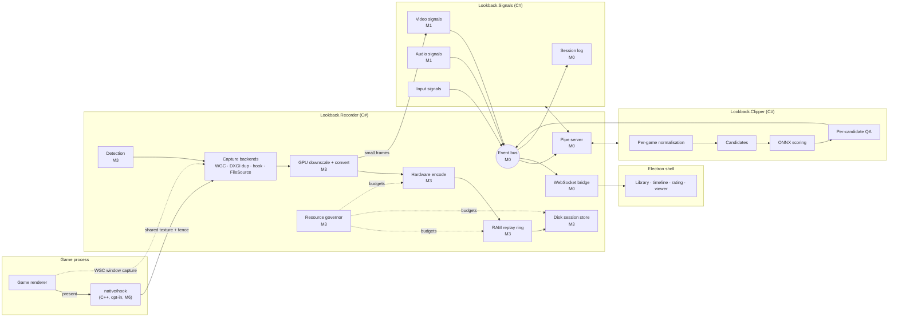
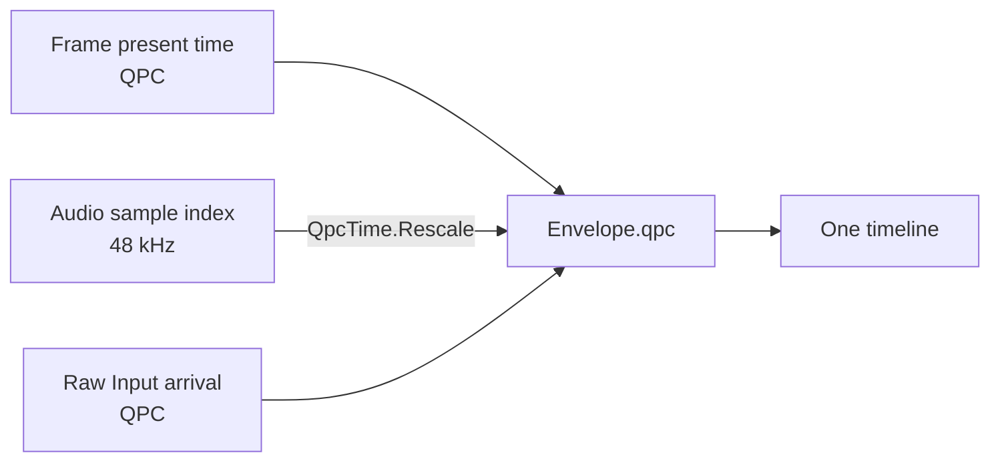
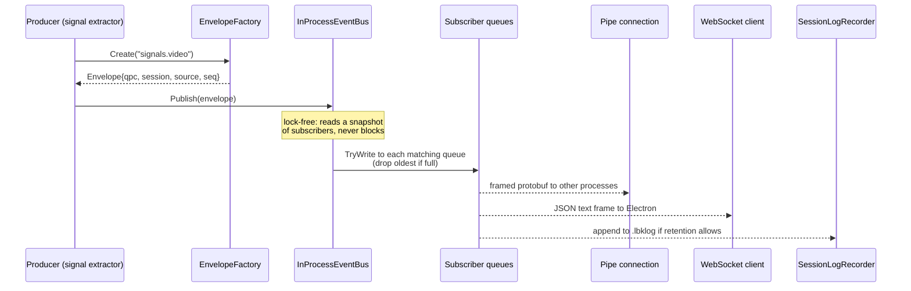
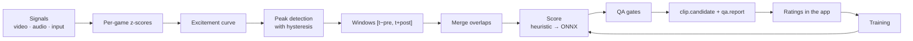
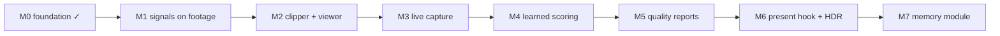

# Architecture

This page shows the whole system, including the parts that later milestones
build. Parts that exist today are marked **M0** or **M1**.

## Processes

Native work runs outside Electron, so a driver reset, an encoder crash or a
fault in the capture path never takes down the UI, and the recorder can run
headless.

| Process | Language | Owns |
|---|---|---|
| `Lookback.Recorder` | C# | Detection, capture, GPU work, encode, replay ring, disk store, audio, governor, the bus and its transports |
| `Lookback.Signals` | C# | Video, audio and input feature extraction; session feature log |
| `Lookback.Clipper` | C# | Normalisation, excitement curve, candidates, scoring, QA |
| `Lookback.Testbench` | C# CLI | Runs footage files through Signals and Clipper |
| `native/hook` | C++ | Present hook for D3D11/D3D12; the only native code, because it lives inside the game |
| `app/` | Electron + TypeScript | Library, live timeline, ratings, official-player viewer |
| `ml/` | Python | Offline training and ONNX export |

## One clock

Every timestamp is a raw QPC tick. QPC is what `Stopwatch` reads on Windows,
and it is also the clock behind DXGI present statistics and Windows.Graphics.Capture
frame times, so captured frames need no conversion. Audio sample positions are
rescaled to QPC with `QpcTime.Rescale`. `SessionStarted.qpc_frequency` records
the counter frequency so a log can be read on any machine.

## How an event flows (M0 path)

## Recording tiers (M3)

| Tier | Contents | Default retention | Size at 1080p60 HEVC 20 Mbps |
|---|---|---|---|
| RAM replay ring | Encoded packets, indexed by keyframe | ~2 minutes, sized by the governor | ~150 MB per minute |
| Disk session store | Whole session as 2 s fMP4 segments | Whole session within a disk budget; unused segments deleted 24 h after the session | ~9 GB per hour |
| Feature log | Signals and embeddings | Outlives the video | ~80 MB per hour |

Clips are cut by remuxing packets from a keyframe, with no re-encode.

## Auto-clipping pipeline (M2 to M4)

## Milestones

