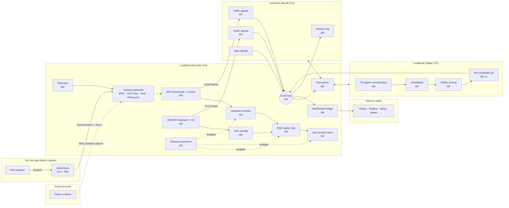
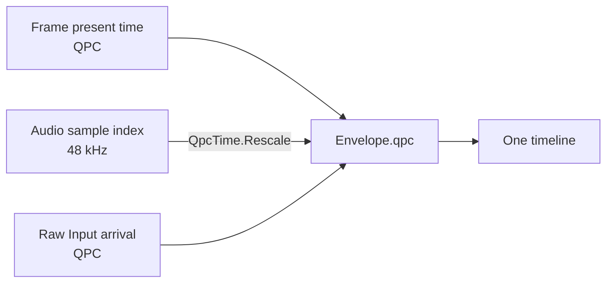
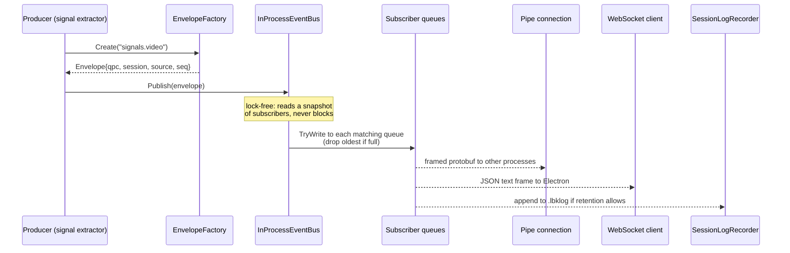
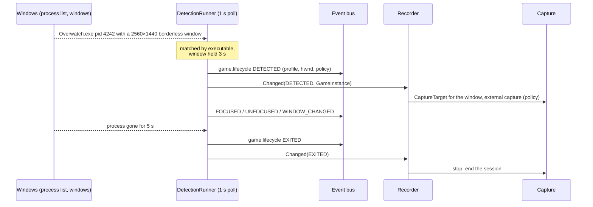
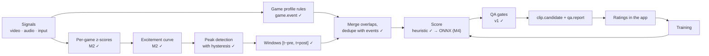
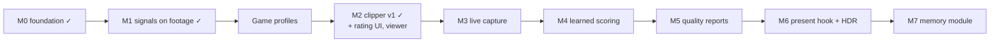

# Architecture

This page shows the whole system, including the parts that later milestones
build. Parts that exist today are marked with their milestone (**M0**, **M1**,
**M2**, **M3**); unmarked parts are still planned. For the current state of
every component (built, in progress, planned), see the [System Map](System-Map).

## Processes

Native work runs outside Electron, so a driver reset, an encoder crash or a
fault in the capture path never takes down the UI, and the recorder can run
headless.

| Process | Language | Owns |
|---|---|---|
| `Lookback.Recorder` | C# | Detection, capture, GPU work, encode, replay ring, disk store, audio, governor, the bus and its transports |
| `Lookback.Signals` | C# | Video, audio and input feature extraction; session feature log |
| `Lookback.Clipper` | C# | Normalisation, excitement curve, candidates, scoring, QA ([Clipper](Clipper); runs beside the profile runner today, in the testbench and later in the recorder) |
| `Lookback.Testbench` | C# CLI | Runs footage files through Signals and Clipper |
| `native/hook`, `native/testapps` | C++ | Present hook for D3D11/D3D12, the only native code because it lives inside the rendering process; and the two test apps that are its only permitted targets. Games are captured with WGC. See [Present Hook](Present-Hook) |
| `app/` | Electron + TypeScript | Library, live timeline, ratings, official-player viewer ([Desktop Shell](Desktop-Shell)) |
| `ml/` | Python | Offline training and ONNX export |

## One clock

Every timestamp is a raw QPC tick. QPC is what `Stopwatch` reads on Windows,
and it is also the clock behind DXGI present statistics and Windows.Graphics.Capture
frame times, so captured frames need no conversion. Audio sample positions are
rescaled to QPC with `QpcTime.Rescale`. `SessionStarted.qpc_frequency` records
the counter frequency so a log can be read on any machine.

## How an event flows (M0 path)

## From a game starting to capture (M2)

Detection reads only what the OS shows about other programs: no memory
reads, no injection, no hooks. Its profile match carries the capture policy
the recorder must honour. See [Game Detection](Game-Detection).

## Live audio (M3)

WASAPI loopback (and the mic) is stamped in QPC through `SampleClock`,
resampled to 48 kHz stereo at the measured device rate, then encoded to AAC
into the replay ring and cut into 10 ms hops for the audio signals.
Official-player sessions never get system loopback or the encoder. Details
in [Live Capture](Live-Capture#live-audio).

## Recording tiers (M3)

| Tier | Contents | Default retention | Size at 1080p60 HEVC 20 Mbps |
|---|---|---|---|
| RAM replay ring | Encoded packets, indexed by keyframe | ~2 minutes, sized by the governor | ~150 MB per minute |
| Disk session store | Whole session as 2 s fMP4 segments | Whole session within a disk budget; unused segments deleted 24 h after the session | ~9 GB per hour |
| Feature log | Signals and embeddings | Outlives the video | ~80 MB per hour |

Clips are cut by remuxing packets from a keyframe, with no re-encode.

The [resource governor](Resource-Governor) sizes the ring, the disk budget
and the quality tier from a probe of the PC (RAM, the store volume's free
space and SSD/HDD, the GPU that scans out the captured monitor and its
hardware encoders), then steps quality down under pressure. The probe is in
`Lookback.Governor.Windows`; the mapping and policy in `Lookback.Governor`
are platform-neutral and tested without the hardware.

## Auto-clipping pipeline (M2 to M4)

Clipper v1 (M2) builds everything up to the QA gates; see [Clipper](Clipper).
Scoring is a bounded heuristic until the learned scorer (M4) replaces it.

Game profiles sit beside the excitement curve, not in place of it. A profile
names moments in one game (an Overwatch elimination) from the same
game-agnostic signals measured inside that game's HUD regions; the clipper
fuses those named moments with peaks of the generic curve into one candidate
set. See [Game Profiles](Game-Profiles) and [Clipper](Clipper).

## Milestones

