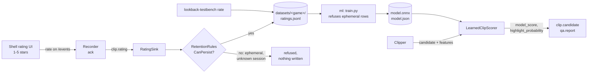

# Clip scoring (M4)

How clip candidates are rated by a person, how the ratings become a small
model, and how that model scores candidates on the recorder. Everything runs
on your machine: the ratings, the training and the inference.

| Part | State |
|---|---|
| Schema: `ClipRating`, `ClipCandidate.features`, `QaReport.highlight_probability` | Built |
| `RatingStore` and `RatingSink` (`src/Lookback.Scoring/Ratings/`) | Built |
| Feature schema `clip-features/1` | Built: the 30-feature list, the floor features any candidate has, the map from Clipper v1's named features, and the C#/Python parity test |
| Training, calibration, evaluation, ONNX export (`ml/`) | Built and tested on synthetic ratings |
| `LearnedClipScorer` (ONNX Runtime, CPU) | Built, matched to Python by a committed fixture |
| `lookback-testbench rate` | Built (terminal fallback) |
| Rating UI in the Electron shell, recorder `rate` handling | M2, in progress elsewhere |
| Clipper-check ratings: your ratings of watched YouTube/Twitch videos, numbers only (`RatingStore.AppendCheck`) | Built |
| Training on real ratings | Waits on your ratings (own footage, clipper check) |

## The loop



## Ratings

A rating says one thing: **is this candidate a highlight?** It rates the
content of the moment, never the video quality (resolution, bitrate and
artefacts are QA's business, measured, not rated).

| Stars | Meaning | Label |
|---|---|---|
| 5 | Clearly a highlight, worth sharing | 1.00 |
| 4 | Good moment | 0.75 |
| 3 | Fine, nothing special | 0.50 |
| 2 | Weak | 0.25 |
| 1 | Not a highlight (false positive) | 0.00 |
| 0 | Unrated: clears an earlier rating | none |

Stars become **soft labels**, (stars − 1) / 4. A 3 is not thrown away: it
pulls the model toward 0.5 for moments like it.

### On the wire

The shell sends `{"type":"rate","id","sessionId","candidateId","stars":0..5}`
on `/events`. The recorder acknowledges it and publishes `ClipRating`
(envelope field 20, topic `clip.rating`: `candidate_id`, `session_id`,
`stars`). See [Event Schema](Event-Schema).

### On disk

`RatingStore` appends one JSON line per rating to
`datasets/<game>/ratings.jsonl`, where `<game>` is the root of the candidate's
profile (`overwatch.push` → `overwatch`). The file is git-ignored with the
rest of a dataset's outputs. Lines are never rewritten: the last line for a
(session, candidate) pair is the current rating and 0 stars clears it, so a
change of mind is history, not an edit.

```json
{"v":"lookback.rating/1","game":"overwatch","profile":"overwatch.push","sessionId":"s1","candidateId":"s1-0001",
 "stars":4,"label":0.75,"retention":"owned","sourceKind":"file","permissionRef":"",
 "startQpc":10000000,"endQpc":130000000,"peakQpc":70000000,"qpcFrequency":10000000,
 "heuristicScore":0.62,"highlightProbability":0.62,"featureSchema":"clip-features/1",
 "features":[0.62,12,null,2,null,...],"ratedAt":"2026-11-27T12:00:00+00:00","source":"shell"}
```

(One line in the file; wrapped here.) The line carries the candidate's
features so a rating stays usable after its session log is deleted. A
missing feature is `null`. Numbers and ids only: no frames, audio, signal
series or video identity.

**Retention.** Before opening the file, `Append` asks
`RetentionRules.CanPersist` about the rated session. Official-player and other
ephemeral sessions, sessions with no retention, and third-party footage
without a `permission_ref` are refused, and so is a rating whose session
header is unknown. See [Data Retention](Data-Retention#ratings-and-the-learned-scorer-m4).

### Clipper-check ratings

Ratings you give in the [clipper check](Official-Player-Calibration#clipper-check-how-accurate-is-the-clipper),
on a YouTube or Twitch video you only watched, are training data too: the
rating is yours, the video is not. `RatingStore.AppendCheck` writes them to
`datasets/<game>/check-ratings.jsonl`, beside `ratings.jsonl`, with the same
line format and three differences:

- `sessionId` is a random run id (`check-` and 32 hex digits) and
  `candidateId` the candidate's place in the run (`c0`, `c1`…);
- `startQpc`, `endQpc`, `peakQpc` and `qpcFrequency` are 0;
- `derivedWrite` is `user-rating-with-features`, `source` is `clipper-check`,
  and `platform` is `youtube` or `twitch`.

```json
{"v":"lookback.rating/1","game":"cs2","profile":"cs2.competitive","sessionId":"check-0123456789abcdef0123456789abcdef",
 "candidateId":"c3","stars":5,"label":1,"retention":"ephemeral","sourceKind":"official-player","permissionRef":"",
 "startQpc":0,"endQpc":0,"peakQpc":0,"qpcFrequency":0,"heuristicScore":0.75,"highlightProbability":0,
 "featureSchema":"clip-features/1","features":[0.75,8,2,1,1,0.75,0.25,0.5,2.5,null,...],
 "ratedAt":"2026-11-27T12:00:00+00:00","source":"clipper-check","derivedWrite":"user-rating-with-features","platform":"youtube"}
```

When the recorder could not hear the player (no shell to isolate, or Windows
older than 19041), the audio features (`loudness_z`, `onset_rate`,
`silent_fraction`, `audio_coverage`, `flux_z`, `loudness_z_max`) are stored as
missing rather than as silence; training imputes them like any missing value.
With the player's sound they are measured like those of your recordings.
`ml/tests/data/check_rating_sample.jsonl` is the exact line C# writes, and the
Python tests load it. See [Data Retention](Data-Retention#your-clipper-check-ratings).

### `RatingSink`

A bus component for the recorder. It watches `session` (to learn each
session's header) and `clip.*` (candidates, then ratings, in order on one
subscription), joins each rating to its candidate's features, and appends it
through the store. Headers and candidates it never saw (a session loaded from
a log) come from the optional `SessionLookup` and `CandidateLookup`; without
one the rating is refused. `OnOutcome` reports every rating, written or
refused, for logging or to tell the shell.

```csharp
var store = new RatingStore(datasetRoot);              // the datasets folder
await using var sink = new RatingSink(bus, store, new RatingSinkOptions
{
    SessionLookup = id => sessionLogs.TryGetHeader(id),  // optional
    OnOutcome = o => log.LogInformation("rating {Id}: {Result}", o.Rating.CandidateId, o.Result.Reason ?? "stored"),
});
```

### In the terminal

`lookback-testbench rate datasets/<game>/manifest.json` analyses each entry,
then asks for stars per candidate: digits 1 to 5, `0` clears, Enter skips, `p`
plays the candidate's window with ffplay, `q` stops. Session ids are stable
per footage file, so the next pass asks only about new candidates
(`--again` asks about all). `--model <dir>` shows a trained model's
probability next to the heuristic. See [Testbench](Testbench).

## Features: `clip-features/1`

The model reads a fixed, game-agnostic vector per candidate. The list is
`ml/feature_schema.json`; `ClipFeatureSchema` in C# mirrors it and a test keeps
them identical. A schema is never edited: new features mean a new id.

| # | Feature | What it is |
|---|---|---|
| 0 | `heuristic_score` | The clipper's heuristic score (0..1), so the model starts from today's ranking |
| 1 | `duration_s` | Candidate length |
| 2 | `event_count` | Game events merged into it |
| 3 | `event_kinds` | Distinct event names |
| 4 | `max_contribution` | Largest weight × confidence of one event |
| 5 | `mean_contribution` | Mean weight × confidence |
| 6 | `event_density` | Events per second |
| 7 | `peak_position` | Where the peak sits, 0 (start) to 1 (end) |
| 8–12 | `motion_z`, `flash_z`, `red_edge_z`, `hud_activity_z`, `loudness_z` | Mean over the candidate, z-scored against the session so far |
| 13 | `onset_rate` | Audio onsets per second |
| 14 | `scene_cuts` | Scene cuts per second |
| 15–17 | `black_fraction`, `frozen_fraction`, `silent_fraction` | Share of frames or hops that are black, frozen, silent |
| 18–19 | `video_coverage`, `audio_coverage` | Share of the candidate with signal frames |
| 20–24 | `curve_mean`, `curve_max`, `curve_above_high`, `curve_peaks`, `curve_peak_max` | The clipper's excitement curve over the candidate: mean, maximum, share of frames at or above the active threshold, peaks inside and the strongest |
| 25 | `event_confidence_mean` | Mean confidence of the game events inside |
| 26–27 | `flux_z`, `scene_cut_z` | Mean spectral flux and scene-cut signal, session z-score |
| 28–29 | `loudness_z_max`, `motion_z_max` | Maximum loudness and motion z-score over the candidate |

### From the clipper

Clipper v1 keeps its own named features per candidate in memory
(`Lookback.Clipper.CandidateFeatures`, version `clipper-features/1`: names
such as `score.heuristic`, `window.seconds`, `curve.max`,
`z_mean.motion.energy`). `ClipperFeatureMap.FromClipper` maps them onto
`clip-features/1` by name, so neither project references the other:

| Ours | Clipper's |
|---|---|
| `heuristic_score`, `duration_s`, `peak_position` | `score.heuristic`, `window.seconds`, `window.peak_position` |
| `event_count`, `event_kinds`, `max_contribution`, `event_confidence_mean` | `events.count`, `events.kinds`, `events.score_max`, `events.confidence_mean` |
| `mean_contribution`, `event_density` | `events.score_sum` / `events.count` (0 with no events), `events.count` / `window.seconds` |
| `motion_z`, `flash_z`, `red_edge_z`, `hud_activity_z`, `loudness_z`, `flux_z`, `scene_cut_z` | `z_mean.` + `motion.energy`, `flash.brighten`, `flash.red_edge`, `hud.activity`, `audio.rms_db`, `spectral.flux`, `scene.cut` |
| `loudness_z_max`, `motion_z_max` | `z_max.audio.rms_db`, `z_max.motion.energy` |
| `black_fraction`, `frozen_fraction`, `silent_fraction` | `qa.black`, `qa.frozen`, `qa.silent` (1 when nothing was measured) |
| `curve_*` | `curve.mean`, `curve.max`, `curve.above_high`, `curve.peaks`, `curve.peak_max` |
| `onset_rate`, `scene_cuts`, `video_coverage`, `audio_coverage` | not provided: NaN |

The clipper's z-scores are clamped robust z-scores, which is what the model
sees in training as long as ratings come from the same clipper. The features
must be on the candidate **before** it is published, so the rating sink can
store them and the scorer can set its probability:

The clipper's `ClipperOptions.Annotate` hook (Clipper v1, PR #19) runs on
its pump thread just before each candidate and its report go on the bus, so
the host wires the scorer there; neither project references the other:

```csharp
using var scorer = LearnedClipScorer.LoadOrHeuristic(modelDir, warn);
var options = new ClipperOptions
{
    Annotate = (candidate, qa, features) =>
    {
        ClipFeatureSchema.Attach(candidate, ClipperFeatureMap.FromClipper(features));
        scorer.Score(candidate, qpcFrequency);
        LearnedClipScorer.Annotate(qa, candidate);
    },
};
var clipper = new ClipperRunner(bus, catalog, gameId, sessionId, qpcFrequency, options);
```

The hook runs under the runner's lock, so it stays quick (one tiny CPU
inference). If it throws, the clipper publishes the candidate unchanged and
counts the failure (`ClipperRunner.AnnotationFailures`).

Until a producer attaches features, any candidate
has its **floor features** (`ClipFeatureSchema.FromCandidate`): heuristic
score, duration and peak position, the rest missing. Missing values are
replaced by the training mean at inference, so a model trained on full
vectors still scores a sparse one sensibly.

## Training

`python -m lookback_ml.train` (in `ml/`) reads every
`datasets/<game>/ratings.jsonl` and `datasets/<game>/check-ratings.jsonl`
(`--no-check-ratings` reads only the first), keeps the current rating per
candidate, and:

1. **Refuses** to train when any line's retention is not `owned`,
   `permissioned` or `open-license`, when third-party lines lack a
   `permissionRef`, when a check line holds anything but the rating and the
   candidate's numbers (an unknown key, a non-zero time, a session id that is
   not a random run id), or when a line sits in another game's folder. Then when
   there are fewer than 40 usable ratings, fewer than 3 sessions, or fewer
   than 5 ratings of 4–5 stars or of 1–2 stars. Nothing is written on a
   refusal.
2. **Imputes** missing features with the training mean and **standardises**.
3. Fits an **L2 logistic regression on soft labels**: each rating counts once
   as a highlight with weight *y* and once as not with weight 1 − *y*. The
   heuristic score is a feature, so with little data the model stays close to
   today's ranking.
4. Picks the regularisation **C** from {0.01, 0.1, 1, 10} by **cross-validation
   grouped by session** (up to 5 folds): candidates from one session share a
   player, a map and a mood, so holding out whole sessions is the honest test.
5. Fits **Platt calibration** p = σ(a · logit(p_model) + b) on the
   out-of-fold predictions: globally (pulled toward the identity), per game
   (pulled toward global) and per sub-game or mode (pulled toward its game).
   Each pull is a Gaussian prior worth `--strength` pseudo-ratings (default
   20), so a game with a handful of ratings stays near global and one with
   hundreds gets its own curve.
6. **Exports** the scaler and regression with skl2onnx and checks ONNX Runtime
   against scikit-learn (max difference ≤ 1e-5) before writing anything.

Games with fewer than 10 ratings are still trained on but are left out of
`games` in `model.json`, so they keep the heuristic. The report counts ratings
by origin (`own`, `check`); each clipper-check run is one session for
cross-validation.

### Evaluation

`report.md` and `report.json` compare, on held-out sessions, overall and per
game: the **heuristic** baseline, the raw **model**, and the **calibrated**
model (each fold calibrated with parameters fitted on the other folds).

| Metric | Meaning |
|---|---|
| AUC | Chance a 4–5 star candidate outranks a 1–2 star one (3 stars left out) |
| Log loss | Cross-entropy against the soft labels |
| Brier | Mean squared error against the soft labels |
| ECE | Expected calibration error, 10 equal-width bins |
| precision@k | Per session, the share of the top k (default 3) rated 4–5 stars, averaged over sessions |

On the synthetic set (3 games × 6 sessions × 15 candidates, `lookback_ml.synth`):

| Scorer | AUC | Log loss | Brier | ECE | precision@3 |
|---|---|---|---|---|---|
| Heuristic | 0.859 | 0.605 | 0.070 | 0.044 | 0.648 |
| Model | 0.935 | 0.561 | 0.051 | 0.046 | 0.833 |
| Calibrated | 0.935 | 0.520 | 0.035 | 0.033 | 0.833 |

Synthetic data proves the plumbing, not the product: real numbers come from
real ratings.

### `model.json`

```jsonc
{
  "format": "lookback.scorer/1",
  "featureSchema": "clip-features/1",
  "featureNames": ["heuristic_score", "..."],
  "featureMeans": [0.49, "..."],            // imputation
  "input": "features", "output": "probabilities", "positiveColumn": 1,
  "games": ["overwatch", "roblox"],         // others keep the heuristic
  "calibration": {
    "global":   { "a": 1.42, "b": 0.05, "n": 268 },
    "profiles": { "overwatch": { "a": 1.47, "b": -0.43, "n": 88 }, "overwatch.push": { "...": 0 } }
  },
  "training": { "trainedAt": "...", "rows": 268, "C": 0.01, "overall": { } }
}
```

## Scoring on the recorder

`LearnedClipScorer` loads `model.json` and `model.onnx` and runs the model with
ONNX Runtime on the CPU execution provider, single-threaded: the model is a
few hundred bytes and must never compete with capture or encode.

```csharp
using var scorer = LearnedClipScorer.LoadOrHeuristic(modelDir, warn: log.LogWarning);
ScoreOutcome o = scorer.Score(candidate, qpcFrequency);   // sets model_score and highlight_probability
LearnedClipScorer.Annotate(qaReport, candidate);          // QaReport.highlight_probability
```

| Situation | Result |
|---|---|
| Model covers the game, candidate has `clip-features/1` | `model_score` = raw probability; `highlight_probability` = calibrated by the deepest listed profile (mode, sub-game, game) |
| Candidate has no features, frequency given | Scored from its floor features |
| No model, a game the model was not trained on, other features | Heuristic stands: `model_score` cleared, `highlight_probability` untouched |
| Model missing or corrupt at load | `LoadOrHeuristic` warns and returns a heuristic-only scorer |
| Inference error or non-finite output | Heuristic stands for that candidate |

A broken model never stops clipping.

## Running it

Python 3.12 with a virtual environment inside the repository (git-ignored):

```powershell
cd ml
python -m venv .venv
.venv\Scripts\python -m pip install -r requirements.txt
.venv\Scripts\python -m pytest
```

```powershell
# Dry run on synthetic ratings (never into the real datasets folder)
.venv\Scripts\python -m lookback_ml.synth --out $env:TEMP\lookback-synth
.venv\Scripts\python -m lookback_ml.train --datasets $env:TEMP\lookback-synth --out out\synthetic

# Train on your ratings (defaults: --datasets ..\datasets --out out\model)
.venv\Scripts\python -m lookback_ml.train

# After changing training, export or calibration: regenerate the C# fixture and commit it
.venv\Scripts\python -m lookback_ml.make_fixture
```

`tests/Lookback.Scoring.Tests/Fixtures/` holds a tiny trained model and
`expected.json`: raw and calibrated probabilities from ONNX Runtime in Python
for a few vectors (some with missing values, one for a game the model does not
cover). The C# test must produce the same numbers within 1e-5, and the `ml`
CI job checks the committed files still reproduce in Python.

## Source files

| File | What it does |
|---|---|
| `src/Lookback.Scoring/Ratings/RatingStore.cs` | Append-only ratings per game, gated by `RetentionRules` |
| `src/Lookback.Scoring/Ratings/RatingSink.cs` | Persists `clip.rating` from the bus |
| `src/Lookback.Scoring/Ratings/RatingRecord.cs` | The line format |
| `src/Lookback.Scoring/Features/ClipFeatureSchema.cs` | `clip-features/1` in C# |
| `src/Lookback.Scoring/Features/ClipperFeatureMap.cs` | Clipper v1's named features → `clip-features/1` |
| `src/Lookback.Scoring/Model/*` | `model.json`, Platt calibration, the ONNX session |
| `src/Lookback.Scoring/LearnedClipScorer.cs` | Scores candidates; heuristic fallback |
| `src/Lookback.Testbench/Datasets/RateRunner.cs` | `lookback-testbench rate` |
| `ml/feature_schema.json` | The feature list (source of truth) |
| `ml/lookback_ml/data.py` | Loading and refusals |
| `ml/lookback_ml/train.py` | Training, cross-validation, evaluation, export |
| `ml/lookback_ml/calibration.py` | Platt per game, shrunk toward the parent |
| `ml/lookback_ml/metrics.py` | AUC, log loss, Brier, ECE, precision@k |
| `ml/lookback_ml/synth.py` | Synthetic ratings |
| `ml/lookback_ml/make_fixture.py` | The C# test fixture |
