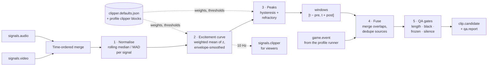
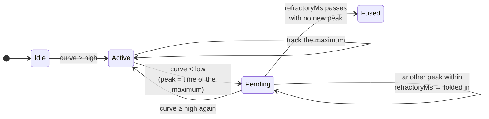

# Clipper

`src/Lookback.Clipper` turns one session's signals and game events into
**clip candidates**, each with a **QA report**. It is the M2 auto-clipping
pipeline, v1: game-agnostic, deterministic, and driven by data. The learned
scorer (M4) will rank its candidates; v1 scores them with a heuristic.



Everything it reads already exists: the [video and audio signals](Signals-Library)
and the [game profile](Game-Profiles) events. It adds no new kind of
measurement, reads nothing from the game, and writes nothing to disk (its
output reaches disk only through the session log, which goes through
[RetentionRules](Data-Retention)).

## 1 · Per-game normalisation

A raw value means different things in different games: −20 dBFS is loud in
one mix and quiet in another; a dark game rarely brightens by 0.1. So every
curve component becomes a **robust z-score against this session's own recent
past**:

```
z = (x − median) / max(1.4826 × MAD, minSpread)
```

| Choice | Why |
|---|---|
| Median and MAD, not mean and standard deviation | The spikes the clipper looks for barely move a median. A mean and standard deviation would chase them and shrink the next spike's score |
| Rolling window of 120 s, a sample every 250 ms (480 samples) | Long enough to learn the game's level, short enough to follow a change of map or scene. Recomputing the median of 480 values 4 times a second costs almost nothing (quickselect, no allocation) |
| Warm-up of 5 s | Until a signal has 5 s of history it contributes nothing, rather than scoring the first loud moment against silence. The window then grows until it is full |
| `minSpread` per component | A nearly constant signal (MAD ≈ 0) would turn rounding noise into huge z-scores. The floor is in the signal's own units: 3 dB for loudness, 0.02 for brightening |
| Clamp to 0..6 | Only "more than usual" is exciting, and one wild signal cannot swamp the rest |
| Score first, then add the sample | A spike is judged against the past, not against itself |

Audio hops arrive at 100 Hz and video frames at 30 Hz; the curve moves on
video frames, and each audio component contributes its **maximum** over the
hops since the previous frame, so a 10 ms transient is not lost.

Source: `Curve/RobustNormalizer.cs`.

## 2 · The excitement curve

On every video frame:

```
raw(t)  = Σ wᵢ · zᵢ(t) / Σ wᵢ          (over components that exist and have warmed up)
curve   = envelope follower over raw: 40 ms attack, 400 ms release
```

A **weighted mean**, not a sum, so a threshold means the same whether a
profile lists five components or eight. Corroboration pays: one modality on
its own (a hard flash that also moves the whole frame, or a loud burst)
reaches about 1.9; both together about 3.4; ordinary play stays well under 1
on the test footage. The envelope follower keeps the peak of a short spike
(fast attack) while smoothing the fall (slow release), which also steadies
the hysteresis below.

### Weights are data

The default curve is `src/Lookback.Clipper/clipper.defaults.json`, using
whole-frame signals only:

| Component | Weight | minSpread | What it catches |
|---|---|---|---|
| `flash.brighten` | 1.0 | 0.02 | Explosions, ability effects, muzzle flashes |
| `audio.rms_db` | 1.0 | 3 dB | Loud moments against the game's own level |
| `spectral.flux` | 0.6 | 0.05 | Transients: gunshots, impacts, stingers |
| `motion.energy` | 0.5 | 0.01 | Action intensity |
| `hud.activity` | 0.5 | 0.01 | Something changed in the auto-discovered HUD |
| `flash.red_edge` | 0.4 | 0.02 | Damage vignettes |
| `scene.cut` | 0.3 | 0.05 | Hard cuts (deaths, respawns) |

A profile overrides any part of it with a `clipper` block, and its children
inherit the override (`ClipperSpec.Over`, applied by `ProfileCatalog.Resolve`):

```jsonc
"clipper": {
  "components": [
    { "signal": "region.kill_feed.activity", "weight": 1.5 },   // add an existing signal
    { "signal": "scene.cut", "weight": 0 }                       // switch an inherited one off
  ],
  "high": 1.8, "low": 0.9,           // thresholds (curve units: weighted mean z)
  "preMs": 8000, "postMs": 3000,     // window around a peak
  "refractoryMs": 3000,              // peaks closer than this are one moment
  "peakScore": 0.5,                  // what a peak at exactly `high` adds to a candidate's score
  "highlightMinMs": 10000,           // shortest highlight
  "highlightMaxMs": 20000            // longest highlight; longer candidates get highlights
}
```

A component replaces the inherited component of the same signal (an unset
`minSpread` is inherited too); an unset number keeps the inherited one; the
defaults fill in the rest. The loader rejects unknown fields, negative
weights, a non-positive `minSpread`, and `low ≥ high` (also after
inheritance). A component may name any signal the pipeline produces, region
signals included; a missing one is reported like any other unknown signal.
No built-in profile overrides the curve yet: the defaults are the baseline,
and ratings will say where a game needs different weights.

To change them, use the desktop app's **Profiles** tab (see
[Game Profiles](Game-Profiles#editing-weights-and-thresholds)): it shows each
setting and component resolved with its source (a profile, or `defaults`),
writes overrides into the profile's own `clipper` block in place, and refuses
an edit the clipper could not run, also after the defaults fill in (for
example a `low` of 2 under the default `high` of 1.6). The recorder reloads
the checkout's `profiles/` when a recording starts, so a saved edit applies
from the next game without a rebuild.

The clipper runs the **whole profile tree** at once: its component list is
the union over every profile in the tree, so the normalisers are shared and
switching sub-game or mode (on `game.profile`) only switches weights and
thresholds, from that moment on.

Source: `Curve/CurveProfile.cs`, `Lookback.Profiles/Model/GameProfile.cs` (`ClipperSpec`).

## 3 · Peaks and windows



- **Hysteresis.** A peak starts at `high` (default 1.6) and ends only below
  `low` (0.8), so a curve wobbling around one threshold is one peak, not ten.
  The peak's time is the maximum in between.
- **Refractory period.** A peak within 3 s of the previous one is the same
  moment: it is folded in (stronger value kept, window stretched to cover
  both), and the reason says `excitement ×2`.
- **Window.** `[t − pre, t + post]`, default 6 s before and 3 s after. Lead-up
  matters more than aftermath; the profile events' own default is 8 s / 3 s.

Source: `Curve/PeakDetector.cs`.

## 4 · Fusion with profile events

Profile events (`game.event`, see [Detection Walkthrough](Detection-Walkthrough))
and curve peaks are two opinions about the same footage. They become **one
deduplicated candidate set**:

- Every window (an event's suggested clip window, or a peak's window) joins
  every open candidate it overlaps or comes within 1.5 s of, as long as the
  result stays within 60 s; otherwise it starts its own. A window that
  bridges two candidates joins them.
- **Score.** `raw = Σ events (weight × confidence) + Σ peaks peakScore × min(3, value / high)`,
  and `heuristic_score = 1 − e^(−raw)`, bounded to 0..1 and monotonic.
  `highlight_probability` equals it until ratings calibrate a model (M4).
- **Peak and profile** come from the strongest contribution.
- **Reasons** say where it came from, one line per source:
  `elimination ×2 (best confidence 0.95)`, then
  `excitement ×1 (peak 3.42: audio.rms_db 6.0σ, motion.energy 6.0σ, hud.activity 6.0σ)`.

The profile runner no longer publishes its own event-only candidates when a
clipper runs (`ProfileRunner(..., publishCandidates: false)`); the
`CandidateBuilder` path stays for a profile runner on its own, such as the
official-player calibration.

Source: `Candidates/CandidateFuser.cs`, `ClipperEngine.cs`.

### Highlights

A good clip is 10 to 20 s of gameplay, but busy play chains peaks and events
into one candidate of up to `MaxLengthMs` (60 s): each peak brings 6 s of
build-up and 3 s of aftermath, and windows within 1.5 s merge. So a candidate
longer than its profile's `highlightMaxMs` (20 s by default) also yields
**highlights**: its most exciting stretches, each between `highlightMinMs`
and `highlightMaxMs` long, and each a candidate of its own with
`parent_candidate_id` set to the long one.

1. **Windows** (`Candidates/HighlightPicker.cs`). Each of the candidate's
   eight strongest moments (events and curve peaks, by score) anchors a
   window of `highlightMinMs` with the moment 60% of the way in, more
   build-up than aftermath. The window then grows to take in the strongest
   moment outside it (with 3 s before and 2 s after it) while it stays
   within `highlightMaxMs`, and repeats. It is kept inside the parent.
2. **Ranking.** Each window is built exactly like a candidate (score,
   reasons, features, QA over its own span) and ranked by the host's
   `ClipperOptions.RankHighlight`, or its heuristic score without one. The
   recorder passes the learned scorer's probability when a model covers the
   game, so what ratings teach picks the highlights
   ([Clip Scoring](Clip-Scoring#highlights)).
3. **Keeping.** The best are kept, at most one per `highlightMaxMs` of the
   parent, only those ranked at least `HighlightKeepFraction` (0.5) of the
   best, and none overlapping a better one by more than a quarter of its
   length. They follow the parent on the bus in time order, named
   `<parent>-h1`, `-h2`….

A highlight is rated, saved and trained on like any candidate; its rating
line carries `parentCandidateId`. The parent stays, so the whole stretch can
still be watched and saved; the shell's default **Highlights** view shows the
highlights in place of their parent. Highlights come only from candidates the
clipper finishes; a candidate shorter than `highlightMaxMs` has none.

### Probes

`ClipperOptions.Probes` names windows to describe as the stream passes them:
each is built exactly like a candidate over its span (score, reasons,
features and QA from the events and peaks whose moment falls inside it) and
handed to `ClipperOptions.Probed` instead of being published. A probe is
described once nothing still to come can fall inside it, so the result does
not depend on when frames arrive; a window in which nothing happened is still
described, with a score of 0. The [rating backfill](Clip-Scoring#backfill)
uses probes to recompute the features of candidates rated before the clipper
computed them.

## 5 · QA gates v1

Each candidate gets a `QaReport` over its own window, from signals already
measured (the engine keeps 5 minutes of per-frame flags in preallocated rings):

| Check | Fails when | Signal |
|---|---|---|
| `length` | shorter than 4 s or longer than 90 s | the window |
| `black` | half or more of the frames are black | `luma.black` |
| `frozen` | half or more of the frames have been static for over 0.5 s | `motion.frozen_s` |
| `silence` | 99% or more of the audio hops are silent, or there is no audio | `audio.silent` |

`passed` is true only when every check passes; each check carries its value
and a sentence (`78% of 270 frames black (fails at 50%)`). Thresholds are in
`QaOptions`. The candidate is published first, then its report, so a viewer
can attach the report to the candidate it already shows.

Source: `Qa/QaGates.cs`, `Qa/FlagHistory.cs`.

## Features for the learned scorer

Every finished candidate also carries `CandidateFeatures`: game-agnostic
numbers by name, **in memory only**. They are not on the wire; the M4
scorer (`src/Lookback.Scoring`) owns the schema for features on
`ClipCandidate` and maps these names onto it. Version `clipper-features/1`:

| Names | What they are |
|---|---|
| `score.heuristic`, `score.raw` | The heuristic score (0..1) and the raw sum behind it |
| `window.seconds`, `window.peak_position` | Length, and where the peak sits (0 at the start, 1 at the end) |
| `source.events`, `source.curve` | 1 when profile events, or curve peaks, contributed |
| `events.count`, `events.kinds`, `events.score_sum`, `events.score_max`, `events.confidence_mean`, `events.confidence_max`, `events.weight_max` | The profile events inside |
| `curve.peaks`, `curve.peak_max`, `curve.score_sum` | The curve peaks inside (folded peaks counted) |
| `curve.mean`, `curve.max`, `curve.above_high` | The excitement curve over the whole window, and the share of frames at or above the active threshold |
| `qa.black`, `qa.frozen`, `qa.silent`, `qa.passed` | The QA fractions (1 when nothing was measured) and the verdict |
| `z_mean.<signal>`, `z_max.<signal>` | Each curve component's clamped robust z-score over the window |

The curve and its z-scores come from a preallocated history of the last
5 minutes (`Curve/CurveHistory.cs`), so recording them adds nothing per frame.
`ClipperEngine` returns them in each `ClipperOutput`; `ClipperRunner` raises
`CandidateFinished` with them right after publishing the candidate and its
QA report; the testbench keeps them in `AnalyzeResult.Features`.

Anything that has to travel **with** the candidate (stored ratings join on
the candidate seen on the bus) goes in through `ClipperOptions.Annotate`, a
`CandidateAnnotator` the runner calls just **before** it publishes each
candidate and its QA report. The host wires the M4 scorer in there, so
neither `Lookback.Clipper` nor `Lookback.Scoring` references the other:

```csharp
var options = new ClipperOptions
{
    Annotate = (candidate, qa, features) =>
    {
        ClipFeatureSchema.Attach(candidate, ClipperFeatureMap.FromClipper(features)); // M4's wire features
        scorer.Score(candidate, frequency);       // model score and calibrated probability, if a model covers the game
        LearnedClipScorer.Annotate(qa, candidate);
    },
};
var clipper = new ClipperRunner(bus, catalog, gameId, sessionId, frequency, options);
```

It runs on the runner's pump thread, so it should be quick. If it throws,
the candidate and report are published exactly as the clipper made them,
`AnnotationFailures` counts it, and `LastAnnotationError` keeps the exception.

## Determinism and latency

The clipper must give the same candidates for the same footage at any replay
speed, as the detector does. Two things make that hold:

1. **Frames in time order.** Video and audio go through the same
   `TimeOrderedMerger` the profile runner uses.
2. **Events are waited for, not raced.** When following a profile, the runner
   also merges the profile runner's `signals.rules` frames as a third stream.
   The profile runner publishes a rules frame after every event and profile
   change it found before that frame, so once a rules frame at time *T* has
   arrived, every event up to *T* minus the widest boost window is in. The
   engine takes events into the fusion in time order only once they are that
   safe, and closes a candidate only once nothing not yet seen could still
   reach it (an event's pre-roll and composite streak, a peak's pre-roll).

```mermaid
sequenceDiagram
    participant PR as ProfileRunner
    participant B as Bus
    participant CR as ClipperRunner
    PR->>B: game.event kill @ 12.40 (finalised at 13.00)
    PR->>B: signals.rules frame @ 13.03
    B->>CR: rules @ 13.03 (read first)
    B->>CR: game.event (read next: already queued)
    Note over CR: frames ≤ 13.03 may now be processed;<br/>events ≤ 13.03 − 0.7 s are safe to fuse
    CR->>B: clip.candidate + qa.report<br/>once no unseen window can overlap
```

The cost is latency. A candidate is published once stream time has passed
its end by the merge gap plus the earliest a future window could start:
one curve pre-roll with no profile (about 7.5 s after the window ends,
10.5 s after the peak), or the tree's widest event pre-roll plus its longest
composite streak plus the boost lag with one (about 18 s after the window
ends for Overwatch). Clips are cut from a RAM
replay ring that holds minutes, so that is fine. If the profile runner sends
no rules frame for 5 s of wall time the clipper stops waiting for it (longer
than the profile runner's own 2 s, so a missing audio device does not break
the gating).

`FollowingAProfileWaitsForItsEventsSoArrivalTimeDoesNotMatter` checks that an
event delivered up front and one delivered late give identical candidates.

## Cost

Per video frame: one pass over 7 components (a clamp, a division, a
multiply-add each), one envelope step, one hysteresis step, and a few ring
writes. Every 250 ms, a quickselect median and MAD over 480 floats per
component. **No allocation per frame** (`SteadyFramesAllocateNothing`); it
allocates only when a peak ends, an event arrives or a candidate is finished.
The runner adds one curve message per 100 ms for viewers
(`CurvePublishIntervalMs`, 0 turns it off).

## Running it

```csharp
// With a profile tree: the clipper follows the profile runner on the same bus.
var profile = new ProfileRunner(bus, catalog, "overwatch", DetectionMethod.Executable, sessionId, clock.Frequency, publishCandidates: false);
var clipper = new ClipperRunner(bus, catalog, "overwatch", sessionId, clock.Frequency);

// An unknown game: the curve alone, default weights.
var clipper = new ClipperRunner(bus, sessionId, clock.Frequency);

// Features for the learned scorer, in memory (raised on the runner's thread: hand off, don't block).
clipper.CandidateFinished += (_, e) => scorer.Enqueue(e.Output.Candidate, e.Output.Features);

// End of the session: the profile runner first (it flushes its last events), then the clipper.
await profile.DisposeAsync();
await clipper.DisposeAsync();
```

| Publishes | Payload | Stamp |
|---|---|---|
| `clip.candidate` | `ClipCandidate`, id `<session>-c0001`, source `clipper` | the candidate's peak (raw QPC) |
| `qa.report` | `QaReport` for that candidate, right after it | the same |
| `signals.clipper` | `SignalSchema` (id 4, `SIGNAL_FAMILY_CLIPPER`), then a `SignalFrame` every 100 ms: `clipper.excitement`, `clipper.high`, `clipper.low`, `clipper.z.<signal>`… | the frame's time |

`ClipperEngine` is the same logic with no threads or bus, for tests and
offline tools: feed it `OnSchema`, `OnFrame` (in time order), `OnEvent`,
`OnProfile`, then `Flush`.

The [testbench](Testbench) runs it in `analyze` and `live`; the report shows
the candidate windows with their QA and the curve under them.

## Limits and what comes next

| Limit | Effect | Plan |
|---|---|---|
| Defaults tuned on generated footage only | Thresholds may be too eager or too shy on a given game | Ratings in the app (M2) give labelled candidates; the M4 scorer re-ranks, and per-game `clipper` blocks adjust |
| The weighted mean dilutes a single strong cue in a game where other components are always busy | A loud moment in a constantly flashing game can miss `high` | Per-game weights; M4 features see every component separately |
| Normalisation is per session | The first 5 s of a session cannot produce a curve peak | Carry a game's statistics across sessions (feature log, M3) |
| QA checks only what signals already measure | Encode faults, desync or HUD-only stretches pass | M5 quality reports (VMAF, audio checks) |
| Curve peaks of a menu or loading screen with loud music | A candidate that QA may not catch | Mode detection (profile tree) and the learned scorer |

M4 (`src/Lookback.Scoring`) owns the wire schema for candidate features,
`QaReport.highlight_probability` and ratings, and the ONNX scorer; v1 leaves
the schema of `ClipCandidate` unchanged and hands M4 its features in memory.
