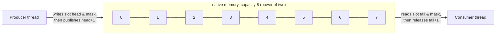
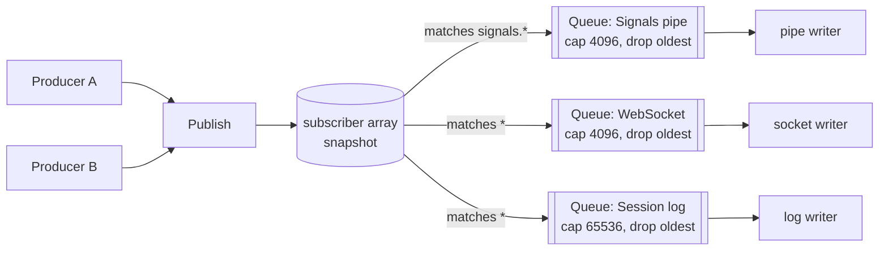

# Core library

`src/Lookback.Core`: timekeeping and in-memory data movement. No I/O.

## `Time/IClock.cs`

```csharp
public interface IClock { long Frequency { get; } long Now { get; } }
```

Every component takes an `IClock` rather than reading time itself.

- **`SystemClock`** reads `Stopwatch.GetTimestamp()`. On Windows that is
  `QueryPerformanceCounter`, the same counter DXGI present statistics and
  Windows.Graphics.Capture use, so captured frames carry timestamps already in
  our clock. It is a singleton (`SystemClock.Instance`).
- **`ManualClock`** moves only when `Advance` is called, using
  `Interlocked` so it is thread-safe. FileSource (M1) uses it to replay
  footage faster than real time while producing the same timestamps a real
  playback would; tests use it for determinism.

## `Time/QpcTime.cs`

Conversions between ticks and durations that do not overflow.

| Method | Use |
|---|---|
| `ToTimeSpan(ticks, frequency)` | Display and logging |
| `FromTimeSpan(duration, frequency)` | "2 minutes before this peak" in ticks |
| `Rescale(ticks, from, to)` | Audio sample index (48 kHz) to QPC |

The naive `ticks * TimeSpan.TicksPerSecond / frequency` overflows `long` after
about ten days at a 10 MHz counter. `ToTimeSpan` splits ticks into whole
seconds and remainder first (`Math.DivRem`), and `Rescale` multiplies in
`Int128`. A test checks 30 days at a 3 GHz counter.

## `Buffers/SpscRing.cs`

A bounded, lock-free, single-producer single-consumer ring for unmanaged
values, used on the capture and audio threads (from M1) where a lock, an
allocation or a GC pause would cost frames.



How it works:

1. **Native memory.** The buffer comes from `NativeMemory.AlignedAlloc`,
   64-byte aligned. The GC never scans or moves it.
2. **Power-of-two capacity.** The constructor rounds up, so the slot index is
   `counter & mask` instead of a division.
3. **Monotonic counters.** `head` and `tail` only increase (64-bit, so they
   never wrap in practice). Count is `head - tail`; full is
   `head - tail >= capacity`.
4. **Memory ordering.** The producer writes the slot, *then* publishes the new
   head with `Volatile.Write` (release). The consumer reads head with
   `Volatile.Read` (acquire), so it can never see the new head before the
   slot's contents. The same pairing in reverse protects slot reuse.
5. **No false sharing.** Each counter lives in its own 128-byte
   `PaddedCounter` struct with the value at offset 64, so the producer's
   writes to head and the consumer's writes to tail never contend for the
   same cache line. (Explicit layout cannot be nested in a generic type, so
   `PaddedCounter` is a separate internal struct.)

The type is only correct with exactly one producer thread and exactly one
consumer thread; that is the contract the capture pipeline is built around.

## `Bus/IEventBus.cs`

```csharp
bool Publish(Envelope envelope);
IEventSubscription Subscribe(string topicPattern, int capacity = 4096);
```

The bus is the local event stream. Its key property: **publishing never
blocks.** Each subscriber has its own bounded queue; a slow subscriber loses
its own oldest events and nobody else is affected. `IEventSubscription`
exposes `Dropped` so the loss is visible, `ReadAllAsync` for consumers,
`TryRead` for draining, and `WaitToReadAsync` for consumers that must not be
interrupted mid-write (see the session log).

## `Bus/InProcessEventBus.cs`



- **Copy-on-write subscribers.** Subscribers live in an array. `Publish` reads
  it with `Volatile.Read` and takes no lock. `Subscribe` and unsubscribing
  build a new array under a lock and swap it in, so subscribe churn never
  stalls a producer.
- **Queues.** Each subscription wraps a `Channel<Envelope>` created with
  `BoundedChannelFullMode.DropOldest`; the channel's drop callback increments
  `Dropped`.
- **Shutdown.** `Dispose` marks the bus completed under the same lock that
  `Subscribe` uses, so a subscription cannot sneak in after shutdown, then
  completes every queue. Readers drain what was queued and finish; later
  `Publish` calls return false.

## `Bus/EnvelopeFactory.cs`

Stamps envelopes for one producer: `qpc` from the clock (or a given time,
such as a frame's present time), the session id, the source id, and a
`seq` from `Interlocked.Increment`. Because every producer numbers its own
events from 1, any consumer can spot dropped events by a gap in `seq`.
