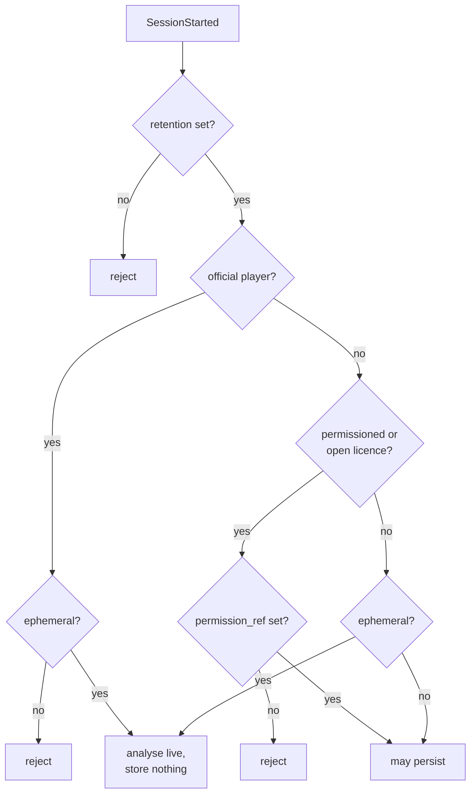

# Data retention

Lookback analyses footage from several kinds of source, and they come with
different rights. Retention decides what may be written to disk, and one
function enforces it.

## The rule

Source: `src/Lookback.Contracts/RetentionRules.cs`.

| Source kind | Allowed retention | Extra requirement |
|---|---|---|
| `LIVE_GAME` (you playing) | `OWNED` | none |
| `FILE`, your own footage | `OWNED` | none |
| `FILE`, someone else's footage | `PERMISSIONED` or `OPEN_LICENSE` | `permission_ref` pointing to the written permission or licence |
| `OFFICIAL_PLAYER` (YouTube or Twitch embed) | `EPHEMERAL` only | nothing is ever stored |
| any | `UNSPECIFIED` | always rejected |

`RetentionRules.Validate(session)` returns null when a session is valid, or a
reason when it is not. `RetentionRules.CanPersist(session)` is true only for a
valid session that is not ephemeral.

## Where it is enforced

`SessionLogWriter.CreateAsync` calls `Validate` and `CanPersist` **before
creating any file**. A rejected session throws `RetentionViolationException`
and leaves the target folder empty. The tests check exactly that.

From M3 the same check gates the encoder, the RAM replay ring and the disk
segment store: for an ephemeral session they never start, so there is no
video to leak.

## The official-player viewer (M2)

The viewer plays YouTube or Twitch videos through their official embedded
players in a visible app window, played by you, with no ad blocking. Lookback
captures that window the same way it captures a game and shows detected
events live. The session is `OFFICIAL_PLAYER` + `EPHEMERAL`: features stay in
memory and vanish when the session ends, and export is disabled. It
demonstrates the pipeline on arbitrary footage; it is not a dataset source.

### Confirmed profile parameters

The viewer can also calibrate a game profile ([Official-Player
Calibration](Official-Player-Calibration)). The only thing that may leave an
official-player session is numbers in a profile file that you reviewed and
pressed Save for: region rectangles (x, y, w, h) and rule thresholds.
`RetentionRules.ValidateDerived(session, ConfirmedProfileParameters,
userConfirmed)` gates it, and `CalibrationWriter` is the only code that calls
it. The writer edits those number tokens in place and nothing else, so the
profile's diff shows exactly what was saved. Frames, audio, signal series,
marks, times and the video's identity are never written, and
`RetentionRules.CanPersist` stays false for the session.

## Datasets

Per-game datasets come from your own recordings (labelled automatically by
process detection), streamer footage used with written permission, and
openly licensed footage. Each dataset has a manifest that records every
file's source, retention and `permission_ref`.
