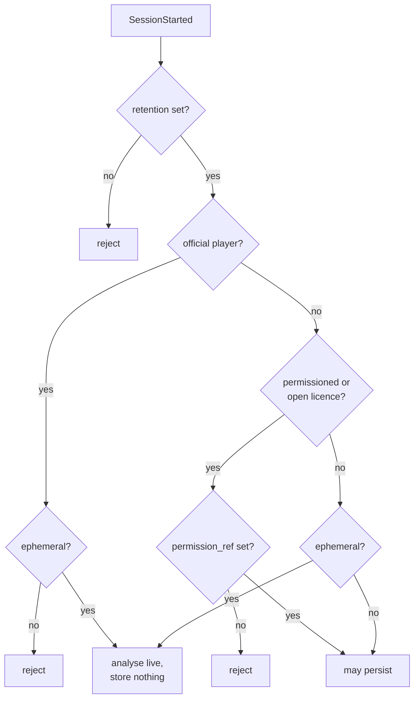

# Data retention

Lookback analyses footage from several kinds of source, and they come with
different rights. Retention decides what may be written to disk, and one
function enforces it.

## The rule

Source: `src/Lookback.Contracts/RetentionRules.cs`.

| Source kind | Allowed retention | Extra requirement |
|---|---|---|
| `LIVE_GAME` (you playing) | `OWNED` | none |
| `FILE`, your own footage | `OWNED` | none |
| `FILE`, someone else's footage | `PERMISSIONED` or `OPEN_LICENSE` | `permission_ref` pointing to the written permission or licence |
| `OFFICIAL_PLAYER` (YouTube or Twitch embed) | `EPHEMERAL` only | nothing of the video is ever stored (two derived writes, below) |
| any | `UNSPECIFIED` | always rejected |

`RetentionRules.Validate(session)` returns null when a session is valid, or a
reason when it is not. `RetentionRules.CanPersist(session)` is true only for a
valid session that is not ephemeral.

## Where it is enforced

`SessionLogWriter.CreateAsync` calls `Validate` and `CanPersist` **before
creating any file**. A rejected session throws `RetentionViolationException`
and leaves the target folder empty. The tests check exactly that.

From M3 the same check gates the encoder, the RAM replay ring and the disk
segment store: for an ephemeral session they never start, so there is no
video to leak. In the recorder, `CaptureService` records live games (always
`owned`), into `%LOCALAPPDATA%\Lookback\store` by default: session footage
under a 20 GB budget (oldest unpinned segments evicted first, unused ones
swept 24 h after the session) and saved clips under a separate 10 GB budget
that is never swept. The clip cache (each candidate cut so it can be watched
without saving it) goes in `previews/`, bounded at 5 GB and a day unwatched,
and only from sessions that may persist; rating a candidate moves its clip to
`clips/`. Each live session's own envelopes (start, end, candidates, QA
reports, ratings, saved clips; never signal frames) are kept beside its
footage in `events.jsonl`, through the same retention check, so the session
can be listed after a restart; they go when the session does. At the clips budget saving is refused rather than
deleting anything; the UI is warned at 90 %.

### Ratings and the learned scorer (M4)

A clip rating is training data, so it follows the rated session's retention
like everything else. `RatingStore.Append` (`src/Lookback.Scoring/Ratings/`)
asks `RetentionRules.CanPersist` about the rated session before it opens a
file: a rating of an official-player or other ephemeral session, of a session
with no retention, or of permissioned footage without a `permission_ref` is
refused and nothing is written. A rating of a session whose header the
recorder cannot find is refused too: retention is never guessed. Each stored
line carries the session's retention and `permission_ref`, holds numbers and
ids only (stars, candidate times, scores, the feature vector) and never
frames, audio, signal series or the video's identity.

Training checks again. `ml/lookback_ml/data.py` refuses to train at all if
any ratings line has a retention other than `owned`, `permissioned` or
`open-license`, or third-party retention without a `permission_ref`: such a
line means something upstream went wrong, so it is reported rather than
skipped. The trained model (`model.onnx`, `model.json`) holds regression
weights, feature means and calibration numbers, not footage.

The [rating backfill](Clip-Scoring#backfill) writes through the same store:
`RatingStore.AppendBackfill` re-checks the rating's own retention and source
with `RetentionRules.CanPersist`, refuses clipper-check lines, and replaces
only the feature vector. To re-read a live recording it writes the session's
own footage once into the clip cache (a session that may persist, through
`SegmentStore.WritePreview`, which checks the same rule) and deletes it after
the analysis. A footage file is read where it is; only its fingerprint is
kept on the ratings, never its path.

## The official-player viewer (M2)

The viewer plays YouTube or Twitch videos through their official embedded
players in a visible app window, played by you, with no ad blocking. Lookback
captures that window the same way it captures a game and shows detected
events live. The session is `OFFICIAL_PLAYER` + `EPHEMERAL`: features stay in
memory and vanish when the session ends, and export is disabled. Its sound is
heard by process loopback of the desktop shell's own process tree (never the
whole system, so no other app is heard), analysed in memory and never encoded
or stored. It
demonstrates the pipeline on arbitrary footage; it is not a dataset source.

### Confirmed profile parameters

The viewer can also calibrate a game profile ([Official-Player
Calibration](Official-Player-Calibration)). The only thing that may leave an
official-player session is numbers in a profile file that you reviewed and
pressed Save for: region rectangles (x, y, w, h) and rule thresholds.
`RetentionRules.ValidateDerived(session, ConfirmedProfileParameters,
userConfirmed)` gates it, and `CalibrationWriter` is the only code that calls
it. The writer edits those number tokens in place and nothing else, so the
profile's diff shows exactly what was saved. Frames, audio, signal series,
marks, times and the video's identity are never written, and
`RetentionRules.CanPersist` stays false for the session.

### Your clipper-check ratings

The viewer's panel can also score the clipper on what you watch
([Clipper check](Official-Player-Calibration#clipper-check-how-accurate-is-the-clipper)).
The candidates, your missed-highlight marks and the scores live only in memory
(`ClipperCheck`) and are cleared when the player stops.

Your 1–5 ratings are kept: **the rating is your data, the video is not.**
`RatingStore.AppendCheck` writes one line per rating to
`datasets/<game>/check-ratings.jsonl`, gated by
`RetentionRules.ValidateDerived(session, UserRatingWithFeatures, userConfirmed)`.
A line holds only:

| Kept | Never kept |
|---|---|
| your stars and the soft label | the video's id, address or title |
| the profile (`cs2.competitive`, or `generic`) and the platform (`youtube`, `twitch`) | any time in the video: start, end and peak are 0 |
| the candidate's heuristic score and its 30 `clip-features/1` numbers (audio ones missing when the player's sound was not heard) | frames, audio, thumbnails or signal series |
| a random run id (`check-` and 32 hex digits) and the candidate's place in the run (`c0`, `c1`…) | the clipper's candidate id, which names the player session |
| when you rated it (wall clock) | missed-highlight marks and the check's scores |

The file sits apart from `ratings.jsonl` so it can be read, kept out of
training (`--no-check-ratings`) or deleted on its own. Training checks the
shape again: `ml/lookback_ml/data.py` refuses to train at all if a check line
carries a key it does not know, a non-zero time, a session id that is not a
random run id, or any retention other than an ephemeral official player.
Deleting the file forgets every check rating; nothing else refers to them.

## Datasets

Per-game datasets come from your own recordings (labelled automatically by
process detection), streamer footage used with written permission, and
openly licensed footage. Each dataset has a manifest that records every
file's source, retention and `permission_ref`.
