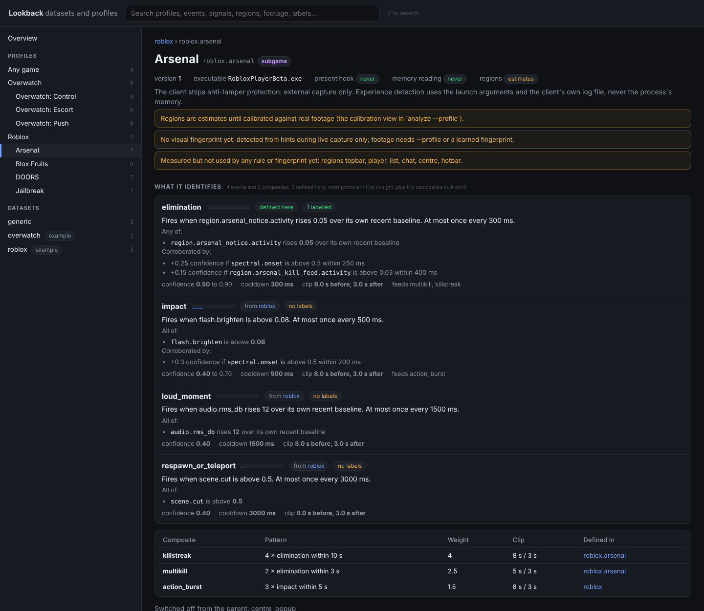
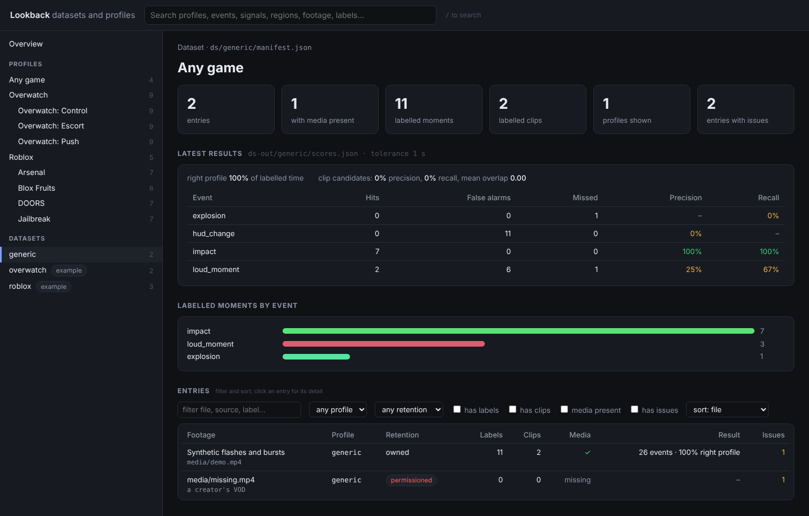

# Dataset browser

`lookback-testbench browse` writes one self-contained page for sifting
through every game profile and every dataset. For each profile it shows what
the profile recognises and how, which signals and screen regions carry it,
how it is detected, and how much of it the labelled footage actually tests.
For each dataset it shows the footage, its provenance and labels, and the
latest scores.

```
lookback-testbench browse
lookback-testbench browse --results dataset-out/overwatch,dataset-out/roblox
```

```
profiles 10 in 3 games
datasets 2 manifests, 5 entries from /…/Lookback/datasets
browser  /…/browse-out/index.html
```

| Flag | Default | Meaning |
|---|---|---|
| `--datasets <dir>` | the nearest `datasets/` at or above the current folder | Every `manifest*.json` under it is read; `*.example.json` files are shown and tagged as examples |
| `--results <dir>[,<dir>…]` | none | `--out` folders of `dataset` runs; their `scores.json` is joined to the manifests by game and file |
| `--profiles <file-or-folder>` | built-ins only | Extra or edited profiles (for example learned fingerprints), as for `analyze` |
| `--out <file>` | `browse-out/index.html` | Where to write the page |

It only reads: profiles, manifests and `scores.json`. Media is checked for
presence and never opened, so it runs in a second, even on a machine without
the footage. Run it again after editing a profile or a manifest.

## Profiles



Each profile page is the **resolved** profile: everything inherited from its
ancestors applied, with where each part came from.

- **What it identifies.** Every event, most prominent first. Prominence is
  the event's weight plus the weight of the composites built on it. Each card
  gives the rule in words ("Fires when region.arsenal_notice.activity rises
  0.05 over its own recent baseline"), the conditions, the boosts and the
  confidence range they allow, the cooldown and the clip window. Chips show
  whether the event is defined here, inherited ("from roblox") or replaces an
  inherited one, and whether any labelled footage tests it. Composites are
  listed with their pattern. Events switched off with `disable` are named.
- **Prominent components.** Every signal the rules read, ranked by influence:
  the effective weight of the events it triggers, half the weight of those it
  only boosts, plus one if the detection fingerprint uses it. Hover a signal
  for what it measures. A signal the pipeline does not produce is struck
  through and flagged, because rules using it can never fire.
- **Region map.** The profile's HUD regions on a 16:9 frame; solid boxes are
  defined here, dashed ones are inherited. Hover a box, or a region signal in
  the list, to see its purpose and what uses it.
- **How it is detected.** The executable for a game; for a sub-game or mode,
  its hints (source, pattern, required values) and fingerprint conditions, in
  words, and the same for each profile beneath it.
- **Dataset coverage.** Labelled moments per event across the footage of this
  profile and everything beneath it; the events no label tests; labels that
  name an event the profile does not define; and, with results loaded,
  precision and recall per event.

Warnings at the top call out what needs work: regions that are still
estimates, sub-games that cannot yet be detected from footage, regions that
are measured but unused, and unknown signals.

## Datasets



A dataset page summarises the manifest (entries, media present, labels,
clips, profiles shown, entries with issues), the latest results if loaded
(detection accuracy, clip-candidate precision and recall, per-event scores)
and labelled moments per event. The entries table filters by text, profile
and retention, and by "has labels", "has clips", "media present" and "has
issues", and sorts by file, most labels, most issues or lowest recall.

An entry page shows its provenance and permission reference, a timeline of
its labels (ticks per event) and labelled clips (bands), each label checked
against the profile, and its result with a link to its timeline report.

Each entry is checked for problems a dataset run would otherwise hit later
or never report:

| Check | Why |
|---|---|
| Label names an event the profile does not define | It can never be matched, so it silently counts as missed |
| Profile does not exist, or is outside the manifest's game tree | Detection accuracy would be meaningless |
| Third-party footage without `permissionRef` | `dataset` refuses it ([Data Retention](Data-Retention)) |
| Clip ends before it starts; negative label time | Typos |

A manifest that does not parse is shown with the loader's error instead of
stopping the page.

## The overview

Totals, a row per game (profiles, events defined, regions, calibration,
footage, labels, untested events), and a **Needs attention** list that
gathers every unknown signal and every manifest or entry problem in one place.

## Implementation

`src/Lookback.Testbench/Browse/`:

| File | What it does |
|---|---|
| `BrowserBuilder.cs` | Resolves each profile through `ProfileCatalog`, attributes regions, events and composites to the profile that defines them, ranks components, reads manifests with `DatasetManifest`, joins `scores.json`, computes coverage and issues |
| `BrowserData.cs` | The records embedded in the page |
| `BrowserWriter.cs` | Embeds the data as JSON in `browser.html`; the encoder escapes `<`, `>` and `&`, so no manifest text can end the script element |
| `browser.html` | The page: no network, no external scripts; it builds the DOM with text nodes only, never HTML from the data |

Known signals come from the signal banks themselves (`VideoSignalBank`,
`AudioSignalBank`, and a `RegionSignal` over each game tree's regions), so
the "unknown signal" check always matches what the pipeline really produces.
