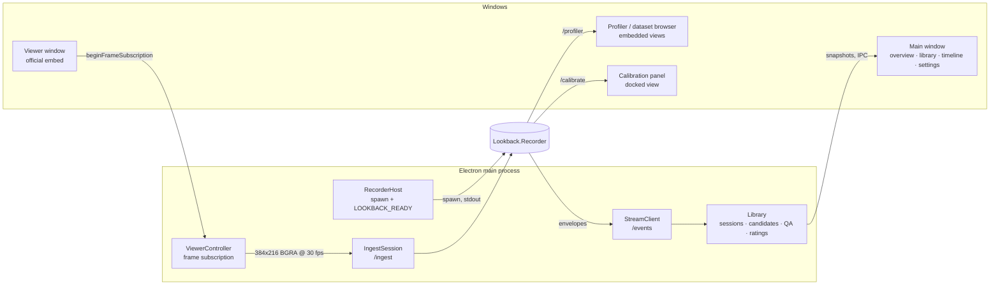
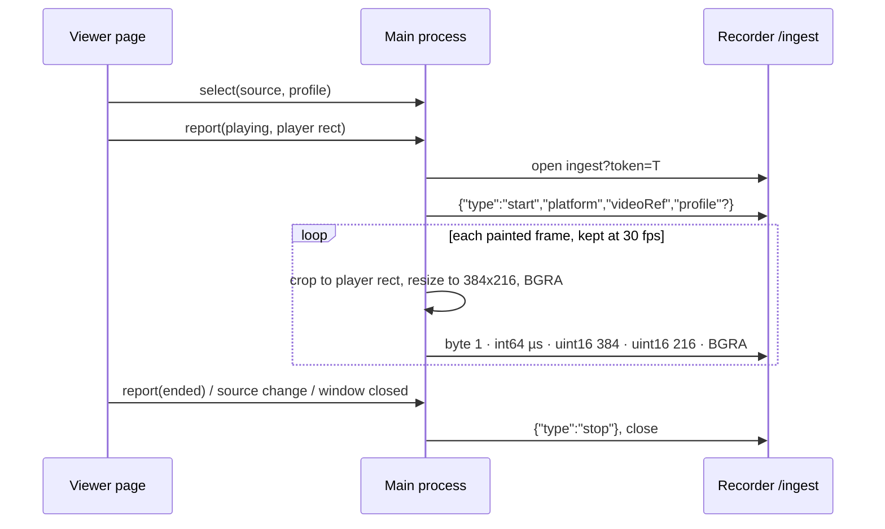

# Desktop shell

`app/`: the Electron + TypeScript desktop app. It starts the recorder, reads
its handshake, keeps the clip library from the event stream, shows a live
timeline and the user's ratings, hosts the recorder's own pages (live
profiler, calibration panel) and the dataset browser, and runs the
**official-player viewer** that feeds calibration.

Source: `app/src/`. Tests: `app/src/test/`. Electron 45, TypeScript 6,
`node:test`, no bundler and no runtime dependencies.



## Running it

```powershell
.\launch.bat
```

`launch.bat` in the repository root does all of it in one step: it updates
`main` from GitHub (only when `main` is checked out with no local changes),
builds Release, runs `npm ci` in `app` when the packages are missing or
`package-lock.json` changed, and starts the app. It stops with a message when
something is missing (the .NET SDK, Node.js) or when Lookback from the same
folder is already running, since the build cannot replace a running recorder.
`launch.bat --no-pull`, `--no-build` and `--no-start` skip a step;
`launch.bat --help` lists them. By hand, the same steps are:

```powershell
dotnet build Lookback.slnx -c Release
cd app
npm ci
npm start
```

`npm start` builds the TypeScript and opens the main window. The shell finds
the recorder in the checkout (`src/Lookback.Recorder/bin/Release/net10.0`,
then Debug), or at the path in Settings or `LOOKBACK_RECORDER`. In a checkout
it passes `--Recorder:ProfilesDirectory=<repo>/profiles`, so the calibration
panel can save. `npm start -- --viewer-link=<url>` opens the viewer on a
link at startup.

## Processes and windows

| Piece | Where it runs | Partition | Notes |
|---|---|---|---|
| Main window (`app://lookback/index.html`) | Sandboxed renderer | default | No sockets (`connect-src 'none'`); everything comes through the `window.lookback` preload API |
| Live profiler | Embedded `WebContentsView` | `lookback-pages` (memory) | The recorder's `/profiler` page, token in the fragment |
| Dataset browser (`app://browse/index.html`) | Embedded `WebContentsView` | default | Generated by `lookback-testbench browse` into userData |
| Viewer page (`http://localhost:PORT/viewer.html`) | `BaseWindow` + `WebContentsView` | `lookback-viewer` (memory) | Served by the shell on loopback because the embeds need a real web origin |
| Calibration panel | Docked `WebContentsView` beside the player | `lookback-pages` (memory) | `calibrate#token=…` from the handshake |

Every renderer is sandboxed with context isolation; IPC handlers check the
sender (`event.sender` and the frame URL) and validate every argument; no
renderer may open windows, attach `<webview>`s, navigate away from its origin,
download files or get any permission except fullscreen for the player.

## Recorder process management

`RecorderHost` (`src/main/recorder.ts`) spawns the recorder with
`stdio: [ignore, pipe, pipe]` and reads stdout line by line
(`handshake.ts`). It waits up to 60 s for:

```
LOOKBACK_READY {"pipe":…,"ws":"ws://127.0.0.1:P/events","token":…,"ingest":"ws://127.0.0.1:P/ingest","calibrate":"http://127.0.0.1:P/calibrate"}
LOOKBACK_PROFILER http://127.0.0.1:P/profiler#token=…
```

Each URL must be loopback; a malformed line is logged by reason only, never
echoed, because it may hold the token. The token lives in the main process's
memory: it is never on a command line, in an environment block, in a log line
or in the state the renderer sees. States: `stopped → starting → ready`, or
`exited` (unexpected exit), `failed` (could not start, or no handshake in
time). Stop is a terminate, then a kill after 3 s. Quitting the app stops the
recorder first.

Arguments the shell adds: `--Recorder:ParentProcessId=<shell pid>`, so the
recorder exits when the shell does however the shell ends (closed, crashed or
killed); `--Recorder:ProfilesDirectory` and `--Recorder:DatasetsDirectory`
for the checkout's `profiles/` and `datasets/` (or the folders in
Settings), so calibration can save and ratings land where `ml/` trains; and
`--Recorder:ModelDirectory` for the checkout's `ml/out/model`, where training
writes the learned clip scorer (restart the app after training to load it). With
no datasets folder the recorder uses its default,
`%LOCALAPPDATA%\Lookback\datasets`, which Settings shows. A recorder that
does not know an option ignores it.

### Supervision

`RecorderSupervisor` (`supervisor.ts`) restarts the recorder when it exits
unexpectedly: a crash, or a watchdog ending it on purpose after writing
`lookback: fatal: <reason>` to stderr. Restarts wait 1 s, 2 s, then 5 s;
after 5 restarts within a minute the shell stops trying. A banner shows what
happened (the fatal reason when there is one), the countdown, and on
**Details** the recorder's last stderr lines; once it has given up, **Start
the recorder** tries again and resets the count. Each start re-reads
`LOOKBACK_READY` (the port and token change) and the stream, viewer and
footage jobs follow the new handshake. A stop the user asks for, or a
recorder that cannot be found or spawned, is never restarted.

## Library, timeline and ratings

`StreamClient` (`stream.ts`) holds the read-only `/events` socket, with
reconnect and backoff. `Library` (`library.ts`) turns the protobuf-JSON
envelopes into:

- **sessions**: title, source kind, retention, profile, clock (`qpcFrequency`),
  first and last QPC, event and signal-frame counts, ended or live;
- **timeline marks**: game events, profile detections and lifecycle changes;
- **clip candidates**: window, peak, heuristic and model score, reasons, the
  QA report and the saved-clip path once they arrive;
- **ratings**: 0 (unrated) to 5 stars per candidate, and whether the
  recorder has stored each one.

The main process sends the renderer a snapshot at most four times a second.
The **Timeline** tab draws the selected session's lanes (game, profile,
events, candidates coloured by stars) over the last 2 or 10 minutes or the
whole session; click a candidate to open it in the library.

### Rating clips

Ratings are about **content**: "is this moment a highlight worth keeping?",
not video quality (QA checks that automatically). The Library tab is built
for going through candidates quickly:

1. **Open footage…** picks a video file (your own gameplay, or someone
   else's with a recorded permission or licence) and a profile. The shell
   asks the recorder to analyse it (`analyze`, below). Until the recorder
   supports that, it runs `lookback-testbench live <file> --profile <id>
   --pipe <recorder pipe> --speed 8 --title <path>` instead: the testbench
   analyses the file, applies `RetentionRules`, writes nothing, and its FILE
   session reaches `/events` like any other. The session's title is the
   file's path, which is how the shell links it back to the file.
2. The candidates appear as the analysis runs. Select one (click, or
   <kbd>↑</kbd>/<kbd>↓</kbd>): the **preview** plays its window
   `[start, end]` from the file in a loop, or the saved clip when the
   recorder reported one.
3. Rate with the stars or <kbd>1</kbd>–<kbd>5</kbd>; <kbd>0</kbd> or ×
   clears; clicking the current star clears it too. Filter by stars
   (unrated, rated, 4–5, 3, 1–2), QA or saved clips; sort by time, score or
   stars. The default view, **Highlights**, shows a long candidate's
   [highlights](Clipper#highlights) (tagged *highlight*) in place of the long
   candidate itself, so a session is rated moment by moment; **All** shows
   both.
4. **Rate queue** (on by default): rating the selected candidate jumps to the
   next unrated one in the table's order, then on to the next session that
   has one, so a session's highlights can be rated back to back with the
   number keys alone. <kbd>N</kbd> jumps without rating. Sort **model least
   sure first** puts the candidates whose probability is nearest an even
   chance first, so each rating teaches the model the most (time order
   without a model).

YouTube and Twitch sessions are listed too, but nothing of them is recorded:
the preview says to replay the moment in the viewer (▶ in its panel), and
their stars are replaced by a pointer to the panel, where ratings of watched
videos are saved as numbers only.

Previews are streamed by the main process over a private
`lookback-media://` scheme with HTTP byte ranges (`media.ts`). Only files the
shell itself opened, or that the recorder reported as saved clips, are
registered, under random ids; nothing is copied or transcoded, and the
renderer's CSP allows media from that scheme only.

### Live recordings, saving clips and storage

When the recorder records a game it detects, its LIVE_GAME session (titled
with the game) lists candidates from the clipper like footage does. A live
recording has no file of its own, so the recorder keeps a **clip cache**: as
soon as the clipper proposes a candidate, the recorder cuts its window from
the recording, with no re-encode, into `store/previews/`: every highlight and
every candidate up to 25 s, while a longer candidate with highlights is cut
only when it is opened. Selecting the
candidate sends `preview`, which answers with the cached clip at once (or
cuts it then, for an older candidate), and the preview plays it. A cached clip
is not a saved clip: it pins no footage and uses no clips budget. **Rating** a
candidate (1–5) keeps its clip: the recorder moves it to `clips/` and reports
it as saved. **Unrated** cached clips are deleted after a day unwatched, or
the least recently watched first once the cache passes its budget
(`CacheBudgetGB`, 5 GB).

Recordings survive a restart. The recorder keeps each live session's own
envelopes (its start and end, candidates, QA reports, ratings, saved clips;
never signal frames) in its store folder (`events.jsonl`). When the shell
connects it asks for them (`history`) and replays them into the library, so
earlier sessions appear as they did live, with their ratings and saved clips,
and their candidates can still be watched, rated and saved for as long as
their footage is kept (24 h after the session, or longer with **keep** on
the Storage tab).

### Storage

The **Training** tab lists ratings stored without the clipper's full feature
set, by session (`backfill-plan`), and fills them in from the footage
(`backfill`, see [Clip Scoring](Clip-Scoring#backfill)): **Backfill** for a
live recording whose footage is still stored, **Choose file…** for footage
analysed from a file. It shows each job's progress and result; your stars are
never changed.

The **Storage** tab shows everything the recorder's store holds (`storage`):
the footage, saved clips and cache against their budgets and the drive's free
space; each recorded session (size, candidates, when its footage is swept,
a **keep** switch that exempts it, **Open in Library**, **Delete**); each
saved clip (**Show file**, **Delete**); and each cached clip with when it
leaves the cache (**Show file**, **Delete**, **Clear cache**). Deleting asks
first and cannot be undone; deleting a session removes its footage and cached
clips but leaves its saved clips. The shell only reveals or deletes files the
recorder listed.

To keep a moment, press **Save** on a candidate (or <kbd>S</kbd>).
The shell sends `save` and waits up to 30 s (the recorder cuts the clip from
its recording); the ack's `path` and the `clip.saved` envelope fill in the
clip, the row shows its file name and **Show file**, and the preview plays it.
A refusal (`clips-full`, `ephemeral`, or `unsupported` when the moment is no
longer recorded) shows the recorder's message under the button. Footage and
official-player sessions have no Save button.

The recorder reports its storage in `recorder.storage` (StorageStatus,
Envelope field 21) every 10 s and after each save: saved clips and recordings
against their budgets (10 GB and 20 GB by default) and the drive's free
space. These envelopes are not sessions. When clips reach the warning
threshold (90%), a banner says "Saved clips are at X of 10 GB"; when they are
full, a red banner and a blocking notice say so, and Save is disabled until
there is room. **Open clips folder** opens the folder of a clip the recorder
saved. Settings shows both budgets; they are the recorder's `ClipsBudgetGB` and
`FootageBudgetGB` options.

**Retention.** The shell writes no session data. The library and ratings are
in memory; each rating is offered to the recorder (`rate`, below) and marked
**stored** only when the recorder acknowledges it. Without an ack within 2 s
it stays "in memory" and is gone when the app quits.

### Control commands on `/events`

The recorder handles these (see [Recorder Host](Recorder-Host#control-commands)); the M4 scorer design reserves Envelope
field 20 for `ClipRating`. Text JSON on the existing `/events` socket, same
token and Origin checks:

| Shell sends | Meaning |
|---|---|
| `{"type":"rate","id","sessionId","candidateId","stars":0..5}` | Rate a candidate; 0 clears |
| `{"type":"analyze","id","path","profile"?,"retention":"owned\|permissioned\|open-license","permissionRef"?}` | Analyse a footage file; `permissionRef` required unless owned |
| `{"type":"save","id","sessionId","candidateId"}` | Cut a live recording's candidate into a clip under the recorder's clips budget |
| `{"type":"preview","id","sessionId","candidateId"}` | Cut a temporary preview of a live recording's candidate to watch it, outside the clips budget; the ack carries its path |

The recorder answers the sending client only with
`{"type":"ack","id","ok":true}` or
`{"type":"ack","id","ok":false,"error":"ephemeral|unknown-session|unknown-candidate|bad-request|unsupported|clips-full","message"}`.
A stored rating's ack carries `"stored":true`; an `analyze` ack carries the new
`sessionId`; a `save` ack carries the clip's `path`, and a `clip.saved`
envelope follows. `save` is refused as `clips-full` at the clips budget,
`ephemeral` for official-player sessions, and `unsupported` for footage files
or a moment that is no longer recorded.
On success it publishes `ClipRating` (Envelope field 20, topic `clip.rating`:
`candidate_id` 1, `session_id` 2, `stars` 3; `source_id` "shell") to every
client, stored through the M4 `RatingStore` and gated by
`RetentionRules.CanPersist`, so official-player and other ephemeral sessions
get `ok:false "ephemeral"` and nothing is written. For `analyze` it runs the
analysis and publishes an ordinary FILE session (path in the title; events,
candidates, QA and the end, but no signal frames).

What the shell does with them:

| Command | Ack `ok` | Ack refused | No ack (a recorder before the commands) |
|---|---|---|---|
| `rate` (2 s) | "stored" when `stored:true` | stars kept in memory, "not stored" with the `message` | kept in memory |
| `analyze` (2 s) | session linked by the ack's `sessionId` (and by title, the exact path) | the job fails with the `message`; never worked around | `lookback-testbench live --pipe` instead |
| `save` (30 s) | the clip's `path` fills in the row and the preview | the `message` under Save | "the recorder did not answer" |

Incoming `clip.rating` envelopes set the stars as stored, and `clip.saved`
envelopes fill in saved clips, whichever client asked.

## The official-player viewer

Open it from the toolbar ("Open viewer") or the Overview card with a YouTube
or Twitch link. `embeds.ts` accepts `youtube.com/watch`, `youtu.be`, shorts,
live and embed links (with `t=`), and Twitch channels and `/videos/<id>`;
anything else is refused, and only the official player is ever loaded
(YouTube IFrame Player API, Twitch embed, allowed by the page's CSP and
nothing else).



- **Capture.** `webContents.beginFrameSubscription` on the player view while
  an ingest session is streaming. `FrameThrottle` keeps 30 fps from whatever
  the compositor paints (a quarter-interval of slack so a 30 Hz source is not
  halved; no catch-up burst after a stall). `cropRect` maps the player's CSS
  rectangle to the captured image at the display scale. Chromium crops and
  scales (`NativeImage.crop().resize()`); `toBitmap()` is BGRA on Windows.
- **Timing.** Microseconds from `performance.now()` relative to the moment the
  start message was sent.
- **Back-pressure.** A frame is dropped, not queued, when more than 4 MB is
  buffered on the socket; the viewer shows sent and dropped counts.
- **Position and replay.** The page reports the player's own position
  (`getCurrentTime`, playback rate, and whether it can seek) with its status,
  and the main process sends it to `/ingest`. When the recorder sends
  `{"type":"seek"}` back (▶ in the panel), the page asks the player to go
  there with the player's own API. See
  [Replaying a moment](Official-Player-Calibration#replaying-a-moment).
- **Lifecycle.** Paused or buffering sends nothing; ended, idle, error, a new
  source, a new profile or closing the window sends stop. If the recorder
  restarts, the next once-a-second report from the page reconnects (at most
  every 3 s).
- **Ephemeral.** Frames exist only between the capture callback and the
  socket. The viewer's partition is in memory (no `persist:`), so cookies,
  cache and storage vanish with it. The video id is sent as `videoRef`, which
  the recorder does not keep, and the shell never logs it. No audio is sent:
  the recorder hears the player by process loopback of the shell's own
  process tree, never the whole system (see
  [Official-Player Calibration](Official-Player-Calibration#the-players-sound)).
- **Panel.** The recorder's calibration panel is docked at the right
  (`calibrate#token=…`); "Panel" in the viewer bar hides it.

## Profiles

The **Profiles** tab edits a game profile's weights and thresholds without
hand-editing JSON. The list on the left is the profile tree in the
checkout's `profiles/` (or the folder set in Settings). A profile shows
resolved, with where each number comes from:

- **Events** and **Composite events**: each rule's weight and each
  condition's threshold, with the profile that defines it. A change is saved
  in that profile's file, so it applies to every profile that inherits the
  rule.
- **Clipper**: the excitement curve's `high`, `low`, windows, refractory
  time and peak score, and its components' weights, each from this profile,
  an ancestor or the clipper's defaults. A change becomes this profile's own
  override; **Reset** on an override removes it; **Add** puts any signal
  the game already produces into the curve, and weight 0 switches one off.

Changed inputs are marked until **Save** (or **Discard changes**). Save runs
`lookback-testbench profile-save`, which edits the files in place and checks
that the whole folder still loads the way the recorder loads it; a refusal
shows the loader's message and nothing is written. Saved edits show in
`git diff profiles/`. The recorder runs on the same folder
(`--Recorder:ProfilesDirectory`) and reloads it when a recording starts, so
an edit applies from the next game it records.

The writer is a testbench command rather than a control command on
`/events`: it works whether or not the recorder is running, it is a
one-shot process with nothing to keep in sync, and writing source files
stays off the recorder's network socket. The main process checks the
renderer's edit (profile id, rule and signal names, finite numbers, only the
clipper's six settings) before it runs the tool, and only ever points it at
the profiles folder. See [Game Profiles](Game-Profiles#editing-weights-and-thresholds)
for what is validated and where each change is saved.

## Settings

Stored in `userData/settings.json` (paths and recorder options only; each
value is sanitized on load, so a hand-edited file cannot stop the app). Recorder
path, testbench path, datasets folder (also where the recorder stores
ratings), profiles folder (what the recorder runs on, calibration saves into
and the Profiles tab edits), pipe name, WebSocket port, serve the profiler page,
start the recorder on launch. The page shows where ratings are stored. Changes
to recorder options apply on its next start.

## Tests and smoke runs

```powershell
cd app
npm test                      # builds, then node:test over dist/test
npm run smoke                 # app up: recorder ready, stream open, window rendered
npm run smoke:viewer          # + viewer capture → /ingest on a synthetic player
npm run smoke:demo            # the whole demo on the real recorder (asks first: it records a window and plays tones)
npx electron . --smoke-viewer --viewer-link=https://www.youtube.com/watch?v=M7lc1UVf-VE
npx electron . --smoke --smoke-footage=D:\path\to\match.mp4 --smoke-profile=overwatch
```

| Suite | What it proves |
|---|---|
| `handshake` | Ready/profiler parsing, loopback checks, the token never in an error, line splitting |
| `recorder` | A fake child's handshake gives `ready`; token never in state or log; exit, timeout and spawn failures |
| `ingest` | Byte layout of kind-1 frames, the start message, start/stop on the socket, drop under back-pressure; position messages, checked positions and seeks, seeks passed on only while the session is open |
| `frames` | 30 fps from 60/144 Hz and jittery 30 Hz sources, no burst after a stall, crop scaling and clamping |
| `library` | Sessions, marks, candidates, QA, saved clips, 0–5 star ratings surviving re-sends, acks marking them stored, `clip.rating` envelopes, previewable sessions, caps, junk ignored |
| `control` | The `rate`/`analyze` messages, ack parsing, footage-request checks, request/ack over the stream with timeouts and drops |
| `footage` | `analyze` first, testbench fallback with the right arguments, permission references, refusals not worked around, linking sessions by title |
| `media` | Byte ranges, only registered files served under opaque ids, 206/416/404/405 |
| `stream` | Envelope parsing, reconnect with backoff, stale sockets ignored |
| `control` (save, storage) | `save` messages and acks with `path`, `clips-full` refusals, StorageStatus parsing (uint64 strings, defaults left out) |
| `supervisor` | Restart after 1/2/5 s, give up after 5 in a minute, older restarts expire, user stops and unfixable failures left alone, a user action cancels a pending restart |
| `recorder-control` | Against a recorder with control commands (skipped otherwise): an ephemeral rating refused with a message, `bad-request` and `unsupported`, `analyze` refusing a missing file, parent-exit; with `LOOKBACK_TEST_FOOTAGE`, analyze → candidate → a stored, broadcast rating in the datasets folder the shell passed |
| `files` | Settings sanitizing and atomic save, static path escapes, recorder lookup and args, profile ids, the viewer server's Host check and CSP |
| `profile-editor` | Profile ids and the testbench arguments; the renderer's edits cleaned (unknown fields dropped, resets kept) or refused when malformed; the tool's JSON result and stdin; a crash, garbage output, a hang or a missing tool become a refusal with a reason; against the real built testbench (skipped otherwise): a resolved view with sources, a refused edit that writes nothing, a save and a reset that restores the file |
| `recorder-integration` | Against the real built recorder: frames over `/ingest` become an ephemeral official-player session on `/events`, the video id never comes back, stop ends it, a wrong token is refused |

A smoke run prints one `LOOKBACK_SMOKE ok|fail {json}` line (the recorder,
stream, ingest and panel status, and what the main window rendered) and
exits 0 or 1. `--smoke-candidates=N` also waits for N clip candidates (fed
with `lookback-testbench live … --pipe <name>`), then opens the Library tab,
presses <kbd>5</kbd> and checks the rating. `--smoke-footage=<file>` does the
whole rating flow: opens the file as "Open footage" would, waits for a
candidate, rates it and checks that the preview player loaded the file (and
reports whether the recorder stored the rating). `--smoke-supervise` kills
the recorder once it is up and passes when the supervisor has it ready again
on a new handshake. `--smoke-storage` feeds synthetic storage reports (near
the clips budget, then full) and checks the banner, the blocking notice and
the Settings line. `--smoke-live` lets the recorder record the repo's stand-in
game (`lookback-testwindow.exe`, allowed through a scratch detection list),
waits for its LIVE_GAME session, adds a candidate to the shell's library only
and presses Save in the window; the recorder does not know that candidate and
refuses it, and the run passes when the refusal shows under the button (a
real save was verified in the recorder's own CaptureServiceTests). Every smoke
run points the recorder's ratings and recordings at a folder in its userData,
never the checkout or the user's store. Set
`LOOKBACK_USER_DATA` to keep a run's userData in a scratch folder. CI runs the
unit tests on Linux and Windows, and on Windows also builds the recorder,
runs the integration tests and the startup, viewer, supervise and storage
smoke runs (the footage and live runs need ffmpeg footage and a capturable
desktop, so they are run by hand).

## Limits and next steps

- Ratings and the library are in memory until the recorder implements the
  agreed commands; footage analysis goes through the testbench until then.
- The player's sound needs Windows 10 2004 (19041) or later; before that, calibration is video only (see [Official-Player Calibration](Official-Player-Calibration#the-players-sound)).
- No packaging yet: `resources/recorder` is looked up, but no installer builds it.
