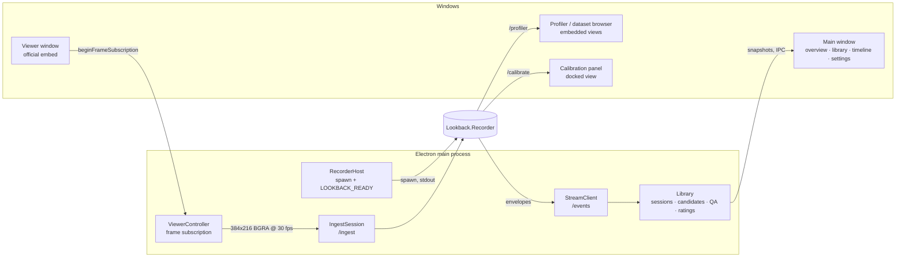
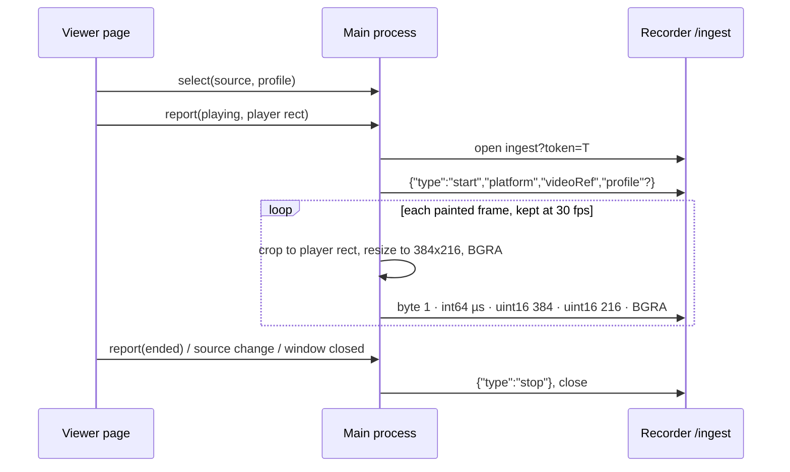

# Desktop shell

`app/`: the Electron + TypeScript desktop app. It starts the recorder, reads
its handshake, keeps the clip library from the event stream, shows a live
timeline and the user's ratings, hosts the recorder's own pages (live
profiler, calibration panel) and the dataset browser, and runs the
**official-player viewer** that feeds calibration.

Source: `app/src/`. Tests: `app/src/test/`. Electron 45, TypeScript 6,
`node:test`, no bundler and no runtime dependencies.



## Running it

```powershell
dotnet build Lookback.slnx -c Release
cd app
npm ci
npm start
```

`npm start` builds the TypeScript and opens the main window. The shell finds
the recorder in the checkout (`src/Lookback.Recorder/bin/Release/net10.0`,
then Debug), or at the path in Settings or `LOOKBACK_RECORDER`. In a checkout
it passes `--Recorder:ProfilesDirectory=<repo>/profiles`, so the calibration
panel can save. `npm start -- --viewer-link=<url>` opens the viewer on a
link at startup.

## Processes and windows

| Piece | Where it runs | Partition | Notes |
|---|---|---|---|
| Main window (`app://lookback/index.html`) | Sandboxed renderer | default | No sockets (`connect-src 'none'`); everything comes through the `window.lookback` preload API |
| Live profiler | Embedded `WebContentsView` | `lookback-pages` (memory) | The recorder's `/profiler` page, token in the fragment |
| Dataset browser (`app://browse/index.html`) | Embedded `WebContentsView` | default | Generated by `lookback-testbench browse` into userData |
| Viewer page (`http://localhost:PORT/viewer.html`) | `BaseWindow` + `WebContentsView` | `lookback-viewer` (memory) | Served by the shell on loopback because the embeds need a real web origin |
| Calibration panel | Docked `WebContentsView` beside the player | `lookback-pages` (memory) | `calibrate#token=…` from the handshake |

Every renderer is sandboxed with context isolation; IPC handlers check the
sender (`event.sender` and the frame URL) and validate every argument; no
renderer may open windows, attach `<webview>`s, navigate away from its origin,
download files or get any permission except fullscreen for the player.

## Recorder process management

`RecorderHost` (`src/main/recorder.ts`) spawns the recorder with
`stdio: [ignore, pipe, pipe]` and reads stdout line by line
(`handshake.ts`). It waits up to 60 s for:

```
LOOKBACK_READY {"pipe":…,"ws":"ws://127.0.0.1:P/events","token":…,"ingest":"ws://127.0.0.1:P/ingest","calibrate":"http://127.0.0.1:P/calibrate"}
LOOKBACK_PROFILER http://127.0.0.1:P/profiler#token=…
```

Each URL must be loopback; a malformed line is logged by reason only, never
echoed, because it may hold the token. The token lives in the main process's
memory: it is never on a command line, in an environment block, in a log line
or in the state the renderer sees. States: `stopped → starting → ready`, or
`exited` (unexpected exit), `failed` (could not start, or no handshake in
time). Stop is a terminate, then a kill after 3 s. Quitting the app stops the
recorder first.

Arguments the shell adds: `--Recorder:ParentProcessId=<shell pid>`, so the
recorder exits when the shell does however the shell ends (closed, crashed or
killed); `--Recorder:ProfilesDirectory` and `--Recorder:DatasetsDirectory`
for the checkout's `profiles/` and `datasets/` (or the folders in
Settings), so calibration can save and ratings land where `ml/` trains. With
no datasets folder the recorder uses its default,
`%LOCALAPPDATA%\Lookback\datasets`, which Settings shows. A recorder that
does not know an option ignores it.

### Supervision

`RecorderSupervisor` (`supervisor.ts`) restarts the recorder when it exits
unexpectedly: a crash, or a watchdog ending it on purpose after writing
`lookback: fatal: <reason>` to stderr. Restarts wait 1 s, 2 s, then 5 s;
after 5 restarts within a minute the shell stops trying. A banner shows what
happened (the fatal reason when there is one), the countdown, and on
**Details** the recorder's last stderr lines; once it has given up, **Start
the recorder** tries again and resets the count. Each start re-reads
`LOOKBACK_READY` (the port and token change) and the stream, viewer and
footage jobs follow the new handshake. A stop the user asks for, or a
recorder that cannot be found or spawned, is never restarted.

## Library, timeline and ratings

`StreamClient` (`stream.ts`) holds the read-only `/events` socket, with
reconnect and backoff. `Library` (`library.ts`) turns the protobuf-JSON
envelopes into:

- **sessions**: title, source kind, retention, profile, clock (`qpcFrequency`),
  first and last QPC, event and signal-frame counts, ended or live;
- **timeline marks**: game events, profile detections and lifecycle changes;
- **clip candidates**: window, peak, heuristic and model score, reasons, the
  QA report and the saved-clip path once they arrive;
- **ratings**: 0 (unrated) to 5 stars per candidate, and whether the
  recorder has stored each one.

The main process sends the renderer a snapshot at most four times a second.
The **Timeline** tab draws the selected session's lanes (game, profile,
events, candidates coloured by stars) over the last 2 or 10 minutes or the
whole session; click a candidate to open it in the library.

### Rating clips

Ratings are about **content**: "is this moment a highlight worth keeping?",
not video quality (QA checks that automatically). The Library tab is built
for going through candidates quickly:

1. **Open footage…** picks a video file (your own gameplay, or someone
   else's with a recorded permission or licence) and a profile. The shell
   asks the recorder to analyse it (`analyze`, below). Until the recorder
   supports that, it runs `lookback-testbench live <file> --profile <id>
   --pipe <recorder pipe> --speed 8 --title <path>` instead: the testbench
   analyses the file, applies `RetentionRules`, writes nothing, and its FILE
   session reaches `/events` like any other. The session's title is the
   file's path, which is how the shell links it back to the file.
2. The candidates appear as the analysis runs. Select one (click, or
   <kbd>↑</kbd>/<kbd>↓</kbd>): the **preview** plays its window
   `[start, end]` from the file in a loop, or the saved clip when the
   recorder reported one.
3. Rate with the stars or <kbd>1</kbd>–<kbd>5</kbd>; <kbd>0</kbd> or ×
   clears; clicking the current star clears it too. Filter by stars
   (unrated, rated, 4–5, 3, 1–2), QA or saved clips; sort by time, score or
   stars.

Previews are streamed by the main process over a private
`lookback-media://` scheme with HTTP byte ranges (`media.ts`). Only files the
shell itself opened, or that the recorder reported as saved clips, are
registered, under random ids; nothing is copied or transcoded, and the
renderer's CSP allows media from that scheme only.

**Retention.** The shell writes no session data. The library and ratings are
in memory; each rating is offered to the recorder (`rate`, below) and marked
**stored** only when the recorder acknowledges it. Without an ack within 2 s
it stays "in memory" and is gone when the app quits.

### Control commands on `/events` (agreed, recorder side pending)

Agreed with the live-capture thread; the M4 scorer design reserves Envelope
field 20 for `ClipRating`. Text JSON on the existing `/events` socket, same
token and Origin checks:

| Shell sends | Meaning |
|---|---|
| `{"type":"rate","id","sessionId","candidateId","stars":0..5}` | Rate a candidate; 0 clears |
| `{"type":"analyze","id","path","profile"?,"retention":"owned\|permissioned\|open-license","permissionRef"?}` | Analyse a footage file; `permissionRef` required unless owned |
| `{"type":"save","id","sessionId","candidateId"}` | Cut the clip (later, once the replay ring can) |

The recorder answers the sending client only with
`{"type":"ack","id","ok":true}` or
`{"type":"ack","id","ok":false,"error":"ephemeral|unknown-session|unknown-candidate|bad-request"}`.
On success it publishes `ClipRating` (Envelope field 20, topic `clip.rating`:
`candidate_id` 1, `session_id` 2, `stars` 3; `source_id` "shell") to every
client, stored through the M4 `RatingStore` and gated by
`RetentionRules.CanPersist`, so official-player and other ephemeral sessions
get `ok:false "ephemeral"` and nothing is written. For `analyze` it runs the
analysis and publishes an ordinary FILE session (path in the title; events,
candidates, QA and the end, but no signal frames).

Shell behaviour today: every `rate` is sent; no ack in 2 s or `ok:false`
keeps the rating in memory. `analyze` with no ack (or `bad-request`) falls
back to the testbench; any other refusal is shown and not worked around.
Incoming `clip.rating` envelopes set the stars as stored. A recorder that
predates the commands ignores inbound messages, so all of this degrades to
the in-memory path.

## The official-player viewer

Open it from the toolbar ("Open viewer") or the Overview card with a YouTube
or Twitch link. `embeds.ts` accepts `youtube.com/watch`, `youtu.be`, shorts,
live and embed links (with `t=`), and Twitch channels and `/videos/<id>`;
anything else is refused, and only the official player is ever loaded
(YouTube IFrame Player API, Twitch embed, allowed by the page's CSP and
nothing else).



- **Capture.** `webContents.beginFrameSubscription` on the player view while
  an ingest session is streaming. `FrameThrottle` keeps 30 fps from whatever
  the compositor paints (a quarter-interval of slack so a 30 Hz source is not
  halved; no catch-up burst after a stall). `cropRect` maps the player's CSS
  rectangle to the captured image at the display scale. Chromium crops and
  scales (`NativeImage.crop().resize()`); `toBitmap()` is BGRA on Windows.
- **Timing.** Microseconds from `performance.now()` relative to the moment the
  start message was sent.
- **Back-pressure.** A frame is dropped, not queued, when more than 4 MB is
  buffered on the socket; the viewer shows sent and dropped counts.
- **Lifecycle.** Paused or buffering sends nothing; ended, idle, error, a new
  source, a new profile or closing the window sends stop. If the recorder
  restarts, the next once-a-second report from the page reconnects (at most
  every 3 s).
- **Ephemeral.** Frames exist only between the capture callback and the
  socket. The viewer's partition is in memory (no `persist:`), so cookies,
  cache and storage vanish with it. The video id is sent as `videoRef`, which
  the recorder does not keep, and the shell never logs it. No audio is sent:
  the only audio the shell could tap is the whole system mix.
- **Panel.** The recorder's calibration panel is docked at the right
  (`calibrate#token=…`); "Panel" in the viewer bar hides it.

## Settings

Stored in `userData/settings.json` (paths and recorder options only; each
value is sanitized on load, so a hand-edited file cannot stop the app). Recorder
path, testbench path, datasets folder (also where the recorder stores
ratings), profiles folder, pipe name, WebSocket port, serve the profiler page,
start the recorder on launch. The page shows where ratings are stored. Changes
to recorder options apply on its next start.

## Tests and smoke runs

```powershell
cd app
npm test                      # builds, then node:test over dist/test
npm run smoke                 # app up: recorder ready, stream open, window rendered
npm run smoke:viewer          # + viewer capture → /ingest on a synthetic player
npx electron . --smoke-viewer --viewer-link=https://www.youtube.com/watch?v=M7lc1UVf-VE
npx electron . --smoke --smoke-footage=D:\path\to\match.mp4 --smoke-profile=overwatch
```

| Suite | What it proves |
|---|---|
| `handshake` | Ready/profiler parsing, loopback checks, the token never in an error, line splitting |
| `recorder` | A fake child's handshake gives `ready`; token never in state or log; exit, timeout and spawn failures |
| `ingest` | Byte layout of kind-1 frames, the start message, start/stop on the socket, drop under back-pressure |
| `frames` | 30 fps from 60/144 Hz and jittery 30 Hz sources, no burst after a stall, crop scaling and clamping |
| `library` | Sessions, marks, candidates, QA, saved clips, 0–5 star ratings surviving re-sends, acks marking them stored, `clip.rating` envelopes, previewable sessions, caps, junk ignored |
| `control` | The `rate`/`analyze` messages, ack parsing, footage-request checks, request/ack over the stream with timeouts and drops |
| `footage` | `analyze` first, testbench fallback with the right arguments, permission references, refusals not worked around, linking sessions by title |
| `media` | Byte ranges, only registered files served under opaque ids, 206/416/404/405 |
| `stream` | Envelope parsing, reconnect with backoff, stale sockets ignored |
| `supervisor` | Restart after 1/2/5 s, give up after 5 in a minute, older restarts expire, user stops and unfixable failures left alone, a user action cancels a pending restart |
| `recorder-control` | Against a recorder with control commands (skipped otherwise): an ephemeral rating refused with a message, `bad-request` and `unsupported`, `analyze` refusing a missing file, parent-exit; with `LOOKBACK_TEST_FOOTAGE`, analyze → candidate → a stored, broadcast rating in the datasets folder the shell passed |
| `files` | Settings sanitizing and atomic save, static path escapes, recorder lookup and args, profile ids, the viewer server's Host check and CSP |
| `recorder-integration` | Against the real built recorder: frames over `/ingest` become an ephemeral official-player session on `/events`, the video id never comes back, stop ends it, a wrong token is refused |

A smoke run prints one `LOOKBACK_SMOKE ok|fail {json}` line (the recorder,
stream, ingest and panel status, and what the main window rendered) and
exits 0 or 1. `--smoke-candidates=N` also waits for N clip candidates (fed
with `lookback-testbench live … --pipe <name>`), then opens the Library tab,
presses <kbd>5</kbd> and checks the rating. `--smoke-footage=<file>` does the
whole rating flow: opens the file as "Open footage" would, waits for a
candidate, rates it and checks that the preview player loaded the file (and
reports whether the recorder stored the rating). `--smoke-supervise` kills
the recorder once it is up and passes when the supervisor has it ready again
on a new handshake. Set
`LOOKBACK_USER_DATA` to keep a run's userData in a scratch folder. CI runs the
unit tests on Linux and Windows, and on Windows also builds the recorder,
runs the integration tests and both smoke runs.

## Limits and next steps

- Ratings and the library are in memory until the recorder implements the
  agreed commands; footage analysis goes through the testbench until then.
- Video only in calibration (see [Official-Player Calibration](Official-Player-Calibration#limits)).
- No packaging yet: `resources/recorder` is looked up, but no installer builds it.
