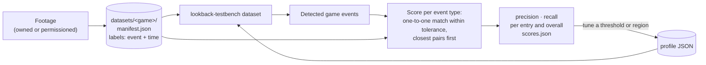
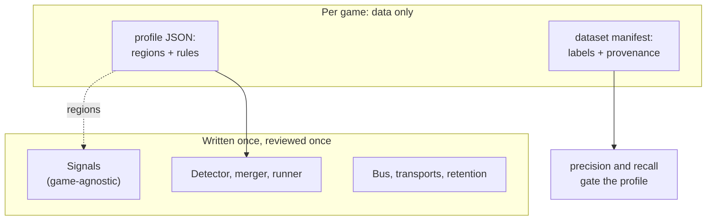

# Detection design notes

The [Detection Walkthrough](Detection-Walkthrough) shows *how* a frame
becomes a `game.event`. This page is about *why* it is built that way: the
decisions, what each one costs, where the approach breaks, how it is
measured, and the questions a reviewer usually asks.

## The constraints that shaped it

| Constraint | Consequence in the design |
|---|---|
| Most games publish no state API, and many run anti-cheat | Detection uses only pixels and sound captured from outside the process. `capturePolicy` in each profile says so, and the loader keeps anti-cheat profiles at no present hook and no memory reading |
| It must work on games nobody has written a profile for | A game-agnostic layer (whole-frame signals, the auto-discovered HUD mask, the `generic` profile) fires events with no game knowledge at all |
| It runs beside a game the player cares about | Fixed 384×216 analysis frames, one pass per signal, zero allocation per frame, a bus that never blocks capture |
| Adding a game must be cheap and safe | Game knowledge is JSON data, validated strictly; no code per game |
| Clips are judged by people, later by a model | Every event carries evidence and confidence; every condition publishes its margin |
| Replays and live sessions must agree | One clock (QPC), a watermark merge, and detection that depends only on timestamps |

## Decisions and their trade-offs

### Pixels and sound instead of game APIs

**Chosen because** it works for every game, needs nobody's cooperation, and
is the only option that is safe for anti-cheat titles. Players can also
trust it: nothing touches the game process.

**Costs.** Lower precision than an API would give, and sensitivity to HUD
layout, HUD scale, aspect ratio, colour-blind modes and game patches. The
design accepts that and invests in calibration (the overlay of profile boxes
on the learned HUD mask) and measurement (per-game datasets with precision
and recall) to manage it.

**Where an API would still help.** A game with an official, permitted event
API could feed the same `game.event` topic directly, as just another
producer. The clipper would not need to know the difference. That keeps the
door open without putting game-specific code on the clipping path.

### Hand-written rules first, learned models later

**Chosen because** rules are explainable (every event lists why it fired),
debuggable live (margins on `signals.rules`), cheap, and need no training
data to start. They also produce the labelled data a model needs later: the
same dataset that scores a profile trains the M4 scorer.

**Costs.** Rules are brittle near their thresholds and need tuning per game.
The response is to make tuning fast (margins plotted on the timeline,
`--profile ./edited.json` without a rebuild) and measurable (the dataset
scorer).

**How a model fits.** A model does not replace the signal layer; it consumes
it. The 64 mel bands already exist as input for sound-event models, and the
clipper's ONNX scorer (M4) ranks candidates using game events as features.
Rules stay as the explainable, zero-shot baseline.

### Profiles are data, and may not add measurements

A profile can only point existing signals at rectangles and combine their
outputs. If a game needs something new (say, detecting a specific icon), the
answer is a new **game-agnostic** signal that every profile can use, not a
special case for one game.

**Why it matters.** It keeps the hot path reviewed once, keeps profiles safe
to load from untrusted files (they cannot run code), and makes improvements
compound: a better signal improves every game.

**Cost.** Some game moments are hard to express as thresholds over generic
measurements, notably anything that needs reading text or recognising a
specific glyph. Those wait for a generic signal (for example template or
text-change detection inside a region) rather than being hacked in.

### A fixed, small analysis format

384×216 at 30 fps and 48 kHz mono, whatever the source. Thresholds become
portable across resolutions, cost is fixed and tiny, and live capture does
the downscale on the GPU before the CPU ever sees a pixel.

**Cost.** Small HUD text and thin UI elements lose detail. Activity and
colour measures survive downscaling well; anything that would need reading
small text would not. If that becomes necessary, the right move is a second,
higher-resolution crop of specific regions, not a bigger whole frame.

### Relative measures and adaptive baselines

Nearly every signal is a difference: from the previous frame, from a rolling
baseline, edge versus centre, flux versus its own running statistics. The
`rise` test in rules adds another adaptive baseline per condition.

**Why.** Absolute thresholds do not transfer between a dark game and a bright
one, or a loud mix and a quiet one. Relative ones mostly do, so the same
`generic` rules work on games they were never tuned for.

**Cost.** Adaptive baselines adapt to sustained conditions too. A HUD
element that flickers continuously raises its own baseline and stops
triggering; a condition that rises slowly never crosses. Rules for steady
states use `above` and `below` instead.

### Edge-triggered rules with cooldowns, then boosts

A `rise` condition is effectively edge-triggered: the baseline catches up, so
it fires on the change, not for as long as the change persists. `above` and
`below` are level-triggered; the cooldown keeps them from firing every frame
(a red damage vignette held for 10 seconds fires `low_health` every 3 s, not
300 times).

Boosts separate "did it happen" from "how sure are we". The trigger decides
recall; corroboration (an audio onset, a kill-feed change) raises confidence.
That keeps a muted player or an unusual sound mix from losing events, while
the clipper can still rank corroborated moments higher.

### Determinism over minimum latency

The detector waits for the watermark and for the widest boost window before
publishing. That adds a bounded delay (about 0.6 s for an Overwatch
elimination), and in return the same footage always yields the same events
at the same timestamps, at any replay speed.

**Why that trade is right here.** The clipper cuts from a RAM replay ring
that already holds minutes of past footage, so a sub-second detection delay
costs nothing. Determinism is what makes datasets, regression tests and
side-by-side profile comparisons meaningful.

### A bus that drops rather than blocks

`InProcessEventBus` never blocks a producer; a slow subscriber loses its
oldest events and its `Dropped` counter shows it. Live capture must never
stall because a viewer is slow. Replays, which run faster than real time,
use `ReplayPacer` instead and fail loudly if anything is dropped. Every
envelope carries a per-producer `seq`, so the live profiler and the session
log can prove that nothing was lost.

## Where it breaks

Honest limits, roughly from most to least likely to matter.

| Limit | Effect | Mitigation today, or the plan |
|---|---|---|
| HUD layout differs from the profile (ultrawide, HUD scale, patches, colour-blind modes) | Regions measure the wrong pixels; recall drops | `reference.calibrated`; calibration overlay against the learned HUD mask; per-game datasets catch regressions. Plan: detect aspect and scale, and pick or adjust regions automatically |
| Spectating, kill cams and replays inside the game | The HUD shows someone else's eliminations | Composite and `death` rules provide context; the clipper weighs events by kind. Mode and state detection would gate rules |
| A rule's `when` uses an audio signal | Rules are evaluated on video frames (30 Hz) using the latest audio value, so an audio spike shorter than ~33 ms between two frames can be missed as a trigger | Use audio signals as **boosts** (boosts scan the full 10 ms history), or as triggers that last longer than a frame, such as `audio.rms_db` rises |
| Boost windows wider than about 1 s | The boost history keeps 2 s, and finalisation happens at trigger + window, so the part of the window before the trigger is trimmed once the window passes ~1 s | Keep boost windows ≤ 1 s (Overwatch uses at most 600 ms); a validation rule in the loader would make this explicit |
| A stream that stalls for over 2 s of wall time and then resumes | The merger stops waiting for it; when it resumes, its first items can be older than what has already been released, so they arrive out of order | The detector's clock only moves forward, so nothing is double-counted; the merge is exact whenever both streams keep flowing |
| Very busy HUDs | `hud.activity` and wide regions respond to everything | Smaller, purpose-specific regions; `whenAny` across several precise regions rather than one broad one |
| Cooldown longer than the real repeat rate | Two genuine events close together count as one | Keep cooldowns just above the animation length of the HUD element (300 ms for eliminations) |
| The HUD mask needs 10 s of gameplay to warm up | `hud.activity` is 0 until then, and the mask is learned once per session | Profile regions do not need warm-up. Plan: re-learn after a long scene change |

## How it is measured

- **Matching is one-to-one.** Each label and each detection is used at most
  once, closest pairs first, so firing twice on one elimination scores a hit
  and a false positive. Double-firing cannot inflate recall.
- **Scores are summed per entry**, never by pooling timestamps across files,
  because each file has its own time origin.
- **The loop is fast.** Change a number in the JSON, pass `--profile
  ./edited.json`, rerun the dataset, compare precision and recall. No
  rebuild.
- **Margins explain misses.** On the timeline, a rule's margin line shows
  how close a condition came during a missed label and how far over it went
  during a false positive. That points straight at the threshold to move.
- **The `generic` profile is the baseline.** A game profile has to beat what
  game-agnostic rules achieve on the same dataset to justify its regions.

Live, the [Live Profiler](Live-Profiler) shows the same evidence while a clip
plays: each event lands as a tick on its lane, the rule bands show when its
conditions held, and the stream-health table proves `Dropped` is 0.

## Scaling to many games

The marginal cost of a game is a JSON profile and a labelled dataset; no
code review of the hot path, no new binary. A profile is safe to ship as a
data update. Strict loading (unknown fields rejected, regions validated,
signal names checked against what is produced) turns most profile mistakes
into load errors rather than silent misdetections.

The work that does not scale linearly is calibration and labelling. That is
where the remaining design effort goes: learning region positions from the
HUD mask, detecting HUD scale and aspect, and using clip ratings as labels.

## Questions reviewers ask

**How do you detect a kill without the game telling you?**
The game tells the player, on screen and through sound. A profile names the
rectangle where the game announces your eliminations; the detector watches
activity in that rectangle rise sharply against its own recent past, then
looks for an audio onset and a kill-feed change nearby to raise confidence.

**Isn't that brittle?**
Per game, near the thresholds, yes. Three things contain it: relative
measures that transfer across games, evidence and margins that make every
miss explainable, and datasets that turn tuning into a measured loop. The
game-agnostic layer still works when a profile is wrong.

**Why not just train a model?**
A model needs labels, and rules generate the first labels while already
being useful. Rules are explainable and cheap enough to run beside a game.
The planned model consumes the same signals and events; it ranks, it does
not replace.

**What happens with a game nobody has profiled?**
The `generic` profile runs: flashes with audio onsets, HUD changes found by
the auto-discovered mask, loudness rises against the game's own level, and
bursts of those. Fewer named moments, but clips still happen.

**What does it cost the player?**
A fixed 384×216 frame per 33 ms, about five linear passes over 83 000
pixels, and one 1024-point FFT per 10 ms. No managed allocation per frame.
Detection runs off the capture path and cannot stall it.

**How do you know an event is real and not a timing artefact?**
Every input is stamped with QPC at the source; the merger orders by
timestamp, not arrival; the detector is a pure function of the ordered
stream. Skewing how far apart video and audio arrive (as an 8x replay does)
does not change the detected events; `DetectorOutputDoesNotDependOnArrivalSkew`
asserts it.

**How do you keep this safe with anti-cheat titles?**
Capture happens outside the process through the OS capture API. The profile
format has explicit `allowPresentHook` and `allowMemoryReading` flags, the
project rule is that anti-cheat titles keep both false, and the detection
path cannot read memory at all: it only ever sees `VideoFrame` and
`AudioBlock`.

**What would you build next?**
Automatic region calibration from the HUD mask, aspect and HUD-scale
detection, mode and spectator-state gating, a generic template-match signal
for icons, and the learned scorer trained on dataset labels and clip
ratings.
