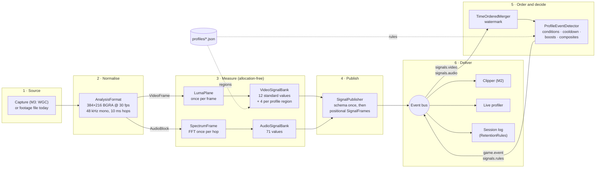
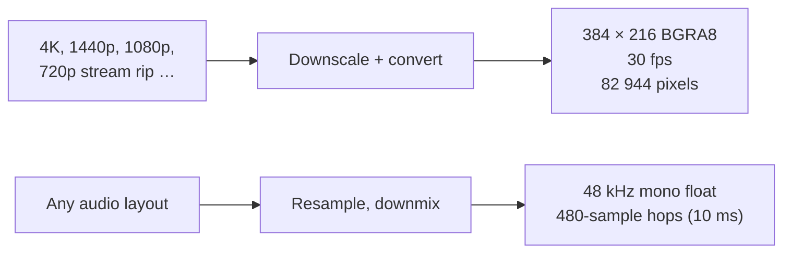
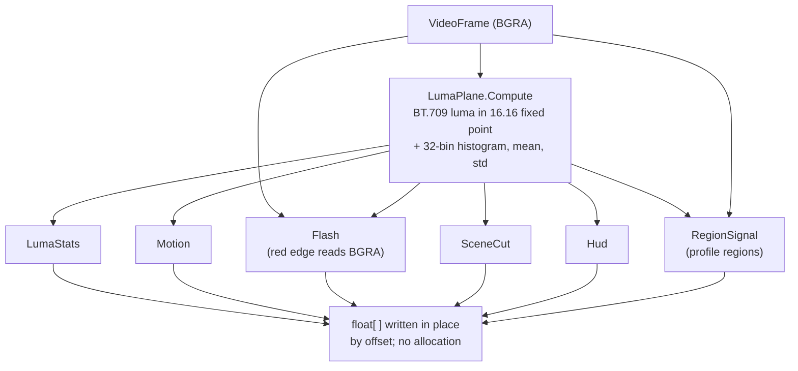
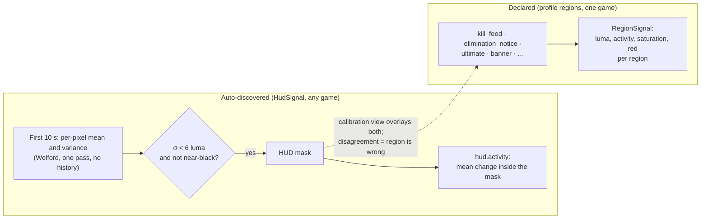
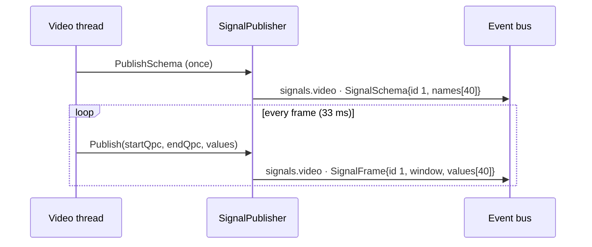
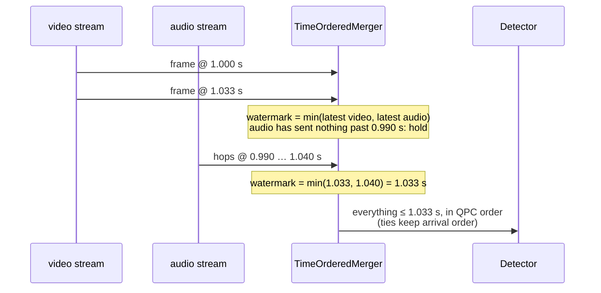
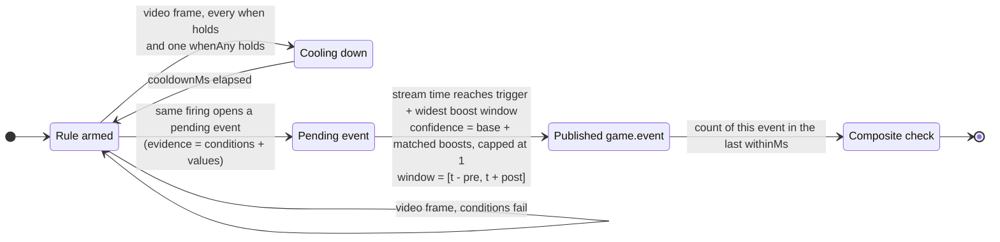
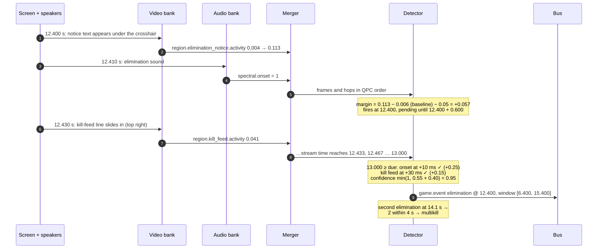

# Detection walkthrough

How Lookback knows that something happened in a game (an elimination, an
ultimate, a death, a round won) with no game API, no memory reading and no
code inside the game process. This page follows one frame and one audio hop
from the screen to a `game.event` on the event stream, stage by stage, with
the file that does each step. [Detection Design Notes](Detection-Design-Notes)
covers the trade-offs, the limits and the questions reviewers ask.

## The problem in one paragraph

Lookback has to clip highlights from any game on Windows. Most games publish
no game-state API. Many competitive games run anti-cheat, so injecting code
or reading memory is off the table, and doing it anyway risks the player's
account. What every game does produce is pixels and sound. So detection
works only from what a player sees and hears: it reduces each frame and each
10 ms of audio to a small vector of game-agnostic numbers (brightness,
motion, change inside the HUD, redness at the screen edge, audio onsets),
and a per-game profile, written as data, turns patterns in those numbers
into named moments.

## The whole path



The profile touches the pipeline in exactly two places, both as data: its
**regions** add measurement rectangles to the video bank, and its **rules**
configure the detector. Everything between is the same code for every game.

| Stage | Where | Runs | Output |
|---|---|---|---|
| Source | `Lookback.Media/Ffmpeg/FfmpegFileSource.cs` today; WGC capture in M3 | decoder or capture thread | borrowed `VideoFrame` / `AudioBlock` |
| Normalise | `Lookback.Media/Frames/AnalysisFormat.cs` | in the source (decoder scaler today, GPU downscale in M3) | 384×216 BGRA, 48 kHz mono |
| Measure | `Lookback.Signals/Video/*`, `Lookback.Signals/Audio/*`, `Lookback.Profiles/Regions/RegionSignal.cs` | video thread, audio thread | one `float` vector per frame or hop |
| Publish | `Lookback.Signals/SignalPublisher.cs` | same threads | `SignalSchema`, `SignalFrame` envelopes |
| Order | `Lookback.Profiles/Detection/TimeOrderedMerger.cs` | profile runner pumps | one time-ordered stream |
| Decide | `Lookback.Profiles/Detection/ProfileEventDetector.cs` | under the runner's lock | `GameEvent`, rule margins |
| Deliver | `Lookback.Profiles/Detection/ProfileRunner.cs`, `Lookback.Core/Bus/InProcessEventBus.cs` | bus fan-out | `game.event`, `signals.rules` |

## Stage 1 · Source

The detector does not care where frames come from. Two sources exist or are
planned, and they feed the same types:

- **Footage** (today): `FfmpegFileSource` decodes a file with ffmpeg's
  scaler straight into the analysis format. `FootageAnalyzer` runs video and
  audio on two tasks in parallel.
- **Live capture** (M3): Windows.Graphics.Capture from outside the game
  process, with a GPU downscale to the analysis format. The profile's
  `capturePolicy` decides whether anything more invasive is allowed; for an
  anti-cheat title such as Overwatch it says no present hook and no memory
  reading, and the loader keeps it that way.

What makes "live" live today is pacing, not the source. `lookback-testbench
live` plays a clip through the exact same analyser and profile runner, then a
`WallClockRelay` releases each envelope when the wall clock reaches its
timestamp. To everything downstream (the recorder's pipe, the WebSocket
bridge, the [live profiler](Live-Profiler)) it is indistinguishable from a
game being played. When M3 lands, the capture backend replaces the decoder
and the relay goes away; nothing after stage 2 changes.

Every timestamp is a raw QPC tick. A video frame carries its presentation
QPC; an audio block's sample index is rescaled to QPC with
`QpcTime.Rescale` (an `Int128` multiply, so it never overflows). Because QPC
is also the clock behind WGC frame times and DXGI present statistics, live
frames need no conversion, and a replay produces the same numbers a capture
would.

## Stage 2 · Normalise



Every signal sees one fixed format (`AnalysisFormat.Default`). That single
decision buys three things:

1. **Resolution independence.** Thresholds mean the same on a 4K monitor and
   a 720p recording, so one profile works for both.
2. **A fixed, tiny cost.** 82 944 pixels per frame is about 1% of a 4K frame.
   Every video signal is one linear pass over that buffer.
3. **Normalised coordinates.** Profile regions are fractions of the frame
   (`x`, `y`, `w`, `h` in 0..1), so they survive any resolution at the same
   aspect ratio. (Aspect ratio and HUD scale still move them; see
   [Design Notes](Detection-Design-Notes#where-it-breaks).)

Frames and audio blocks are **borrowed**: the source reuses one buffer, and a
consumer must finish with a frame before asking for the next. That is what
keeps the hot path free of per-frame allocation.

## Stage 3 · Measure

This is the core idea. A signal is a game-agnostic measurement: it knows
nothing about any game, it is computed the same way for every frame, and it
is chosen because many games express important moments through it.

### Shared work first



`VideoSignalBank.Process` converts the frame to luma **once**, then hands
each signal its slice of one preallocated output array. `AudioSignalBank`
does the same with one Hann-windowed 1024-point FFT per hop. Signals that
need history (previous luma, a rolling baseline, Welford accumulators) keep
it in arrays sized at construction. Tests assert that 50 frames at 384×216
and 100 audio hops allocate zero bytes.

### What each signal notices

| Signal | Computed as | Game moment it tends to reveal |
|---|---|---|
| `luma.mean`, `luma.std`, `luma.black` | Mean and spread of luma; black when both are tiny | Loading screens, fades, capture faults |
| `motion.energy`, `motion.coverage` | Mean abs luma difference; fraction of pixels changed by more than 12/255 | Fight intensity; a camera whip (high coverage) versus a muzzle flash (low coverage) |
| `motion.frozen_s` | Seconds with energy below 0.002 | A frozen picture is a fault, not a highlight |
| `flash.brighten` | Mean luma above a ~10-frame moving average | Explosions, ability effects, victory screens |
| `flash.red_edge` | Redness of the outer eighth of the frame minus the centre | The damage vignette most shooters draw |
| `scene.cut` | Half the L1 distance between consecutive luma histograms | Death cams, respawns, menus; camera motion leaves the histogram alone |
| `hud.activity` | Mean change inside a learned HUD mask | A bar dropping, a counter ticking, a kill-feed line, in any game |
| `audio.rms_db`, `audio.peak_db` | Level per 10 ms hop in dBFS | Loud moments relative to the game's own level |
| `spectral.flux`, `spectral.onset` | Positive change in compressed spectrum; onset when flux clears mean + 2.5σ and 1.5× mean | Gunshots, impacts, hit markers, UI stingers |
| `spectral.centroid_hz`, `mel.00`…`mel.63` | Spectral brightness and 64 log-mel bands | Input for later sound-event models |
| `region.<name>.luma`, `.activity`, `.saturation`, `.red` | The same measurements, inside one profile rectangle | Whatever that HUD element shows: kill feed, ultimate meter, banner |

Almost every signal is **relative**: change from the last frame, brightness
above its own recent past, edge redness minus centre redness, an onset
threshold that adapts to the game's loudness. That is what makes them
portable. A dark game and a bright game, a loud game and a quiet one, all
produce comparable values.

### Finding the HUD without knowing the game

The HUD is where games announce what just happened, so it is the single most
useful place to look. Lookback finds it in two complementary ways.



- **Auto-discovery** (`HudSignal`) works on a game it has never seen.
  Gameplay pixels change constantly; HUD pixels stay put. After a 10-second
  warm-up, pixels whose luma standard deviation stayed under 6 (and which are
  not static black letterbox) form the mask. Then `hud.activity` reports how
  much the HUD changed this frame. It answers "something in the HUD changed",
  not which element.
- **Declared regions** (`RegionSignal`) name the elements. A profile says
  "the kill feed is the top-right 27% × 20% of the frame", and the bank
  measures the same four values inside that rectangle every frame. Now a
  rule can say *the elimination notice changed*, not just *the HUD changed*.

The two meet in the testbench's calibration view, which draws the profile's
boxes over the learned mask. Where they disagree, the box is in the wrong
place for that footage.

## Stage 4 · Publish



Each family publishes a `SignalSchema` once (video is schema 1, audio 2,
rule margins 3), then one `SignalFrame` per window whose values are
**positional** against the schema's names. A frame is a window of QPC plus a
packed float array, so 40 Overwatch video values cost about 160 bytes plus
framing. Every envelope also carries `source_id` and a per-producer `seq`, so
any consumer can count dropped events from gaps.

The bus (`InProcessEventBus`) never blocks a producer. Publish reads a
copy-on-write snapshot of subscribers and `TryWrite`s into each bounded
channel; a slow subscriber loses its oldest events, and its `Dropped` counter
says so. Capture must never stall because a viewer is slow. Replays, which
run faster than real time, are instead **paced** by `ReplayPacer` on the
slowest lossless consumer's queue depth, so a replay drops nothing.

## Stage 5 · Order

Video and audio come from different threads at different rates (30 Hz
versus 100 Hz), and in a replay one decoder can run seconds ahead of the
other. Rules mix them ("the notice changed *and* there was an audio onset
within 250 ms"), so the detector must see one stream in true time order.



`TimeOrderedMerger` keeps a priority queue keyed by `(qpc, arrival seq)` and
releases an item only when **every** registered stream has delivered
something at or past its time: the watermark is the minimum of each stream's
latest timestamp. Each stream is in order on its own, so once the watermark
passes `t`, nothing earlier than `t` can still arrive. The output therefore
depends only on timestamps, never on thread scheduling: a replay at 8x gives
the same events as one at 1x. `MergerTests.DetectorOutputDoesNotDependOnArrivalSkew`
checks exactly that: skewing when the streams arrive does not change the
detector's output.

The one concession to wall time: a stream that has sent nothing for 2 seconds
of wall clock (a game with no audio device) stops holding back the watermark
until it sends again.

## Stage 6 · Decide

`ProfileEventDetector` consumes the ordered stream. It keeps the latest value
of every named signal, a 2-second history of any signal used as a boost, and
per-rule state.



On every **video** frame (audio frames update values but do not trigger
evaluation):

1. **Conditions.** Each condition is one test on one signal:

   | Test | Margin (holds when > 0) | Use |
   |---|---|---|
   | `above: a` | `value − a` | Signals with fixed meaning: `flash.red_edge > 0.06` |
   | `below: b` | `b − value` | Absence: banner saturation under 0.12 (grey death cam) |
   | `rise: r` | `value − baseline − r` | HUD changes. The baseline is an exponential moving average of the signal's own past (`baselineAlpha`, default 0.05, about 20 frames or 0.7 s at 30 fps), updated **after** evaluation so a spike is judged against the past, not itself |

   A rule fires when every `when` condition holds and at least one `whenAny`
   holds. A missing signal has margin −∞ and never holds.
2. **Cooldown.** A rule that fired cannot fire again for `cooldownMs`. This
   is the debounce: a kill-feed line animates in over several frames, and
   without a cooldown it would be several eliminations.
3. **Pending and boosts.** A firing opens a *pending* event at time `t`.
   Boosts are corroborating evidence that may arrive slightly before or after
   the trigger (the kill sound often lags the notice by a frame or two). The
   event is finalised only once merged stream time passes `t` plus its widest
   boost window. Because of the watermark, at that moment every frame and hop
   in the window has arrived, so the boost check is complete and
   deterministic. Each matching boost adds its `add` to `baseConfidence`
   (capped at 1) and a line of evidence.
4. **Composites.** Finalised events feed composite rules: "at least 2
   `elimination` within 4000 ms" is a `multikill`. The composite's clip
   window is stretched back to cover the whole streak, and the streak is
   cleared so the next composite needs a fresh set.
5. **Margins.** After evaluation, every condition's margin is published as a
   `signals.rules` frame. That is what the live profiler and the testbench
   timeline draw as "why it fired, or why it did not".

Every `GameEvent` carries its evidence in words, for example:

```json
{
  "name": "elimination",
  "gameProfile": "overwatch",
  "atQpc": "1234500000",
  "windowStartQpc": "1174500000",
  "windowEndQpc": "1264500000",
  "confidence": 0.95,
  "weight": 1.0,
  "evidence": [
    "region.elimination_notice.activity rise 0.05 (value 0.1132)",
    "boost spectral.onset > 0.5 within 250 ms",
    "boost region.kill_feed.activity > 0.02 within 600 ms"
  ]
}
```

(Values illustrative; the evidence format is the detector's.)

## Stage 7 · Deliver

`ProfileRunner` is the glue: it subscribes to `signals.video` and
`signals.audio` for one session, drives the merger and the detector under one
lock, and publishes `game.event` and `signals.rules` envelopes stamped with
the moment's own QPC (not the time of publication). From the bus they fan out
to:

- the **clipper** (M2), which weighs named moments alongside the generic
  excitement curve and cuts clips from the RAM replay ring using the event's
  suggested window;
- the **live profiler** page, over the loopback WebSocket bridge, which draws
  each event at its `at_qpc` on the session's own clock;
- other processes over named pipes;
- the **session log**, only if `RetentionRules` allows that session to be
  stored.

## Worked example: one Overwatch elimination

The player eliminates an enemy at about 12.40 s into a session. The profile
rule is:

```json
{ "name": "elimination", "baseConfidence": 0.55, "cooldownMs": 300,
  "whenAny": [ { "signal": "region.elimination_notice.activity", "rise": 0.05 } ],
  "boosts": [
    { "signal": "spectral.onset", "above": 0.5, "withinMs": 250, "add": 0.25 },
    { "signal": "region.kill_feed.activity", "above": 0.02, "withinMs": 600, "add": 0.15 } ],
  "clip": { "preMs": 6000, "postMs": 3000 } }
```



(Signal values are illustrative; the rule, the arithmetic and the timing
logic are the code's.)

What this shows:

- **No game knowledge outside the JSON.** The code measured "activity in a
  rectangle" and "an audio onset". Only the profile knows that this
  rectangle is where Overwatch announces your eliminations.
- **Corroboration raises confidence, not recall.** The notice alone fires the
  event at 0.55. Sound and kill feed raise it to 0.95. A muted player still
  gets the event; the clipper just trusts it less.
- **Latency is bounded and known.** The event is published once stream time
  passes trigger + 600 ms, plus however long the slower stream lags. For
  clipping this does not matter: the clip window reaches 6 s back into the
  replay ring.
- **Determinism.** Replaying the same file at any speed gives the same event,
  at the same QPC, with the same confidence.

## Cost

Per video frame at 384×216, the bank makes about five linear passes over
82 944 pixels (luma, motion, red edge, HUD, and the regions, which together
cover a fraction of the frame), plus a 32-bin histogram compare. At 30 fps
that is on the order of ten million simple integer operations per second, a
small fraction of one core. Audio is one 1024-point FFT and a 64-band mel
projection per 10 ms. The detector does dictionary lookups per value per
frame and allocates only when an event fires; it is not on the capture path.
For scale, the testbench analyses footage at about 6x real time on a laptop,
and that figure includes ffmpeg decoding and scaling
([Testbench](Testbench)).

## See also

- [Detection Design Notes](Detection-Design-Notes): why it is built this
  way, where it breaks, how it is measured, and questions reviewers ask
- [Signals Library](Signals-Library): every signal in detail
- [Game Profiles](Game-Profiles): the profile format, calibration, datasets
  and scoring
- [Live Profiler](Live-Profiler): watching the stream live
- [Event Schema](Event-Schema): `SignalSchema`, `SignalFrame`, `GameEvent`
