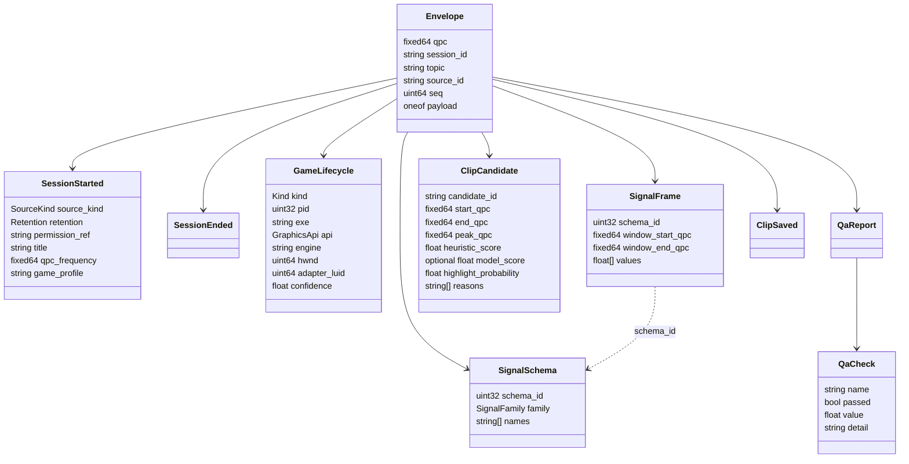

# Event schema

Source: `proto/lookback/v1/events.proto`. Generated into the
`Lookback.Contracts.V1` namespace.

## Envelope

Every message on the stream, on the pipe, on the socket and in the log is an
`Envelope`.

| Field | Type | Meaning |
|---|---|---|
| `qpc` | fixed64 | When the event happened, in raw QPC ticks |
| `session_id` | string | Which recording session it belongs to; also the log file name |
| `topic` | string | Routing key, such as `signals.video` (see [Topics](#topics)) |
| `source_id` | string | The producer, such as `signals.video.motion` |
| `seq` | uint64 | Per-producer counter starting at 1; a gap means events were dropped |
| `payload` | oneof | Exactly one of the messages below |

`fixed64` is used for timestamps because QPC values are large: a varint would
take 9 to 10 bytes, a fixed64 always takes 8 and encodes faster.

## Payloads

**`SessionStarted`** opens every session and is always the first record in a
session log. `source_kind` and `retention` drive [Data Retention](Data-Retention).
`qpc_frequency` makes the log's timestamps interpretable anywhere.

**`SessionEnded`** closes a session, with a reason.

**`GameLifecycle`** reports detection: detected, focused, unfocused, exited.
`api` and `engine` come from the loaded-module probe; `hwnd` and
`adapter_luid` tell capture which window and GPU to use.

**`SignalSchema` and `SignalFrame`** carry features. A producer publishes its
schema once (`schema_id` plus an ordered list of names, such as
`["motion", "luma_mean", "flash"]`), then sends frames with only a
`schema_id` and a packed `float` array. At 30 frames per second, repeating
names in every frame would multiply the size of the stream several times
over; this keeps a frame to a few bytes per value. Each frame covers a window
(`window_start_qpc` to `window_end_qpc`) because features such as audio
loudness describe a span, not an instant.

**`ClipCandidate`** is a proposed clip: its window, the peak inside it,
the heuristic score, an optional model score (`optional` so "not scored yet"
differs from 0), the calibrated `highlight_probability`, and human-readable
`reasons`.

**`QaReport`** lists the QA checks run on a candidate, each with a pass flag,
a measured value and detail.

**`ClipSaved`** records a clip written to disk.

## Enums

| Enum | Values |
|---|---|
| `SourceKind` | `LIVE_GAME`, `FILE`, `OFFICIAL_PLAYER` |
| `Retention` | `EPHEMERAL`, `OWNED`, `PERMISSIONED`, `OPEN_LICENSE` |
| `GraphicsApi` | `D3D11`, `D3D12`, `VULKAN`, `OPENGL` |
| `SignalFamily` | `VIDEO`, `AUDIO`, `INPUT` |

Every enum starts with an `_UNSPECIFIED = 0` value, as proto3 requires, so a
missing field can be told apart from a real choice. `RetentionRules` rejects
`RETENTION_UNSPECIFIED` outright.

## Topics

Defined in `src/Lookback.Contracts/Topics.cs`.

| Topic | Payload |
|---|---|
| `session` | `SessionStarted`, `SessionEnded` |
| `game.lifecycle` | `GameLifecycle` |
| `signals.video`, `signals.audio`, `signals.input` | `SignalSchema`, `SignalFrame` |
| `clip.candidate` | `ClipCandidate` |
| `qa.report` | `QaReport` |
| `clip.saved` | `ClipSaved` |

Subscriptions use patterns: an exact name, `*` for everything, or a prefix
ending in `.*`. `Topics.Matches("signals.*", "signals.video")` is true;
`Topics.Matches("signals.*", "signalsx.video")` is false because the dot is
part of the prefix.

## Evolving the schema

Field numbers are permanent. Add new fields with new numbers; never renumber
or reuse one. Breaking changes go in a new package, `lookback.v2`.
