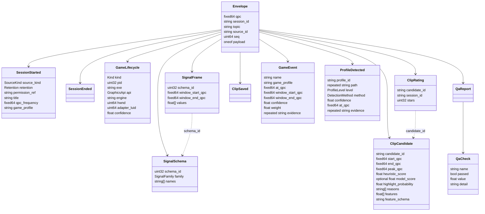

# Event schema

Source: `proto/lookback/v1/events.proto`. Generated into the
`Lookback.Contracts.V1` namespace.

## Envelope

Every message on the stream, on the pipe, on the socket and in the log is an
`Envelope`.

| Field | Type | Meaning |
|---|---|---|
| `qpc` | fixed64 | When the event happened, in raw QPC ticks |
| `session_id` | string | Which recording session it belongs to; also the log file name |
| `topic` | string | Routing key, such as `signals.video` (see [Topics](#topics)) |
| `source_id` | string | The producer, such as `signals.video.motion` |
| `seq` | uint64 | Per-producer counter starting at 1; a gap means events were dropped |
| `payload` | oneof | Exactly one of the messages below |

`fixed64` is used for timestamps because QPC values are large: a varint would
take 9 to 10 bytes, a fixed64 always takes 8 and encodes faster.

## Payloads

**`SessionStarted`** opens every session and is always the first record in a
session log. `source_kind` and `retention` drive [Data Retention](Data-Retention).
`qpc_frequency` makes the log's timestamps interpretable anywhere.

**`SessionEnded`** closes a session, with a reason.

**`GameLifecycle`** reports detection: detected, focused, unfocused, exited.
`api` and `engine` come from the loaded-module probe; `hwnd` and
`adapter_luid` tell capture which window and GPU to use.

**`SignalSchema` and `SignalFrame`** carry features. A producer publishes its
schema once (`schema_id` plus an ordered list of names, such as
`["motion", "luma_mean", "flash"]`), then sends frames with only a
`schema_id` and a packed `float` array. At 30 frames per second, repeating
names in every frame would multiply the size of the stream several times
over; this keeps a frame to a few bytes per value. Each frame covers a window
(`window_start_qpc` to `window_end_qpc`) because features such as audio
loudness describe a span, not an instant.

**`GameEvent`** (field 18 of the envelope) is a named game moment, such as
an Overwatch `elimination` or `ultimate_used`, recognised by a
[game profile](Game-Profiles)'s rules from the game-agnostic signals.
`at_qpc` is the moment; `window_start_qpc` to `window_end_qpc` is the footage
worth keeping around it; `confidence` is how sure the rule is (base plus
boosts); `weight` is how much the moment matters to the clipper; `evidence`
lists, in words, the conditions and boosts that made it fire, so a person
can see why.

**`ProfileDetected`** (field 19) says which profile is active: the game, a
sub-game beneath it (a Roblox experience) or a mode. `path` lists the tree
from the game down. `method` says how it was decided: the executable, a hint
(launch arguments or the client's own log), a visual fingerprint, or chosen
by hand. It is published on `game.profile` at the start and whenever the
active profile changes, so the clipper and the viewer always know which
rules applied when.

**`ClipCandidate`** is a proposed clip: its window, the peak inside it,
the heuristic score, an optional model score (`optional` so "not scored yet"
differs from 0), the calibrated `highlight_probability`, and human-readable
`reasons`. `features` (field 10, packed floats) and `feature_schema`
(field 11, for example `clip-features/1`) carry the game-agnostic feature
vector the learned scorer reads; `features` is positional against the schema
in `ml/feature_schema.json`, a missing value is NaN, and both are empty until
the clipper computes them. When a learned model covers the candidate's game,
`model_score` is the model's raw probability and `highlight_probability` the
probability after that game's calibration; otherwise `model_score` stays
unset and the heuristic stands. See [Clip Scoring](Clip-Scoring).

**`QaReport`** lists the QA checks run on a candidate, each with a pass flag,
a measured value and detail. `highlight_probability` (field 4) is the
candidate's highlight probability when QA ran, so a QA threshold on it can
be read straight from the report.

**`ClipRating`** (field 20) is a person's content rating of one candidate:
is this a highlight? `stars` is 1 to 5, or 0 to clear an earlier rating;
video quality is never rated here. The shell sends a `rate` request, the
recorder acknowledges it and publishes a `ClipRating` on `clip.rating`, and
`RatingSink` stores it, but only for a session `RetentionRules` allows to
persist (see [Data Retention](Data-Retention)). Ratings become training
labels, `(stars − 1) / 4`.

**`ClipSaved`** records a clip written to disk.

## Enums

| Enum | Values |
|---|---|
| `SourceKind` | `LIVE_GAME`, `FILE`, `OFFICIAL_PLAYER` |
| `Retention` | `EPHEMERAL`, `OWNED`, `PERMISSIONED`, `OPEN_LICENSE` |
| `GraphicsApi` | `D3D11`, `D3D12`, `VULKAN`, `OPENGL` |
| `ProfileLevel` | `GAME`, `SUBGAME`, `MODE` |
| `DetectionMethod` | `EXECUTABLE`, `HINT`, `VISUAL`, `MANUAL` |
| `SignalFamily` | `VIDEO`, `AUDIO`, `INPUT`, `RULES` (a profile's rule margins, for viewers) |

Every enum starts with an `_UNSPECIFIED = 0` value, as proto3 requires, so a
missing field can be told apart from a real choice. `RetentionRules` rejects
`RETENTION_UNSPECIFIED` outright.

## Topics

Defined in `src/Lookback.Contracts/Topics.cs`.

| Topic | Payload |
|---|---|
| `session` | `SessionStarted`, `SessionEnded` |
| `game.lifecycle` | `GameLifecycle` |
| `signals.video`, `signals.audio`, `signals.input` | `SignalSchema`, `SignalFrame` |
| `signals.rules` | `SignalSchema`, `SignalFrame`: one margin per profile condition, published by the profile runner |
| `game.event` | `GameEvent` |
| `game.profile` | `ProfileDetected` |
| `clip.candidate` | `ClipCandidate` (today built from profile events; source `profile.<game>.candidates`) |
| `qa.report` | `QaReport` |
| `clip.saved` | `ClipSaved` |
| `clip.rating` | `ClipRating`: a person's 1 to 5 star content rating of a candidate |

Subscriptions use patterns: an exact name, `*` for everything, or a prefix
ending in `.*`. `Topics.Matches("signals.*", "signals.video")` is true;
`Topics.Matches("signals.*", "signalsx.video")` is false because the dot is
part of the prefix.

## Evolving the schema

Field numbers are permanent. Add new fields with new numbers; never renumber
or reuse one. Breaking changes go in a new package, `lookback.v2`.
