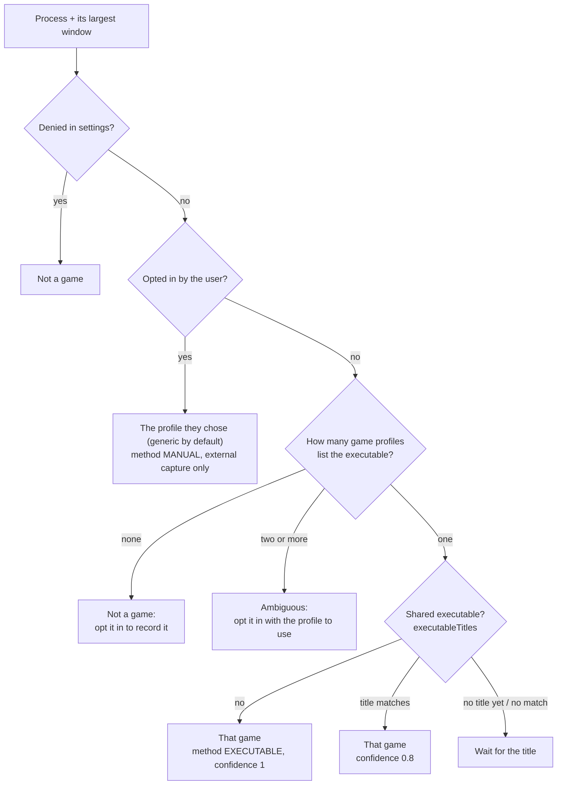
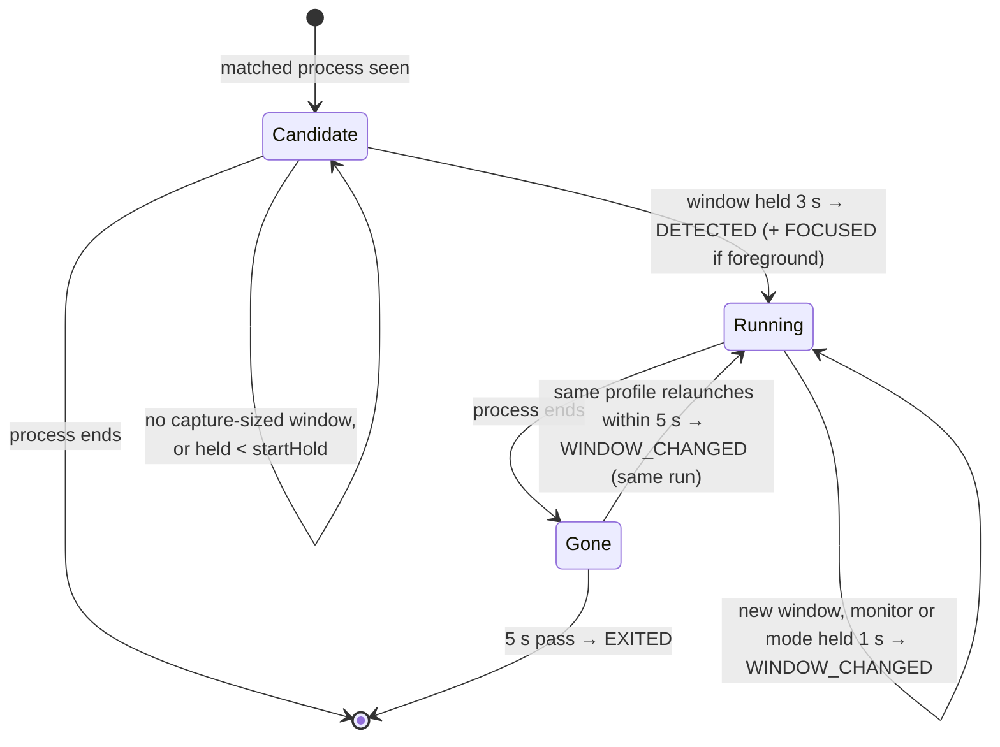

# Game detection

`src/Lookback.Detection` (platform-neutral) and
`src/Lookback.Detection.Windows` (the Windows probe): the M2 **game
identifier**. It notices that a game started, gained or lost focus, moved
window, or stopped on this machine, says which profile it is, and publishes
that on `game.lifecycle` so the recorder can start and stop capture by
itself. Which sub-game or mode is being played is decided later, by the
[profile tracker](Game-Profiles#detecting-the-sub-game-and-mode), from the
hints this component hands over and from the screen.

## What it may look at

Only what Windows tells any program about the others. Nothing inside a game
process is opened, read, injected or hooked, so it is safe beside anti-cheat.

| Fact | Where it comes from | When |
|---|---|---|
| Running processes (pid, executable name) | Toolhelp process snapshot | Every poll |
| Executable path, start time | `QueryFullProcessImageName`, `GetProcessTimes` on a `PROCESS_QUERY_LIMITED_INFORMATION` handle | Once, only for processes whose name a profile or the user's settings mention |
| Launch arguments | `NtQueryInformationProcess(ProcessCommandLineInformation)` on the same handle: the kernel returns them, nothing reads the game's memory | Once, only for games whose profile tree has `launchArgs` hints (Roblox) |
| Top-level windows: title, size, monitor | `EnumWindows` (visible, unowned, not cloaked, not tool windows), `GetWindowRect`, `MonitorFromWindow` | Every poll |
| Window mode | No frame and covering its monitor is **borderless**; `SHQueryUserNotificationState` reports **exclusive fullscreen** for the foreground window; anything else is **windowed** | Every poll |
| Focus | The process that owns `GetForegroundWindow` | Every poll |
| Engine | `UnityPlayer.dll` or `<Game>_Data` beside the executable is Unity; `Binaries\Win64\*-Shipping.exe` is Unreal | Once, from the disk, not the process |
| Adapter | The display-config API (`QueryDisplayConfig`): the adapter whose source drives the window's monitor, the same LUID DXGI reports. Never a DXGI factory (see below) | When the monitor changes |

It polls (default once a second) instead of using WMI's
`Win32_ProcessStartTrace`, which needs administrator rights, or ETW, which
would add a kernel trace session for little gain at one game every few hours.
A poll is one process snapshot and one window enumeration, with handles
opened only for candidate processes: about 3 ms on AETHER with 324
processes running, once a second.

### Why no DXGI in the detector

Creating a DXGI factory and enumerating adapters loads every adapter's
driver into the process. On AETHER that stalled NVENC mid-encode: the
encode-clock test (`EncodeTickerTests`) missed 33 ms ticks in 3 of 9
full test runs while a detection test enumerated DXGI, and in 0 of 8 once
the adapter came from `QueryDisplayConfig` instead. Detection runs beside
live encoding, so it never touches DXGI. `WindowsDetection.TryCaptureTarget`
(which calls `CaptureTarget.ForWindow`) does, once, when the recorder asks
for a target.

## Which program is a game



- Executable names come from each game profile's `executables`.
- `executableTitles` handles a program other software shares: Minecraft:
  Java Edition runs in `javaw.exe`, so the Minecraft profile requires a
  window title matching `^Minecraft\b` before `javaw.exe` counts. Another
  Java app is not mistaken for it.
- Unknown and ambiguous executables are never recorded on a guess. The user
  opts one in (`lookback-detect allow MyGame.exe`), and it gets the
  `generic` profile unless they name another.

### The user's allow and deny lists

These are **settings, not session data**: executable names or paths and
profile ids, never anything seen or heard in a session. They live in
`%LOCALAPPDATA%\Lookback\detection.json`:

```json
{
  "allow": [ { "exe": "MyIndieGame.exe", "profile": "generic" },
             { "exe": "D:\\Games\\Mod\\javaw.exe", "profile": "minecraft" } ],
  "deny":  [ "RocketLeague.exe" ]
}
```

An entry is a file name (any folder) or a full path (that copy only); case is
ignored. Deny beats everything; allow beats a profile's own listing. Unknown
fields are rejected, so a typo is an error. The runner takes new settings
with `UpdateSettings` from the next poll; games already running keep their
profile.

## Capture policy

Every lifecycle event carries the profile's capture policy, resolved down the
tree (a child can only make it stricter), as `allow_present_hook` and
`allow_memory_reading`. The recorder must honour it. Detection never relaxes
it, and makes it stricter in one case: an executable the user opted in is
the user's word, not a verified title, so it gets external capture only
whatever its profile says. Every built-in profile keeps both at false.

## Lifecycle and debouncing



| Option | Default | Stops |
|---|---|---|
| `PollInterval` | 1 s | |
| `StartHold` | 3 s | Launchers, crash reporters (no window) and splash screens that close at once |
| `FocusHold` | 0.5 s | A quick alt-tab, a notification stealing focus |
| `WindowHold` | 1 s | Mode flicker while a game switches resolution |
| `ExitGrace` | 5 s | An anti-cheat bootstrapper or a game that relaunches itself ending the run |
| `MinWindowWidth` × `MinWindowHeight` | 320 × 200 | Tool tips, tray pop-ups |

- The capture window is the process's largest visible top-level window.
  Minimizing keeps the last one; a title change alone does not change the
  target, it only refreshes the hints (`HintsChanged`).
- A game announced while in the background starts unfocused; `FOCUSED`
  follows when the player switches to it.
- Each run gets one id, `live-<game>-<pid>-<qpc>`, kept across focus,
  window changes and a relaunch. It is the `session_id` of the run's
  `game.lifecycle` envelopes; the recorder can give its capture session the
  same id.
- Envelope `qpc` is the raw QPC tick of the poll that confirmed the change.
- Two games at once are two runs; the recorder chooses (usually the focused one).

## Hosting it

```csharp
// Windows: the real machine, built-in profiles, the user's settings.
await using DetectionRunner detection = WindowsDetection.CreateRunner(bus);

detection.Changed += change =>          // on the poll thread, after the envelope is on the bus
{
    GameInstance game = change.Game;    // id, profile, pid, window, focus, policy, hints
    switch (change.Kind)
    {
        case GameLifecycle.Types.Kind.Detected:
        case GameLifecycle.Types.Kind.WindowChanged:
            CaptureTarget? target = WindowsDetection.TryCaptureTarget(game); // null: window gone, capture its monitor
            // start or re-target capture with game.Policy; SessionStarted.game_profile = game.Match.ProfileId
            break;
        case GameLifecycle.Types.Kind.Exited:
            // stop capture, end the session
            break;
    }
};
detection.HintsChanged += game => profileRunner.ApplyHints(game.Hints, SystemClock.Instance.Now);
```

The runner never stops because one poll failed: a probe exception or a
throwing subscriber is kept in `LastError` and the next poll goes ahead.
Disposing it stops polling without announcing `EXITED` (the recorder ends
its own sessions). `Games` lists the runs in progress; `Pending` lists
candidate processes not announced yet and why.

## Try it

```
dotnet run --project src/Lookback.Detection.Cli -- windows
dotnet run --project src/Lookback.Detection.Cli -- --seconds 120
dotnet run --project src/Lookback.Detection.Cli -- allow MyIndieGame.exe
```

`windows` lists every capture-sized window with its process, mode, size,
monitor and whether it is a game (and if not, why). The default command
prints changes live:

```
    4.02s  Detected       generic (Manual) pid 22152 lookback-testwindow.exe  [live-generic-22152-5bc924693d0]
           window 0x2F07C6 "Smoke test game" 960x720 Windowed, adapter 16D1D
           capture: window "Smoke test game" (pid 22152) on \\.\DISPLAY1
           policy: presentHook=False memoryReading=False  engine: ?  why: opted in by the user as generic
   13.02s  Exited         generic (Manual) pid 22152 lookback-testwindow.exe  [live-generic-22152-5bc924693d0]
```

`settings`, `allow <exe> [--profile id]`, `deny <exe>` and `forget <exe>`
show and edit the allow and deny lists (`--settings <path>` for another file).

## Not yet

- Launcher log files (`log` hints, such as Roblox's client log) are not
  tailed yet; launch arguments and window titles are.
- The graphics API (`api`) stays unspecified: finding it would mean listing
  the game's loaded modules, which needs `PROCESS_VM_READ`.
- Games whose window belongs to another process (UWP frame hosts) are not
  matched; current Store games (GDK) own their windows.

## Source files

| File | What it does |
|---|---|
| `Probe/ISystemProbe.cs` | What the OS shows: processes, details, launch arguments, windows, adapters |
| `Matching/GameMatcher.cs` | Executable (and title) to profile; allow, deny, ambiguity; the capture policy |
| `Matching/DetectionSettings.cs` | The user's allow and deny lists, loaded and saved as JSON |
| `Matching/EngineGuess.cs` | Unity or Unreal from files beside the executable |
| `Lifecycle/GameDetector.cs` | Snapshots to debounced changes: start, focus, window, relaunch, exit |
| `Lifecycle/GameInstance.cs` | One run of a game, and the `GameLifecycle` it publishes |
| `DetectionRunner.cs` | The poll loop: publishes on the bus, raises `Changed` and `HintsChanged` |
| `Lookback.Detection.Windows/WindowsSystemProbe.cs` | Toolhelp, query-limited handles, `EnumWindows`, window mode |
| `Lookback.Detection.Windows/WindowsDetection.cs` | `CreateRunner` for this machine, `TryCaptureTarget` for a game |
| `Lookback.Detection.Cli/Program.cs` | The `lookback-detect` bench |
