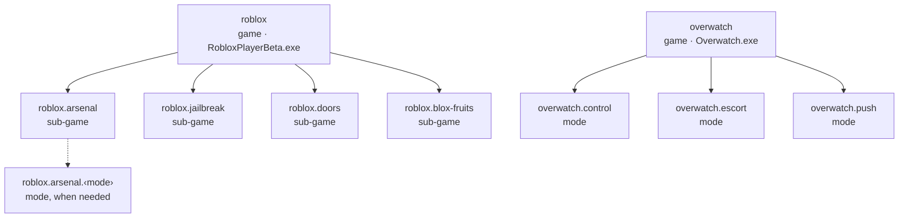
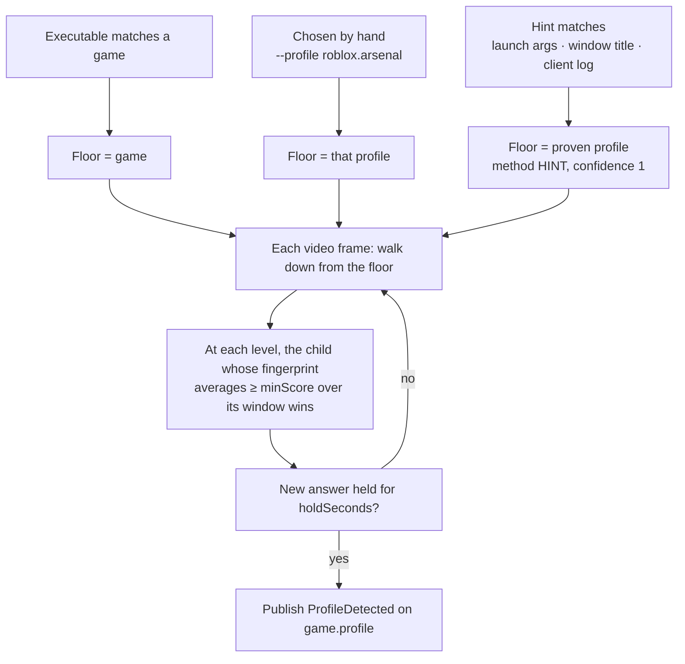
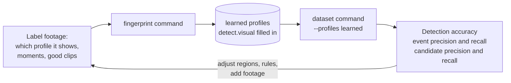
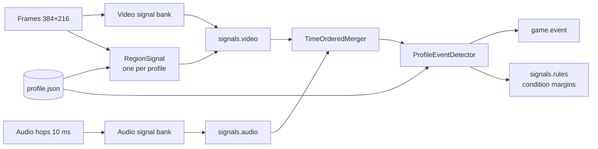
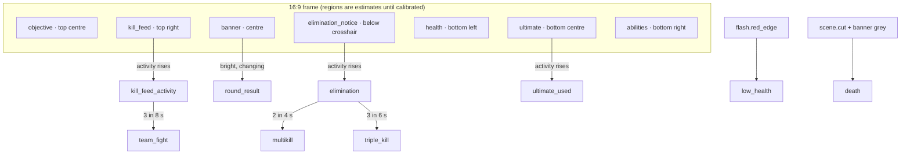
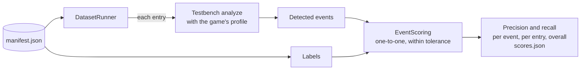

# Game profiles

A game profile is everything Lookback knows about one game, written as data.
It never adds a new kind of measurement. It points the game-agnostic signals
at the parts of the screen that matter in that game, and turns their output
into named moments with rules. Adding a game means writing a JSON file, not
code.

Profiles live in `profiles/<game>/*.json` (one folder per game tree) and
are embedded into `Lookback.Profiles` at build time. Run
`lookback-testbench profiles` to print the tree:

| Profile | Level | Purpose |
|---|---|---|
| `generic` | game | Any game. No regions; rules over the whole-frame signals only. The fallback, and the baseline a game profile has to beat. |
| `overwatch` | game | The first game profile. Vision and audio only. |
| `overwatch.control`, `.escort`, `.push` | mode | Mode stubs, ready for fingerprints learned from footage. |
| `roblox` | game | What every Roblox experience shares: the client's interface and generic moments. |
| `roblox.<experience>` (16) | sub-game | Steal an Egg, Murder Mystery 2, Brookhaven RP, Adopt Me!, 99 Nights in the Forest, Blox Fruits, RIVALS, Steal a Brainrot, Jujutsu Shenanigans, +1 Speed Keyboard Escape, BedWars, Slap Battles, Fisch, Arsenal, Jailbreak, DOORS. Each has its own regions, rules, tags and Roblox ids. |
| `roblox.<experience>.lobby`, `.match`, `.round`, `.duel`, `.run`, `.day`, `.night` | mode | Lobbies switch off the experience's combat rules; 99 Nights tells day from night by brightness. |

## Why Overwatch first

Overwatch has no public game-state API, and it runs anti-cheat. That makes it
the honest test of the design: everything has to come from what a player
sees and hears. The profile's capture policy says so explicitly:

```json
"capturePolicy": { "allowPresentHook": false, "allowMemoryReading": false }
```

Live capture (M3) reads this policy. For a title like this it will use
Windows.Graphics.Capture from outside the process: no injected present hook,
no reading the game's memory. Executable names in the profile are used only
to recognise that the game is running.

## The profile tree

Some games are one game. Others are a platform of many: Roblox runs
thousands of experiences in one executable, and an elimination in an arena
shooter looks nothing like a robbery in an open-world one. Many games also
have modes that change what matters. So profiles form a tree:



A child names its `parent`, its `level` (`subgame` or `mode`), and an id that
starts with the parent's id and a dot. It **inherits everything** and adds to it:

| What | Rule |
|---|---|
| Regions | Added. A region name means one rectangle across the whole tree, because one `RegionSignal` measures them all; a child names new regions instead of moving the parent's. |
| Events and composites | Added, or replaced by giving the same name. `disable` removes inherited ones (and composites built on them). |
| Capture policy | Can only get **stricter**. A Roblox experience can never allow the hook or memory reading its game forbids. |
| Executables | Games only; children are detected beneath their game. |

The detector loads the whole tree under the game at once, so the rule-margin
schema never changes mid-session, and evaluates only the rules of the
**active** profile. Inactive rules keep their baselines up to date, so they
are ready the moment their profile becomes active. Every `GameEvent` carries
the profile that was active when it fired.

## Detecting the sub-game and mode



1. **The floor.** Detection never rises above where it starts: the game
   found by its executable, a profile chosen by hand, or one a hint proved.
2. **Hints are exact.** A hint is a regular expression over facts the
   platform exposes *outside* the game process: the launch arguments, the
   window title, or new lines in the launcher's own log file. With `values`,
   the first capture group must equal one of them, for example a Roblox
   place id. A match decides the sub-game outright and becomes the floor.
   Hints need live capture (M3); footage has none, so footage relies on
   fingerprints.
3. **Fingerprints are learned.** A fingerprint is a few `above`/`below`
   conditions on video signals, usually the region signals. Each frame
   scores the share of conditions that hold; the score is averaged over
   `windowSeconds`. Walking down from the floor, the best child above its
   `minScore` wins at each level.
4. **Hysteresis.** A new answer must persist for `holdSeconds` before the
   active profile switches. Stepping back *up* to a parent waits a full
   window, so a switch between two siblings never detours through the parent.

## Roblox

The `roblox` game profile covers what every experience shares: the client's
top bar, player list, chat, the centre of the screen where most experiences
put pop-ups and banners, and the hotbar. Its events are deliberately generic
(`impact`, `centre_popup`, `respawn_or_teleport`, `loud_moment`), so an
experience with no profile yet still gets reasonable clips.

Each experience profile adds its own regions and rules. Arsenal adds a kill
feed and elimination notice with multikill and killstreak composites;
Jailbreak adds its notification banner and a chase rule; DOORS adds
jumpscare and death; Blox Fruits adds big abilities, level-ups and combos.
Each experience lists its Roblox ids: the **universe id** (one per
experience, stable across all its places, the key to categorise by) and its
**place ids** (lobby, worlds, matches). The `roblox` game profile's
`idHints` read those ids from the client's own log and launch arguments, so
a running experience is identified exactly, without fingerprints.

`lookback-testbench roblox-ids --write true` fills in and verifies the ids
with Roblox's public web API. It resolves listed place ids to universes,
searches by name where none is listed, and confirms each universe's name,
then edits only the `"ids"` line of each profile where the names match.
`lookback-testbench profiles --id roblox.universe=<id>` finds the profile for
an id, and `--tag` lists a category. All regions are estimates until
calibrated.

The client ships anti-tamper protection, so the Roblox capture policy is
external capture only, and every experience inherits it.

## Clip candidates

With the [clipper](Clipper) running (the testbench always runs it), events
are fused with peaks of the game-agnostic excitement curve into one
deduplicated candidate set, each candidate with a QA report; the clipper
page describes how. A profile's optional `clipper` block (below) tunes that
curve for the game, and children inherit it.

On its own (`ProfileRunner(..., publishCandidates: true)`, the default, as
the official-player calibration runs it), the profile runner turns events
into `ClipCandidate`s itself:

- Events whose clip windows overlap, or come within 1.5 s, merge into one
  candidate, up to 60 s long. A team fight with five eliminations becomes one
  clip, not five overlapping ones.
- **Score** is the sum of weight × confidence over the events inside;
  **peak** is the event that contributed most; the candidate belongs to that
  event's profile.
- **Highlight probability** is 1 − e^(−score) for now: bounded, and monotonic
  in the score. Ratings calibrate it in M4.

The report shows a **profile** lane (which profile was active when, with how
and why on hover) and a **candidates** lane (darker is a higher score).

## Training profiles from footage



`fingerprint <manifest>` analyses every entry from the game down, so every
region signal in the tree is measured. For each sub-game or mode, frames of
its footage are compared with frames of its siblings' footage (or of the
parent alone):

1. Each video signal gets a **separation**: the gap between the two means
   over the sum of the two standard deviations.
2. The best separated signals (up to three, separation ≥ 1 and at least half
   the best) become conditions. The threshold is where the two distributions
   cross, kept at least a tenth of the gap from either mean.
3. `minScore` is set halfway between the share of conditions that hold on
   its own frames and on the others'.

It prints each condition with how often it holds on each side, and writes
complete profile files to `<out>/learned/`. Load them with
`--profiles <out>/learned` on `analyze` or `dataset`, check the numbers, then
copy the `detect.visual` block into the profile in `profiles/`. When nothing
separates a profile, it says so: add a region over something only that
experience or mode shows.

## How a profile becomes events



1. **Regions.** `RegionSignal` measures four values inside each region of
   the profile: `region.<name>.luma`, `.activity` (mean change since the
   last frame), `.saturation` and `.red`. They are published with the other
   video signals, so they appear in the timeline and the session log like
   any other signal. Allocation-free per frame.
2. **Merge.** Video frames and audio hops arrive on different threads at
   different speeds. The merger releases them in time order, holding each
   item until every stream has moved past it (the watermark). The output
   depends only on timestamps, so a replay at 8x (where the audio decoder
   can run seconds of footage behind video) gives exactly the same events
   as one at 1x. Only a stream that has sent nothing for two seconds of
   wall time (no audio device) stops holding the others back.
3. **Rules.** On every video frame the detector checks each rule. A rule
   that holds and is out of its cooldown opens a pending event.
4. **Boosts.** Corroborating evidence near the trigger, such as an audio
   onset within 250 ms of a kill-feed change, adds confidence. Because a
   boost can come just after the trigger, the event is held until time has
   passed its widest boost window, then published.
5. **Composites.** Published events feed composite rules: two eliminations
   within four seconds is a `multikill`.

Every event carries `evidence`: the conditions and boosts that made it fire,
in words, with the values seen. The runner also publishes each condition's
margin (value minus threshold) on `signals.rules`, so a viewer can show why
a rule did or did not fire.

## Profile format

```jsonc
{
  "id": "overwatch",                       // lower case; used in events and file names
  "displayName": "Overwatch",
  "version": 1,
  "executables": ["Overwatch.exe"],        // detection only
  "capturePolicy": { "allowPresentHook": false, "allowMemoryReading": false, "notes": "…" },
  "reference": { "aspect": "16:9", "calibrated": false, "notes": "…" },
  "regions": [
    { "name": "kill_feed", "x": 0.72, "y": 0.02, "w": 0.27, "h": 0.20, "purpose": "…" }
  ],
  "events": [
    {
      "name": "elimination",
      "weight": 1.0,                       // how much the moment matters to the clipper
      "baseConfidence": 0.5,
      "cooldownMs": 400,
      "when":    [ /* every condition must hold */ ],
      "whenAny": [ { "signal": "region.elimination_notice.activity", "rise": 0.05 } ],
      "boosts":  [ { "signal": "spectral.onset", "above": 0.5, "withinMs": 250, "add": 0.25 } ],
      "clip": { "preMs": 8000, "postMs": 3000 }
    }
  ],
  "composites": [
    { "name": "multikill", "of": "elimination", "atLeast": 2, "withinMs": 4000, "weight": 2.5 }
  ],
  "clipper": {                             // optional: tunes the clipper's excitement curve for this game
    "components": [ { "signal": "region.kill_feed.activity", "weight": 1.5 } ],
    "high": 1.8, "low": 0.9, "preMs": 8000, "postMs": 3000
  }
}
```

The `clipper` block is described on the [Clipper](Clipper#weights-are-data)
page. Anything it leaves out comes from the parent profile, then from the
clipper's defaults.

A condition sets exactly one of:

| Test | Holds when | Use it for |
|---|---|---|
| `above` | value > threshold | Signals with a fixed meaning, such as `flash.red_edge` |
| `below` | value < threshold | Absence, such as a grey (unsaturated) death screen |
| `rise` | value − baseline > amount | HUD changes. The baseline is a slow moving average of the signal's own past (`baselineAlpha`, default 0.05), so it adapts to a game's palette and brightness |

The loader rejects anything it does not understand: unknown fields
(so a misspelt threshold is an error, not silently ignored), regions outside
the frame, a condition with zero or two tests, composites of unknown events.
When a profile is run, every signal it names is checked against the signals
actually produced, and any missing one is reported as a warning.

## The Overwatch profile



| Event | Rule | Boosts | Weight |
|---|---|---|---|
| `elimination` | The notice under the crosshair changes | Audio onset, kill-feed change | 1.0 |
| `kill_feed_activity` | Any kill-feed change (anyone's elimination) | | 0.3 |
| `ultimate_used` | The ultimate meter changes sharply | Flash, onset | 1.2 |
| `low_health` | Red vignette at the screen edge | | 0.2 |
| `death` | Scene cut while the centre goes grey | | 0.2 |
| `round_result` | The centre banner is bright and changing | | 0.8 |
| `multikill`, `triple_kill` | 2 or 3 eliminations close together | | 2.5, 4 |
| `team_fight` | 3 kill-feed changes in 8 s | | 1.5 |

`reference.calibrated` is **false**. The region positions are estimates of
the default HUD at 16:9 and 100% HUD scale. Ultrawide, a changed HUD scale or
a game update moves them. They have to be checked against real footage, which
is what the calibration view is for.

## Calibration view

```
dotnet run --project src/Lookback.Testbench -- analyze my-overwatch.mp4 --profile overwatch
```

The report then shows, over the video:

- **Profile regions**: the profile's boxes, labelled. Hover a box for its purpose.
- **Detected HUD mask**: the pixels the HUD signal learned are static
  overlay in *this* footage, in teal.

Where the teal mask and the boxes disagree, the boxes are wrong for this
footage. Edit `x`, `y`, `w`, `h` in the JSON, rerun, and look again. Each can
be toggled. Below the video, the timeline gains:

- an **events** lane: a tick per event (height is confidence), a band for its
  clip window; hover for the evidence, click to seek to the moment;
- a **rules** lane per condition: its margin over the threshold, with a
  dashed zero line. Above the line the condition holds. This is the fastest
  way to choose a threshold: look at the margin during a real elimination
  and during a false one.

Pass a path instead of an id (`--profile ./my-overwatch.json`) to try an
edited copy without rebuilding.

## Datasets and scoring

Each game gets a dataset: footage plus hand-marked moments, described by a
manifest at `datasets/<game>/manifest.json`. Each entry can also say which
profile the footage shows (`"profile": "roblox.arsenal"`), which scores
detection and teaches fingerprints, and which stretches a person would clip
(`"clips": [{ "start": 40, "end": 52 }]`), which scores candidates. Media is never committed; only
manifests are (see `.gitignore`). An example is in
`datasets/overwatch/manifest.example.json`.



Every entry records where the footage came from and its retention:
`owned` (your recordings), `permissioned` or `open-license`, the last two
with a `permissionRef` saying where the permission or licence is recorded.
`ephemeral` is not allowed in a dataset, because a dataset is stored by
definition. Official-player sessions are never a dataset source: they stay
ephemeral, enforced by [RetentionRules](Data-Retention).

```
dotnet run --project src/Lookback.Testbench -- dataset datasets/overwatch/manifest.json --tolerance 1.0
```

```
arsenal-01.mp4: 23 events, detected roblox.arsenal (expected roblox.arsenal, right 91% of the time)

detection  right profile 88% of labelled time
candidates 14 match labelled clips, 3 extra, 2 missed: precision 82%, recall 88%, mean overlap 0.61

event                       TP    FP    FN  precision   recall  (tolerance 1 s)
elimination                 41     6     9        87%      82%
multikill                    7     1     2        88%      78%
```

(Illustrative output.) A detection matches a label of the same name within
the tolerance. Each label and each detection is used at most once, closest
pairs first, so firing twice on one elimination scores one hit and one false
positive. Candidates match labelled clips one-to-one when their time ranges
overlap by at least 0.3 (intersection over union). Detection accuracy is the
share of labelled time during which the active profile was the one the entry
names. Scores are counted per entry and then summed, so a label in one
file can never match a detection in another.

This is the per-game QA loop for profile rules: change a threshold or a
region, rerun the dataset, and see precision and recall move. The same
labels later train the learned scorer (M4).

## Source files

| File | What it does |
|---|---|
| `Model/GameProfile.cs` | The records above, with defaults |
| `Model/ProfileCatalog.cs` | The tree: parents, children, inheritance, tree-wide checks |
| `Detection/ProfileTracker.cs` | Hints, fingerprints and hysteresis: which profile is active |
| `Candidates/CandidateBuilder.cs` | Events to clip candidates |
| `Model/GameProfileLoader.cs` | Loads by id (embedded) or path, rejects unknown fields, validates structure and signal names |
| `Regions/RegionSignal.cs` | The per-region measurements, as an `IVideoSignal` |
| `Detection/TimeOrderedMerger.cs` | Watermark merge of video and audio |
| `Detection/ProfileEventDetector.cs` | Conditions, baselines, cooldowns, boosts, composites, margins |
| `Detection/ProfileRunner.cs` | Subscribes to one session's signals on the bus, publishes `game.event` and `signals.rules` |
| `Testbench/Datasets/*` | Manifest, event, detection and candidate scoring, the dataset runner, the fingerprint learner |
