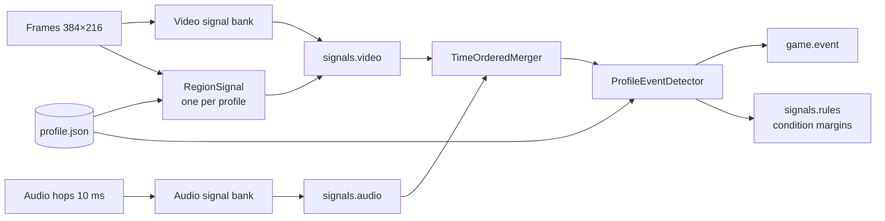
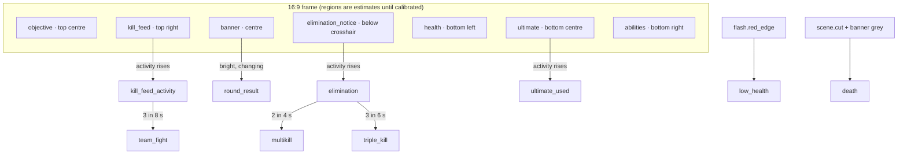
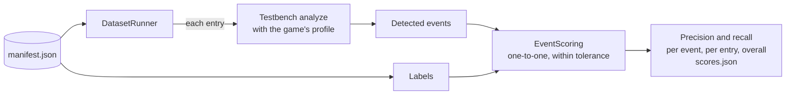

# Game profiles

A game profile is everything Lookback knows about one game, written as data.
It never adds a new kind of measurement. It points the game-agnostic signals
at the parts of the screen that matter in that game, and turns their output
into named moments with rules. Adding a game means writing a JSON file, not
code.

Profiles live in `profiles/*.json` and are embedded into
`Lookback.Profiles` at build time. Two ship today:

| Profile | Purpose |
|---|---|
| `generic` | Any game. No regions; rules over the whole-frame signals only. The fallback, and the baseline a game profile has to beat. |
| `overwatch` | The first game profile. Vision and audio only. |

## Why Overwatch first

Overwatch has no public game-state API, and it runs anti-cheat. That makes it
the honest test of the design: everything has to come from what a player
sees and hears. The profile's capture policy says so explicitly:

```json
"capturePolicy": { "allowPresentHook": false, "allowMemoryReading": false }
```

Live capture (M3) reads this policy. For a title like this it will use
Windows.Graphics.Capture from outside the process: no injected present hook,
no reading the game's memory. Executable names in the profile are used only
to recognise that the game is running.

## How a profile becomes events



1. **Regions.** `RegionSignal` measures four values inside each region of
   the profile: `region.<name>.luma`, `.activity` (mean change since the
   last frame), `.saturation` and `.red`. They are published with the other
   video signals, so they appear in the timeline and the session log like
   any other signal. Allocation-free per frame.
2. **Merge.** Video frames and audio hops arrive on different threads at
   different speeds. The merger releases them in time order, holding each
   item until every stream has moved past it (the watermark). The output
   depends only on timestamps, so a replay at 8x (where the audio decoder
   can run seconds of footage behind video) gives exactly the same events
   as one at 1x. Only a stream that has sent nothing for two seconds of
   wall time (no audio device) stops holding the others back.
3. **Rules.** On every video frame the detector checks each rule. A rule
   that holds and is out of its cooldown opens a pending event.
4. **Boosts.** Corroborating evidence near the trigger, such as an audio
   onset within 250 ms of a kill-feed change, adds confidence. Because a
   boost can come just after the trigger, the event is held until time has
   passed its widest boost window, then published.
5. **Composites.** Published events feed composite rules: two eliminations
   within four seconds is a `multikill`.

Every event carries `evidence`: the conditions and boosts that made it fire,
in words, with the values seen. The runner also publishes each condition's
margin (value minus threshold) on `signals.rules`, so a viewer can show why
a rule did or did not fire.

## Profile format

```jsonc
{
  "id": "overwatch",                       // lower case; used in events and file names
  "displayName": "Overwatch",
  "version": 1,
  "executables": ["Overwatch.exe"],        // detection only
  "capturePolicy": { "allowPresentHook": false, "allowMemoryReading": false, "notes": "…" },
  "reference": { "aspect": "16:9", "calibrated": false, "notes": "…" },
  "regions": [
    { "name": "kill_feed", "x": 0.72, "y": 0.02, "w": 0.27, "h": 0.20, "purpose": "…" }
  ],
  "events": [
    {
      "name": "elimination",
      "weight": 1.0,                       // how much the moment matters to the clipper
      "baseConfidence": 0.5,
      "cooldownMs": 400,
      "when":    [ /* every condition must hold */ ],
      "whenAny": [ { "signal": "region.elimination_notice.activity", "rise": 0.05 } ],
      "boosts":  [ { "signal": "spectral.onset", "above": 0.5, "withinMs": 250, "add": 0.25 } ],
      "clip": { "preMs": 8000, "postMs": 3000 }
    }
  ],
  "composites": [
    { "name": "multikill", "of": "elimination", "atLeast": 2, "withinMs": 4000, "weight": 2.5 }
  ]
}
```

A condition sets exactly one of:

| Test | Holds when | Use it for |
|---|---|---|
| `above` | value > threshold | Signals with a fixed meaning, such as `flash.red_edge` |
| `below` | value < threshold | Absence, such as a grey (unsaturated) death screen |
| `rise` | value − baseline > amount | HUD changes. The baseline is a slow moving average of the signal's own past (`baselineAlpha`, default 0.05), so it adapts to a game's palette and brightness |

The loader rejects anything it does not understand: unknown fields
(so a misspelt threshold is an error, not silently ignored), regions outside
the frame, a condition with zero or two tests, composites of unknown events.
When a profile is run, every signal it names is checked against the signals
actually produced, and any missing one is reported as a warning.

## The Overwatch profile



| Event | Rule | Boosts | Weight |
|---|---|---|---|
| `elimination` | The notice under the crosshair changes | Audio onset, kill-feed change | 1.0 |
| `kill_feed_activity` | Any kill-feed change (anyone's elimination) | | 0.3 |
| `ultimate_used` | The ultimate meter changes sharply | Flash, onset | 1.2 |
| `low_health` | Red vignette at the screen edge | | 0.2 |
| `death` | Scene cut while the centre goes grey | | 0.2 |
| `round_result` | The centre banner is bright and changing | | 0.8 |
| `multikill`, `triple_kill` | 2 or 3 eliminations close together | | 2.5, 4 |
| `team_fight` | 3 kill-feed changes in 8 s | | 1.5 |

`reference.calibrated` is **false**. The region positions are estimates of
the default HUD at 16:9 and 100% HUD scale. Ultrawide, a changed HUD scale or
a game update moves them. They have to be checked against real footage, which
is what the calibration view is for.

## Calibration view

```
dotnet run --project src/Lookback.Testbench -- analyze my-overwatch.mp4 --profile overwatch
```

The report then shows, over the video:

- **Profile regions**: the profile's boxes, labelled. Hover a box for its purpose.
- **Detected HUD mask**: the pixels the HUD signal learned are static
  overlay in *this* footage, in teal.

Where the teal mask and the boxes disagree, the boxes are wrong for this
footage. Edit `x`, `y`, `w`, `h` in the JSON, rerun, and look again. Each can
be toggled. Below the video, the timeline gains:

- an **events** lane: a tick per event (height is confidence), a band for its
  clip window; hover for the evidence, click to seek to the moment;
- a **rules** lane per condition: its margin over the threshold, with a
  dashed zero line. Above the line the condition holds. This is the fastest
  way to choose a threshold: look at the margin during a real elimination
  and during a false one.

Pass a path instead of an id (`--profile ./my-overwatch.json`) to try an
edited copy without rebuilding.

## Datasets and scoring

Each game gets a dataset: footage plus hand-marked moments, described by a
manifest at `datasets/<game>/manifest.json`. Media is never committed; only
manifests are (see `.gitignore`). An example is in
`datasets/overwatch/manifest.example.json`.



Every entry records where the footage came from and its retention:
`owned` (your recordings), `permissioned` or `open-license`, the last two
with a `permissionRef` saying where the permission or licence is recorded.
`ephemeral` is not allowed in a dataset, because a dataset is stored by
definition. Official-player sessions are never a dataset source: they stay
ephemeral, enforced by [RetentionRules](Data-Retention).

```
dotnet run --project src/Lookback.Testbench -- dataset datasets/overwatch/manifest.json --tolerance 1.0
```

```
event                       TP    FP    FN  precision   recall  (tolerance 1 s)
elimination                 41     6     9        87%      82%
multikill                    7     1     2        88%      78%
```

(Illustrative output.) A detection matches a label of the same name within
the tolerance. Each label and each detection is used at most once, closest
pairs first, so firing twice on one elimination scores one hit and one false
positive. Scores are counted per entry and then summed, so a label in one
file can never match a detection in another.

This is the per-game QA loop for profile rules: change a threshold or a
region, rerun the dataset, and see precision and recall move. The same
labels later train the learned scorer (M4).

## Source files

| File | What it does |
|---|---|
| `Model/GameProfile.cs` | The records above, with defaults |
| `Model/GameProfileLoader.cs` | Loads by id (embedded) or path, rejects unknown fields, validates structure and signal names |
| `Regions/RegionSignal.cs` | The per-region measurements, as an `IVideoSignal` |
| `Detection/TimeOrderedMerger.cs` | Watermark merge of video and audio |
| `Detection/ProfileEventDetector.cs` | Conditions, baselines, cooldowns, boosts, composites, margins |
| `Detection/ProfileRunner.cs` | Subscribes to one session's signals on the bus, publishes `game.event` and `signals.rules` |
| `Testbench/Datasets/*` | Manifest, scoring and the dataset runner |
