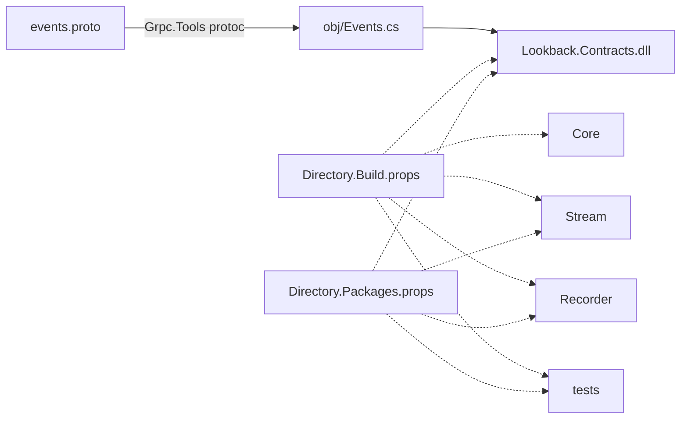
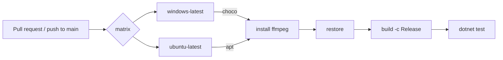
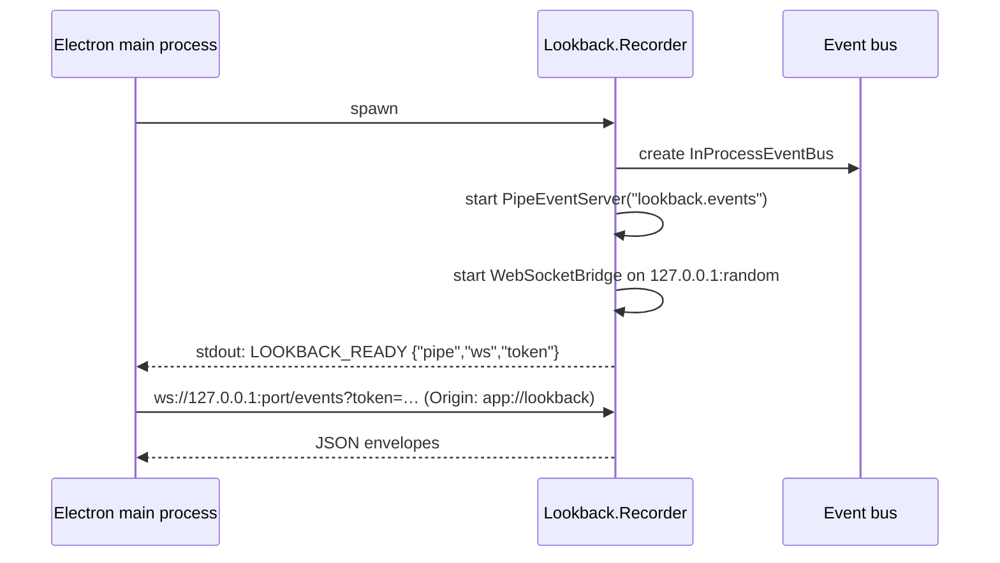
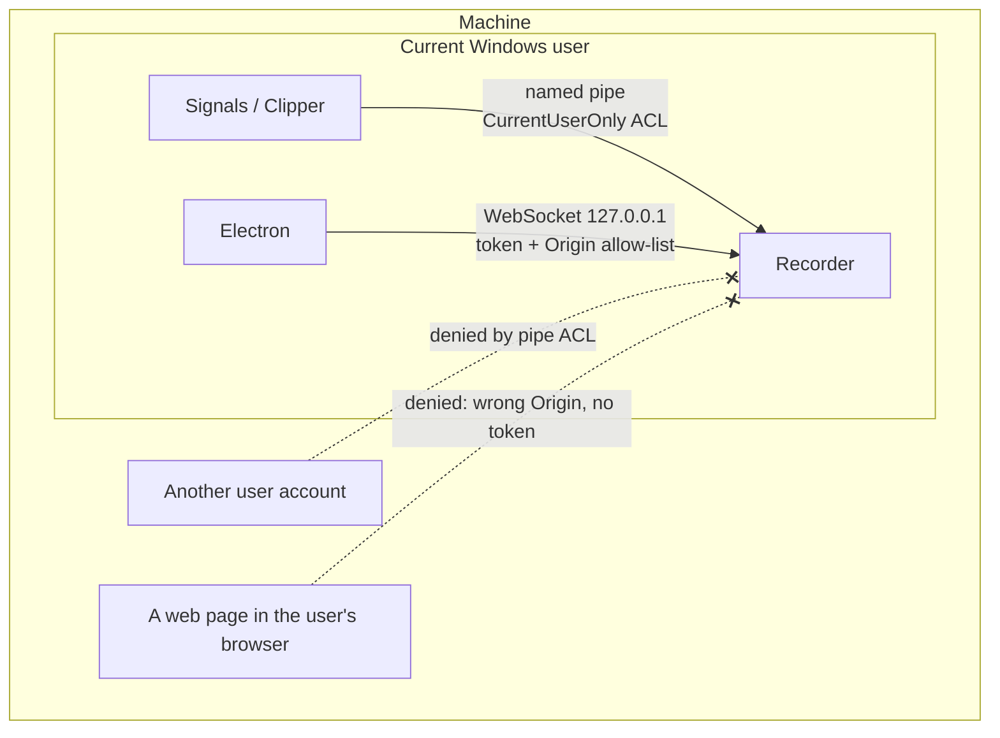

# Infrastructure

## Build system

| File | What it does | Why |
|---|---|---|
| `global.json` | Pins the .NET 10 SDK (rolling forward to newer feature bands) and selects Microsoft.Testing.Platform as the test runner | The .NET 10 SDK no longer runs xUnit v3 through VSTest; MTP runs test projects as executables |
| `Directory.Build.props` | Every project inherits `net10.0`, nullable, latest C#, warnings as errors, `latest-recommended` analyzers, XML docs, unsafe code, deterministic builds and central package management | One place for policy; a new project cannot opt out by accident |
| `Directory.Packages.props` | Every NuGet version | Projects reference packages without versions, so upgrades happen once |
| `.editorconfig` | Style rules and analyzer severities | `CA2007` (ConfigureAwait) is a warning in library code and off in tests, because library code must not capture a sync context |
| `Lookback.slnx` | XML solution file | Readable diffs; supported by the .NET 10 CLI and current Visual Studio |

Protobuf code is generated at build time: `Lookback.Contracts.csproj` includes
`proto/**/*.proto` through `Grpc.Tools` with `GrpcServices="None"`, so only
message classes are generated, with no gRPC service stubs.

## Continuous integration

`.github/workflows/ci.yml` runs on every pull request and every push to `main`.

ffmpeg is installed on both legs because FileSource and the testbench
tests decode generated footage. Windows is the product platform. Linux runs too, because everything in M0 is
platform-neutral (named pipes map to Unix domain sockets there) and the
Linux runners are fast. Capture code (M1 onwards) is Windows-only and its
tests will run only on the Windows leg; D3D11 compute runs on the WARP
software rasteriser there, so GPU code is testable without a GPU.

`.github/workflows/wiki.yml` publishes `docs/wiki/` to the GitHub wiki on
every push to `main` that changes it.

## Runtime launch and handshake

Electron (from M2) launches the recorder and learns where to connect from its
first line of stdout. Logs go to stderr so stdout carries only the handshake.

## Security boundaries

The event stream carries gameplay timing, input statistics and, later, clip
requests, so each entry point is closed to everything except Lookback.

| Entry point | Protection | Threat it stops |
|---|---|---|
| Named pipe | `PipeOptions.CurrentUserOnly` | Another account reading events or injecting fake ones |
| WebSocket | Bound to loopback only | Anything off the machine |
| WebSocket | Random 128-bit token, compared in constant time | Local processes that did not launch the recorder |
| WebSocket | Origin allow-list | Cross-site WebSocket hijacking from a page the user visits |
| Framing | 16 MB frame limit checked before allocating | A corrupt or hostile length prefix exhausting memory |
| Session log | `RetentionRules` before any file is created | Storing data the user has no right to keep |
