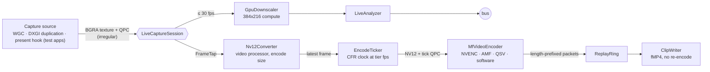
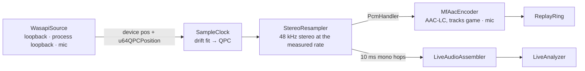

# Live capture (M3)

Live capture turns a running game into two streams: small frames for the
signal pipeline (the analysis tap), and encoded video for the RAM replay ring
and the disk store (the encode path). Both run on one D3D11 device on the
adapter that owns the captured output, and every timestamp is raw QPC.
Game audio and the mic are captured with WASAPI and encoded to AAC into the
same ring ([Live audio](#live-audio)).
Design notes, decisions and the build order live in
[`docs/capture-handoff.md`](https://github.com/Joshmh7128/Lookback/blob/main/docs/capture-handoff.md);
this page explains what runs today.

## The path



| Stage | Type | What it does |
|---|---|---|
| Capture | `WgcCaptureSource`, `DxgiDuplicationSource`, `HookCaptureSource` | Frames as GPU textures with their present/compose QPC. WGC only sends a frame when the window changes. The hook source delivers every present of our own test apps with the QPC of the `Present` call ([Present Hook](Present-Hook)) |
| Analysis tap | `GpuDownscaler` → `LiveAnalyzer` | Letterboxed 384x216 BGRA, read back through a 3-deep staging ring, thinned to 30 fps |
| Convert | `Nv12Converter` | D3D11 video processor: scale to the encode size, BT.709 limited range, letterboxed. Runs on the capture thread for every frame and keeps the latest result |
| Clock | `EncodeTicker` | A high-resolution waitable timer at the tier's fps encodes the latest converted frame at every tick, repeating it when nothing new arrived |
| Encode | `MfVideoEncoder` | Media Foundation encoder MFT chosen by the capture adapter's LUID; async with the DXGI device manager for hardware, sync for the software H.264 fallback. CBR, 2 s GOP, no B-frames, low latency |
| Keep | `ReplayRing`, `SegmentStore`, `ClipWriter` | Packets in native memory, 2 s fMP4 segments on disk, clips cut on a keyframe |

### Why a constant-rate clock

Players and editors expect constant frame rate, and the capture sources do
not provide it: WGC sends nothing while a window is static and bursts when it
changes, and DXGI follows the monitor's refresh. The ticker decouples the two.
Each tick's PTS is its *scheduled* time (`origin + n / fps`, computed from
the origin every tick so it cannot drift), not the time the thread woke up,
so output timing is exact even when the scheduler is late. A tick that is
already a full period late is skipped and counted rather than encoded in a
burst; a busy encoder (its 8-slot input pool full) is counted as `busy`.
The first tick is the first captured frame's QPC, so the recording starts on a
real frame and opens with an IDR.

### Encoder selection

`MFTEnum2` lists hardware encoder MFTs filtered by `MFT_ENUM_ADAPTER_LUID`,
so on a machine with two GPUs (AETHER drives monitors from the RTX card and
the iGPU) the encoder is always on the adapter that owns the captured output
and frames never cross adapters. Hardware MFTs are unlocked for async use and
given the D3D11 device manager; NV12 textures go in as DXGI surface buffers
without leaving the GPU. If no hardware MFT accepts the settings, H.264 falls
back to the Microsoft software MFT, which reads the same surface buffers.
HEVC has no software fallback. AV1 is not offered until the muxer writes `av1C`.

### Machine probe and the governor

Before a session, the [resource governor](Resource-Governor) plans the
recording from a probe of the PC: `WindowsMachineProbe.Run(storePath)` reads
RAM, the store volume's free space and SSD/HDD, every DXGI adapter with the
monitors it drives, and `MfVideoEncoder.List` per adapter LUID. Then
`MachineProfileMapper.Map(probe, target.ToProbeTarget())` picks the adapter
that owns the captured monitor (the same one the pipeline runs on), and
`GovernorPolicy.Decide` returns the tier, ring size and disk budget. It reads
only what a normal user can, never throws, and takes about 80 ms cold, under
5 ms warm. `lookback-capture probe [--store <path>] [--monitor <n> | --window
<title part>]` prints all of it; on AETHER the 4K144 primary gets
`2160p60-hevc` on NVENC and the iGPU's monitor `1440p60-hevc` on AMF. The full
output and the rules for unknowns are on the [Resource Governor](Resource-Governor) page.

### Ephemeral sessions

An official-player session never creates the converter, ticker, encoder,
ring or store: the encode path is only attached when
`RetentionRules.CanPersist` allows it, so nothing exists that could reach
disk. See [Data Retention](Data-Retention).

## Live audio

Game audio and the mic run beside video on their own threads, through the
same clock. `Lookback.Audio` captures; `MfAacEncoder` (in `Lookback.Encode`)
encodes into the same `ReplayRing` as the video.



| Stage | Type | What it does |
|---|---|---|
| Policy | `AudioCapturePolicy` | Decides what a session gets from its `SessionStarted`, the OS build and the game's pid (below) |
| Capture | `WasapiSource` | WASAPI shared mode, event-driven, on an MMCSS ("Pro Audio") thread; raw vtable calls, so nothing is allocated per packet (`CaptureThreadAllocatedBytes` measures it). Endpoint loopback of the default render device, process loopback of the game on Windows build 20348+, or the default mic |
| Clock | `SampleClock` | `u64QPCPosition` (100 ns) is rescaled to raw QPC and fitted against the device position (weighted least squares, ~30 s window); silent packets become zeros, discontinuity flags and timestamp errors reset or bridge the fit |
| Resample | `StereoResampler` | Downmix to stereo (centre and surrounds at -3 dB, LFE dropped), 4-point Hermite to 48 kHz. Once the fit has 5 s it resamples at the *measured* device rate, so the sample count stays on QPC instead of drifting |
| Encode | `MfAacEncoder` | The Microsoft AAC MFT, synchronous: float → PCM16, 128/160/192 kbps, raw access units, AudioSpecificConfig from `MF_MT_USER_DATA`. Packet times come from the sample count, anchored on the first QPC; late input gets silence first, early input is trimmed (20 ms tolerance). 0 B per call |
| Analysis | `LiveAudioAssembler` → `LiveAnalyzer` | 10 ms mono hops at 48 kHz for the audio signals (game audio only; the mic is not analysed) |

### Timing details

- **Loopback stamps are presentation time.** A loopback packet's QPC is when
  the engine plays it, about one device period (10.5 ms on AETHER) after the
  packet can be read. It is kept as is, like a video frame's present time.
- **Silence keeps loopback alive.** With nothing playing, endpoint loopback
  delivers no packets at all. The source plays silence on the same endpoint
  (`KeepLoopbackAlive`), so packets keep coming and the timeline stays
  continuous. Process loopback has no such stream; the assembler and the
  encoder fill its gaps when the next packet comes.
- **No priming offset.** The Microsoft encoder emits no priming frame:
  packet k decodes to samples k·1024 onward, so `EncoderDelay` is 0 and a
  decoded onset lands on its capture QPC (measured within 0.06 ms).
- **Device changes.** An `IMMNotificationClient` default-device change, or
  the device going away, re-opens the stream on the new default (its format
  may differ). The clock refits, and the gap (~30 ms here) is filled with
  silence.

### Which audio a session gets

| Session | Game audio | Mic | Encoded |
|---|---|---|---|
| Live game, owned | Process loopback of the game on 20348+, otherwise endpoint loopback (and the plan says why) | If asked | Yes |
| Live game, ephemeral | As above | No | No (analysis only) |
| Official player | Process loopback of the player on 20348+ only; **never endpoint loopback**, which would pick up everything else the machine plays. On Windows 10 (AETHER) it gets no audio | No | Never: no encoder, ring or store |

### Audio bench: `lookback-capture audio`

```powershell
& $cap audio --list
& $cap audio --seconds 10 --mic --pid 1234 --out audio.mp4
```

It prints the plan, then every second the level, packets, hops, the
measured device rate, clock resets, glitches and capture-thread allocation.
With `--out`, it encodes the game (and mic) tracks into a RAM ring and writes
an audio-only clip at the end. `--out` is refused unless
`RetentionRules.CanPersist` allows it, so `--official-player` creates no
encoder and writes nothing.

Measured on AETHER (Windows 10 19045): endpoint loopback of the Realtek
speakers and the Yeti mic, both 48 kHz float stereo; clock fit 47999.9 Hz
against 48000 (~2 ppm), one reset, no glitches, 0 B allocated per packet;
a 2-track AAC clip that ffprobe reads as `aac,48000,2` twice.

## The bench: `lookback-capture`

```powershell
dotnet build Lookback.slnx -c Release
$cap = "src\Lookback.Capture.Cli\bin\Release\net10.0-windows10.0.22621.0\lookback-capture.exe"
& $cap --list
& $cap --monitor 0 --seconds 20 --profiler
& $cap --monitor 0 --seconds 12 --encode 8 --out clip.mp4 --codec hevc --fps 60 --size 1920x1080 --mbps 20
```

`--encode <s> --out <file>` runs the encode path beside the analysis tap and,
at the end, writes the last `s` seconds from the ring as an MP4 (starting on
the keyframe at or before that point, so it can be up to one GOP longer).
`--software` forces the software encoder. With `--official-player` the
request is refused before capture starts.

Measured on AETHER (Windows 10 19045, RTX 4080 SUPER, 2560x1440 at 144 Hz),
monitor 0 with WGC, HEVC 1920x1080 at 60 fps, 20 Mbps:

```
capturing monitor \\.\DISPLAY1 with wgc on NVIDIA GeForce RTX 4080 SUPER; persist: True
encoding Hevc 1920x1080@60 20 Mbps with NVIDIA HEVC Encoder MFT (hardware)
  5.5s  capture  143.9 fps  analysis  29.8 fps  dropped 0  encode  60.5 fps  repeated   0  skipped 0  busy 0
...
ticker EncodeStats { Captured = 1742, Ticks = 726, Encoded = 726, Repeated = 0, Skipped = 0, EncoderBusy = 0, PacketsOut = 726 }
```

ffprobe on the 8 s clip: `hevc 1920x1080`, 486 frames, average frame rate
60.000, keyframes at exactly 0, 2, 4, 6 and 8 s, `has_b_frames=0`, and
`ffmpeg -v error -f null` decodes it with no errors.

On the iGPU (monitor 2, `AMD Radeon(TM) Graphics`), AMF H.264 and AMF HEVC
at 1080p60 also run live and decode cleanly.

When ticks and captures both stop, the bench prints `STALLED:` with each
thread's phase (`EncodeTicker.Phase`), and the watchdog acts as described
below. Bench flags: `--stall-ms` (watchdog threshold), `--isolate` (encoder on
its own device), `--no-blocklist`.

## Tests

`tests/Lookback.Capture.Tests` (Windows only; skips elsewhere):

| Test | Proves |
|---|---|
| `EncoderTests.Software_h264_on_warp_round_trips_through_the_muxer` | The software H.264 MFT on WARP (CI) takes NV12 DXGI surface buffers; 120 frames through `ReplayRing` + `ClipWriter` come back from ffprobe as 120 frames, keyframes at 0 and 2 s, no B-frames, no decode errors |
| `EncoderTests.Software_h264_on_the_gpu_reads_converter_output` | The same with `Nv12Converter` output on a real adapter |
| `EncoderTests.Hardware_encoder_round_trips_through_the_muxer` (H.264, HEVC) | On every display adapter, the hardware MFT for its LUID (NVENC on the RTX, AMF on the iGPU on AETHER): every frame in comes out, `Dispose` drains in under 3 s, and the clip checks out as above |
| `EncodeTickerTests.Irregular_capture_becomes_constant_rate_packets` | Frames at 10 fps, then a burst, then nothing, still give one packet per tick with constant spacing, repeats counted, nothing skipped or busy |
| `DownscalerTests.*` | The analysis downscale on WARP: BGRA order, 16:9 fill, 4:3 pillarbox like FileSource |

WARP has no video processor, so the CI encoder case uploads NV12 built on
the CPU; the converter is covered on real adapters.

`tests/Lookback.Audio.Tests` covers the audio path: the AAC round trip through
`ReplayRing` + `ClipWriter` (ffprobe `aac,48000,2`, duration, clean decode,
pitch and level), onset alignment, gap fill and trim, zero allocation;
endpoint loopback hearing a tone rendered through WASAPI, the clock fit,
device-change re-open, the mic, and the process-loopback fallback; plus
resampler and policy unit tests. The device tests skip without an audio
endpoint (CI); the AAC tests run on the Windows runner. Full list in
[Testing](Testing).

## No deadlocks: one device lock, a watchdog, fail-fast

### The deadlock that was

Live capture used to stall within seconds, intermittently, on NVIDIA and
AMD alike (AMF HEVC hit it most). Native stacks from a hung process (cdb on
AETHER) showed a lock-order inversion:

```
WGC capture thread:  dcomp!CFlipConsumer::ProcessUpdateContent   holds  D3D11 device lock
                     → our frame callback                         waits  GpuDevice.Lock (managed)
encode ticker:       holds GpuDevice.Lock
                     → ID3D11DeviceContext::CopyResource          waits  D3D11 device lock
```

WGC raises `FrameArrived` from inside DirectComposition's flip processing,
which already holds the device's multithread lock. Our own managed lock was
taken second on that thread and first on the encode thread. Whether the two
threads met was down to timing, which is why it came and went, and why a busy
machine or a slower encoder made it likelier. Moving the encoder to its own
device did not help at the time, because the handoff still took the capture
device's lock the same way.

**Fix:** `GpuDevice` has exactly one lock, D3D11's own recursive multithread
lock (`ID3D11Multithread::Enter`, exposed as `using (gpu.Enter())`). There is
no second lock to order, and the capture callback simply re-enters the lock
DirectComposition already holds. After the fix, on AETHER, 1080p60 for 12 s:
NVENC HEVC 3/3, AMF HEVC 3/3, AMF H.264 1/1, and the opt-in separate-device
mode on both GPUs: 0 stalls, 0 encoder swaps, every clip decodes.

### The harness that keeps it from coming back

Every thread on the path reports a heartbeat (`Beat`: which step, since when)
to a `StallWatchdog` (`Lookback.Core.Diagnostics`), which never blocks or
interrupts the stuck thread:

| Watch | Stalled when | Action |
|---|---|---|
| Encode ticker step | one `Encode` call runs longer than `StallAfter` (2 s) | swap encoders |
| Encoder output | ticks are due but no packet comes out for `StallAfter` | swap encoders |
| Capture thread | the frame callback runs longer than 2 × `StallAfter` | fail fast |

A swap abandons the stuck encoder (released on a reaper thread only once no
call is inside it, otherwise leaked) and starts the next one in the fallback
chain on a fresh thread, on the same tick grid: hardware MFTs for the codec →
hardware H.264 → software H.264. Creating the replacement is itself bounded
(a driver can hang there too). The stalled encoder goes into
`%LOCALAPPDATA%\Lookback\encoder-blocklist.json`, keyed by adapter vendor,
device and driver version, so the next run starts further down the chain and
a driver update gets a fresh chance. When the chain is exhausted, after
`MaxRecoveries` swaps, or when the capture thread is wedged, `Fatal` writes the
reason and every thread's phase to stderr and ends the process
(`Environment.FailFast`): the recorder closes instead of hanging, and the shell
restarts it. `Dispose` never waits more than a few seconds on an encoder.

`EncodeTickerFaultTests` inject encoders that hang inside a call, accept
frames but never output, or refuse all input, and check the swap, the tick
grid, the blocklist, the fatal path and a prompt `Dispose`.

## The present hook

`CaptureBackend.Hook` with `LiveSessionOptions.HookTarget` (a test app that
`HookInjector` launched) runs the same session over `HookCaptureSource`, so
the analysis tap and the encode path are unchanged. Create the session's
target with `HookedProcess.ToCaptureTarget(config)` so the device is on the
hook's adapter. `lookback-capture --hook-testapp d3d11|d3d12` is the manual
check; on AETHER both test apps arrive at their full rate (120 and 144 fps)
with no hook drops, and NVENC encodes them at 60 fps with nothing busy. The
design, sync model and allowlist are on [Present Hook](Present-Hook).

## Known issues

- **Creating a DXGI factory stalls NVENC briefly.** Enumerating adapters or
  outputs while encoding (`CaptureTarget.Outputs`, `ForWindow`, `FindWindow`,
  the governor probe) made the constant-rate tests miss ticks in 3 of 9 runs
  on AETHER. Enumerate only when (re)targeting and before the encoder starts;
  game detection reads adapter LUIDs from `QueryDisplayConfig`. The GPU
  encoder test classes run serially for the same reason.

- **AMF HEVC ignores the bitrate.** It produced about 3x the CBR target in
  `EncoderTests` (4 Mbps asked, ~12 Mbps out); AMF H.264 and NVENC hold it.
- **GOPs count frames, not time.** A tick the encoder had no room for
  (`busy`) shifts every later IDR by one frame (seen once on AMF H.264 at
  60 fps: keyframes at 2.017 s). Segments and clips cut on whatever keyframes
  exist, so this costs clip-start precision only; forcing IDRs from the ticker
  at GOP-aligned ticks would pin them to 2 s.

## Not yet

- Process loopback is written but has never run: AETHER is build 19045 and
  CI runners have no audio device.
- Wiring into the recorder, with control commands on `/events`. See the
  handoff's next steps.
- HDR sources reach the encoder as if SDR (the analysis tap handles them
  correctly); the encode tone-map comes with M6.
- Governor tier changes (a new encoder and a new segment run) are designed
  but not wired.
- Output samples come back from Media Foundation as SharpGen wrapper objects:
  a small managed allocation per packet on the encoder's event thread. Not
  measured yet.
