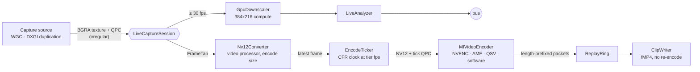

# Live capture (M3)

Live capture turns a running game into two streams: small frames for the
signal pipeline (the analysis tap), and encoded video for the RAM replay ring
and the disk store (the encode path). Both run on one D3D11 device on the
adapter that owns the captured output, and every timestamp is raw QPC.
Design notes, decisions and the build order live in
[`docs/capture-handoff.md`](https://github.com/Joshmh7128/Lookback/blob/main/docs/capture-handoff.md);
this page explains what runs today.

## The path



| Stage | Type | What it does |
|---|---|---|
| Capture | `WgcCaptureSource`, `DxgiDuplicationSource` | Frames as GPU textures with their present/compose QPC. WGC only sends a frame when the window changes |
| Analysis tap | `GpuDownscaler` → `LiveAnalyzer` | Letterboxed 384x216 BGRA, read back through a 3-deep staging ring, thinned to 30 fps |
| Convert | `Nv12Converter` | D3D11 video processor: scale to the encode size, BT.709 limited range, letterboxed. Runs on the capture thread for every frame and keeps the latest result |
| Clock | `EncodeTicker` | A high-resolution waitable timer at the tier's fps encodes the latest converted frame at every tick, repeating it when nothing new arrived |
| Encode | `MfVideoEncoder` | Media Foundation encoder MFT chosen by the capture adapter's LUID; async with the DXGI device manager for hardware, sync for the software H.264 fallback. CBR, 2 s GOP, no B-frames, low latency |
| Keep | `ReplayRing`, `SegmentStore`, `ClipWriter` | Packets in native memory, 2 s fMP4 segments on disk, clips cut on a keyframe |

### Why a constant-rate clock

Players and editors expect constant frame rate, and the capture sources do
not provide it: WGC sends nothing while a window is static and bursts when it
changes, and DXGI follows the monitor's refresh. The ticker decouples the two.
Each tick's PTS is its *scheduled* time (`origin + n / fps`, computed from
the origin every tick so it cannot drift), not the time the thread woke up,
so output timing is exact even when the scheduler is late. A tick that is
already a full period late is skipped and counted rather than encoded in a
burst; a busy encoder (its 8-slot input pool full) is counted as `busy`.
The first tick is the first captured frame's QPC, so the recording starts on a
real frame and opens with an IDR.

### Encoder selection

`MFTEnum2` lists hardware encoder MFTs filtered by `MFT_ENUM_ADAPTER_LUID`,
so on a machine with two GPUs (AETHER drives monitors from the RTX card and
the iGPU) the encoder is always on the adapter that owns the captured output
and frames never cross adapters. Hardware MFTs are unlocked for async use and
given the D3D11 device manager; NV12 textures go in as DXGI surface buffers
without leaving the GPU. If no hardware MFT accepts the settings, H.264 falls
back to the Microsoft software MFT, which reads the same surface buffers.
HEVC has no software fallback. AV1 is not offered until the muxer writes `av1C`.

### Machine probe and the governor

Before a session, the [resource governor](Resource-Governor) plans the
recording from a probe of the PC: `WindowsMachineProbe.Run(storePath)` reads
RAM, the store volume's free space and SSD/HDD, every DXGI adapter with the
monitors it drives, and `MfVideoEncoder.List` per adapter LUID. Then
`MachineProfileMapper.Map(probe, target.ToProbeTarget())` picks the adapter
that owns the captured monitor (the same one the pipeline runs on), and
`GovernorPolicy.Decide` returns the tier, ring size and disk budget. It reads
only what a normal user can, never throws, and takes about 80 ms cold, under
5 ms warm. `lookback-capture probe [--store <path>] [--monitor <n> | --window
<title part>]` prints all of it; on AETHER the 4K144 primary gets
`2160p60-hevc` on NVENC and the iGPU's monitor `1440p60-hevc` on AMF. The full
output and the rules for unknowns are on the [Resource Governor](Resource-Governor) page.

### Ephemeral sessions

An official-player session never creates the converter, ticker, encoder,
ring or store: the encode path is only attached when
`RetentionRules.CanPersist` allows it, so nothing exists that could reach
disk. See [Data Retention](Data-Retention).

## The bench: `lookback-capture`

```powershell
dotnet build Lookback.slnx -c Release
$cap = "src\Lookback.Capture.Cli\bin\Release\net10.0-windows10.0.22621.0\lookback-capture.exe"
& $cap --list
& $cap --monitor 0 --seconds 20 --profiler
& $cap --monitor 0 --seconds 12 --encode 8 --out clip.mp4 --codec hevc --fps 60 --size 1920x1080 --mbps 20
```

`--encode <s> --out <file>` runs the encode path beside the analysis tap and,
at the end, writes the last `s` seconds from the ring as an MP4 (starting on
the keyframe at or before that point, so it can be up to one GOP longer).
`--software` forces the software encoder. With `--official-player` the
request is refused before capture starts.

Measured on AETHER (Windows 10 19045, RTX 4080 SUPER, 2560x1440 at 144 Hz),
monitor 0 with WGC, HEVC 1920x1080 at 60 fps, 20 Mbps:

```
capturing monitor \\.\DISPLAY1 with wgc on NVIDIA GeForce RTX 4080 SUPER; persist: True
encoding Hevc 1920x1080@60 20 Mbps with NVIDIA HEVC Encoder MFT (hardware)
  5.5s  capture  143.9 fps  analysis  29.8 fps  dropped 0  encode  60.5 fps  repeated   0  skipped 0  busy 0
...
ticker EncodeStats { Captured = 1742, Ticks = 726, Encoded = 726, Repeated = 0, Skipped = 0, EncoderBusy = 0, PacketsOut = 726 }
```

ffprobe on the 8 s clip: `hevc 1920x1080`, 486 frames, average frame rate
60.000, keyframes at exactly 0, 2, 4, 6 and 8 s, `has_b_frames=0`, and
`ffmpeg -v error -f null` decodes it with no errors.

On the iGPU (monitor 2, `AMD Radeon(TM) Graphics`), AMF H.264 at 1080p60
also runs live and decodes cleanly. AMF HEVC is not reliable yet; see below.

When ticks and captures both stop, the bench prints `STALLED:` with each
thread's phase (`EncodeTicker.Phase`: capture-thread conversion, encoder
input, encoder events), which is how the AMF HEVC stall was located.

## Tests

`tests/Lookback.Capture.Tests` (Windows only; skips elsewhere):

| Test | Proves |
|---|---|
| `EncoderTests.Software_h264_on_warp_round_trips_through_the_muxer` | The software H.264 MFT on WARP (CI) takes NV12 DXGI surface buffers; 120 frames through `ReplayRing` + `ClipWriter` come back from ffprobe as 120 frames, keyframes at 0 and 2 s, no B-frames, no decode errors |
| `EncoderTests.Software_h264_on_the_gpu_reads_converter_output` | The same with `Nv12Converter` output on a real adapter |
| `EncoderTests.Hardware_encoder_round_trips_through_the_muxer` (H.264, HEVC) | On every display adapter, the hardware MFT for its LUID (NVENC on the RTX, AMF on the iGPU on AETHER): every frame in comes out, `Dispose` drains in under 3 s, and the clip checks out as above |
| `EncodeTickerTests.Irregular_capture_becomes_constant_rate_packets` | Frames at 10 fps, then a burst, then nothing, still give one packet per tick with constant spacing, repeats counted, nothing skipped or busy |
| `DownscalerTests.*` | The analysis downscale on WARP: BGRA order, 16:9 fill, 4:3 pillarbox like FileSource |

WARP has no video processor, so the CI encoder case uploads NV12 built on
the CPU; the converter is covered on real adapters.

## Known issues

- **AMF HEVC can deadlock with live WGC capture.** On AETHER's iGPU at
  1080p60, two of three runs stalled within ~2 s: the ticker sat in
  `CopyResource` holding `GpuDevice.Lock` (so waiting on D3D11's own device
  lock), and the capture thread waited behind it. The AMF MFT's thread holds
  the immediate context's lock and does not let go, most likely waiting on GPU
  work that in turn waits on a WGC frame the blocked capture thread still
  holds. The same encoder passes alone (`EncoderTests`), and NVENC and AMF
  H.264 do not show it. Fix planned: give the encoder its own D3D11 device on
  the same adapter and hand frames over through a shared, keyed-mutex NV12
  texture, so the MFT never shares a context lock with capture; plus a
  watchdog that recreates a stalled encoder.
- **AMF HEVC ignores the bitrate.** It produced about 3x the CBR target in
  `EncoderTests` (4 Mbps asked, ~12 Mbps out); AMF H.264 and NVENC hold it.
- **GOPs count frames, not time.** A tick the encoder had no room for
  (`busy`) shifts every later IDR by one frame (seen once on AMF H.264 at
  60 fps: keyframes at 2.017 s). Segments and clips cut on whatever keyframes
  exist, so this costs clip-start precision only; forcing IDRs from the ticker
  at GOP-aligned ticks would pin them to 2 s.

## Not yet

- WASAPI loopback, mic and the AAC encoder;
  wiring into the recorder with control commands on `/events`. See the
  handoff's next steps.
- HDR sources reach the encoder as if SDR (the analysis tap handles them
  correctly); the encode tone-map comes with M6.
- Governor tier changes (a new encoder and a new segment run) are designed
  but not wired.
- Output samples come back from Media Foundation as SharpGen wrapper objects:
  a small managed allocation per packet on the encoder's event thread. Not
  measured yet.
