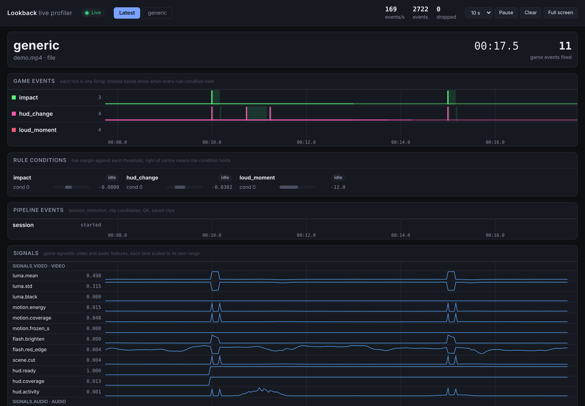
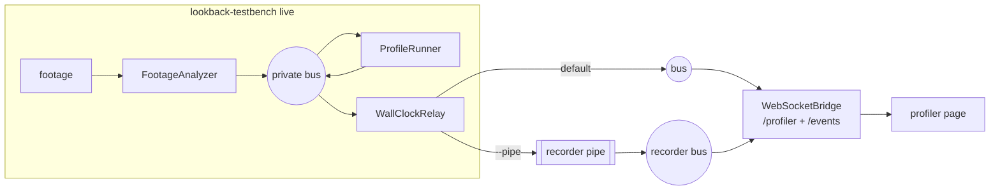

# Live profiler

`src/Lookback.Profiler`: a page that shows every event on the stream as it
fires, for live demos and for debugging a game profile. Open it next to the
game (or a clip playing in real time) and the audience sees each game event
land the moment it happens, the rule conditions that caused it, and proof
that nothing was dropped on the way.



## Run it

Play a clip in real time, with a game profile's rules running on it:

```
lookback-testbench live my-clip.mp4 --profile overwatch
```

```
profiler http://127.0.0.1:51234/profiler#token=8BC3…
waiting  for the profiler to connect (open the link above)
playing  my-clip.mp4 at 1x with profile 'overwatch'
finished the clip; the profiler stays up until Ctrl+C
```

Open the link. The clip starts when the page connects, so the first events
are not missed. Useful flags: `--loop` (replay as a new session each time,
for a demo that runs unattended), `--speed 2`, `--port 5050` (a fixed link
to bookmark; the token still changes per run), `--no-wait`, `--game <id>`.

Against the real recorder (and, from M3, live capture):

```
dotnet run --project src/Lookback.Recorder -- --Recorder:Profiler=true
```

The recorder prints `LOOKBACK_PROFILER <url>` on stdout after its
`LOOKBACK_READY` line. Anything that publishes into its pipe shows up,
including `lookback-testbench live my-clip.mp4 --profile overwatch --pipe lookback.events`.

## What is on the page

| Panel | Shows | Built from |
|---|---|---|
| Header | Game, session title, session clock, game events fired | `SessionStarted`; `game_profile` from the session, `GameLifecycle` or the events |
| Game events | One lane per event: a tick per firing (with a pulse as it lands), a thin strip for the suggested clip window, and green bands while every rule condition held | `GameEvent` on `game.event`; lanes are created from the rules schema, so an event's lane is on screen before it first fires |
| Rule conditions | Each condition's margin against its threshold, live; "armed" when all hold | `signals.rules` frames (`rule.<event>.<n>`); `-1e9` shows as "no signal" |
| Pipeline events | Session start and end, detection, clip candidates (with their window), QA pass or fail, saved clips | the remaining payloads |
| Signals | A sparkline per video and audio signal and a mel spectrogram, each scaled to its visible range | `SignalSchema` + `SignalFrame` |
| Event log | Every discrete event, newest first; click a row for its full JSON | all but signal frames |
| Stream health | Per producer: events, rate, dropped, last seen | `source_id` and `seq` |

The game chips at the top switch between games seen on the stream; "Latest"
follows the newest session.

Keys: <kbd>Space</kbd> pause the view (events keep being counted),
<kbd>1</kbd>/<kbd>2</kbd>/<kbd>3</kbd> show 5, 10 or 30 seconds,
<kbd>C</kbd> clear, <kbd>F</kbd> full screen.

### Proving events fire properly

- **Dropped** counts gaps in each producer's `seq`. It stays at 0 when every
  event reached the page; anything else turns red in the header and the
  health table. The relay behind `live` paces the analyser so it never drops.
- **Timing** uses each session's own clock: positions come from the event's
  QPC divided by `SessionStarted.qpc_frequency`, not from when the browser
  received it. A game event is drawn at its `at_qpc`, so a tick lines up with
  the signal spike that caused it.
- **Rule bands** show why an event fired, or why it did not: a tick should sit
  in or right after a green band.

## How it connects



- **Same origin.** `WebSocketBridge` serves the page itself when
  `WebSocketBridgeOptions.Pages` is set, and then also allows its own origin
  (`http://127.0.0.1:port` and `http://localhost:port`). Every other origin is
  still refused, and the shipping recorder serves no pages unless asked.
- **Token in the fragment.** The link carries the token after `#`, which
  browsers never send to the server, so it is not in a request line, a log or
  a referrer. The page moves it into session storage and removes it from the
  address bar, so it is not on screen during a demo. Without one, the page
  asks for it.
- **Locked-down page.** `Content-Security-Policy` allows inline script and
  style, `connect-src 'self'` and nothing else: no external scripts, no other
  hosts, no framing. Plus `nosniff`, `no-referrer` and `no-store`.
- **Late joiners.** The bridge keeps each live session's `SessionStarted`,
  latest `GameLifecycle` and every producer's latest `SignalSchema`, and
  sends them to a new client before live events, so a page opened mid-session
  still knows the timing, the game and the signal names. Sessions are
  forgotten on `SessionEnded`, and at most 32 are kept.

## `WallClockRelay`

The analyser decodes several times faster than real time, and its video and
audio threads publish slightly out of order. The relay subscribes to the
private bus, holds envelopes in a priority queue ordered by QPC (ties keep
arrival order, so `SessionStarted` goes first) and releases each when the
wall clock (`SystemClock`, the same QPC source as everything else) reaches
it. Its pending count drives a `ReplayPacer`, so the analyser stays at most a
few thousand events ahead and nothing is ever dropped. Footage time is
anchored at the first envelope, not at start-up, so decoder start-up does not
cause a burst. Game events from the profile ride through the same queue, so
they appear in step with the clip.

Nothing in `live` writes to disk; retention is still validated, so
`--retention permissioned` without `--permission-ref` is refused before
anything starts.
