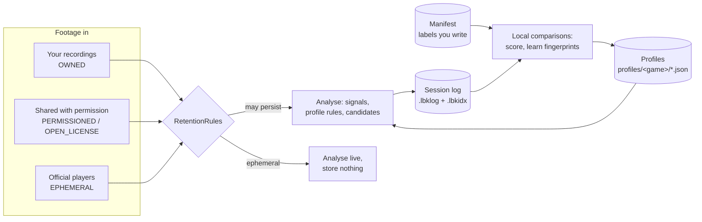
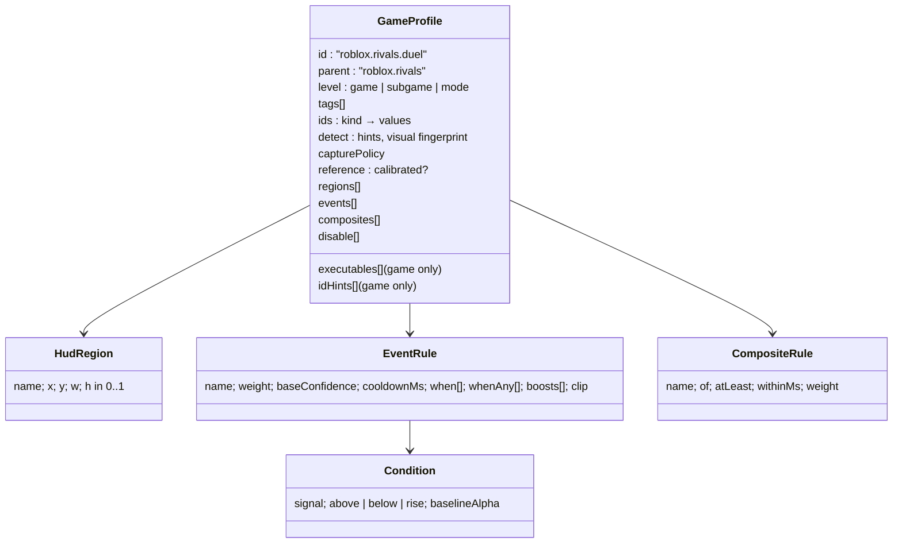
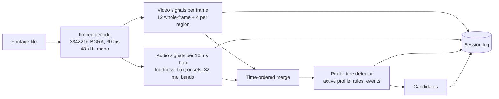
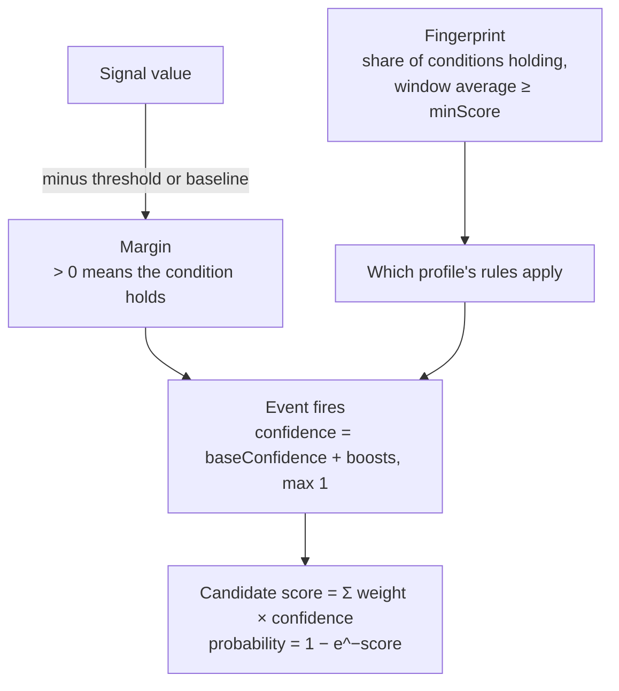
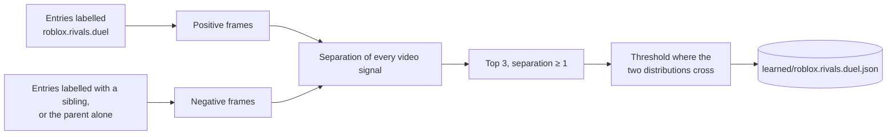

# Profiles and local datasets

How a game profile is structured, and how the dataset Lookback keeps on your
machine is built, weighted and stored, and then used for local comparisons.
Everything here runs locally. Nothing is uploaded, and no model is trained
in the cloud.

Each section says whether its part is **built** (in the code today) or
**planned** (with its milestone).

## The whole loop



## 1. Profile structure (built)

A profile is one JSON file. It holds data only and never adds a new kind of
measurement. Full reference: [Game Profiles](Game-Profiles).



| Part | What it is for |
|---|---|
| `level`, `parent` | Where the profile sits in the tree: game, then sub-game (such as a Roblox experience), then mode (such as a lobby, a match, day or night). A child inherits everything and adds to it. |
| `ids`, `tags` | Platform ids (`roblox.universe`, `roblox.place`) and categories (`shooter`, `roleplay`). The universe id is the stable key for an experience; place ids cover its lobby and worlds. `lookback-testbench profiles --id roblox.universe=<id>` or `--tag shooter` looks profiles up. |
| `executables`, `idHints` | How the game is found (its executable), and how an id is read from outside the process (the Roblox client's own log) to pick the experience. |
| `detect.visual` | The fingerprint: a few signal thresholds that hold while this sub-game or mode is on screen. These are learned from your footage (section 4). |
| `regions` | Rectangles of the HUD. Each one adds four signals per frame: luma, activity, saturation and red. |
| `events`, `composites` | Rules that turn signals into named moments, and patterns of moments (such as two eliminations in four seconds). |
| `capturePolicy` | What capture may do. It can only get stricter down the tree. Every anti-cheat title is external capture only. |

## 2. How a dataset is built (built)

A dataset is **footage you are allowed to keep**, plus **labels you write**.
Both stay on your machine.

### The manifest

`datasets/<game>/manifest.json` is the only part committed to the
repository. Media files are git-ignored.

```jsonc
{
  "game": "roblox",
  "entries": [
    {
      "file": "media/rivals-01.mp4",          // relative to the manifest
      "source": "own recording, 1920x1080",   // provenance, for the record
      "retention": "owned",                    // or permissioned / open-license + permissionRef
      "profile": "roblox.rivals.duel",         // what this footage shows
      "labels": [ { "event": "elimination", "at": 12.4 } ],   // moments, seconds
      "clips":  [ { "start": 6, "end": 17 } ]                  // what you would clip
    }
  ]
}
```

Each entry carries three kinds of label. Each one trains or scores a
different part:

| Label | Used for |
|---|---|
| `profile` | Scoring detection, and learning fingerprints |
| `labels` (moments) | Scoring event rules (precision and recall) |
| `clips` | Scoring clip candidates |

### Analysis of each entry



The analysis is deterministic. The same file gives the same signals, events
and candidates at any replay speed, because everything is keyed to the
footage's own timestamps.

## 3. How things are weighted (built)

Weights appear at four levels. Each is a plain number in a profile, or
comes from a plain formula, so anyone can check it by hand.



| Level | Weight | Where it comes from |
|---|---|---|
| Condition | **Margin** = value − threshold, or value − baseline − rise. The baseline is an exponential moving average of the signal's own past (`baselineAlpha`, default 0.05 per frame). | Profile |
| Event | **Confidence** = `baseConfidence`, plus each boost's `add` when its signal crosses its level within `withinMs` either side of the trigger, capped at 1. **Weight** says how much the moment matters (a triple kill is 4, kill-feed noise 0.3). | Profile |
| Candidate | **Score** = Σ weight × confidence of the events merged into it. **Peak** = the biggest contributor. **Highlight probability** = 1 − e^(−score), a bounded placeholder until ratings calibrate it. | Formula |
| Fingerprint | **Separation** of a signal between a profile and its siblings = \|mean A − mean B\| / (sd A + sd B). Conditions are kept when separation ≥ 1 and at least half the best. **minScore** = midway between how often they hold on the profile's frames and on the others'. | Learned from your dataset |

## 4. Local comparisons (built)

All comparisons read your footage and labels on this machine and write
their results next to them.

### Scoring a profile: `lookback-testbench dataset`

| What | How it is compared | Output |
|---|---|---|
| Events | A detection matches a label of the same name within ±tolerance (default 1 s). Each label and each detection is used once, closest pairs first. | TP, FP, FN, precision, recall per event |
| Detection | Seconds during which the active profile was the entry's `profile`, divided by the footage length | Accuracy per entry and overall |
| Candidates | A candidate matches a labelled clip when intersection over union of their time ranges is ≥ 0.3, one-to-one, best overlap first | Precision, recall, mean overlap |

Scores are counted per entry and summed, so a label in one file never
matches a detection in another. The run writes `scores.json` and a timeline
report per entry.

### Learning fingerprints: `lookback-testbench fingerprint`



Every entry is analysed from the game down, so every region in the game's
tree is measured. The learner compares the frames per signal, writes
complete profile files to `<out>/learned/`, and prints how often each
condition holds on each side. Load them with `--profiles <out>/learned`, run
`dataset` to confirm detection accuracy, then copy the `detect.visual` block
into the profile.

Include footage of experiences that have no profile yet, labelled with just
the game (`"profile": "roblox"`). That footage teaches each fingerprint
what it must not match.

## 5. What is stored on the machine, and where

| What | Where | Format | Size | Kept until |
|---|---|---|---|---|
| Profiles | `profiles/<game>/*.json` (built in), plus any folder passed with `--profiles` | JSON with comments | KB | You delete them |
| Manifests | `datasets/<game>/manifest.json` | JSON with comments | KB | You delete them |
| Footage | Wherever the manifest points (usually `datasets/<game>/media/`) | Your video files | GB | You delete them; never committed |
| Session log per analysed file | `--out` folder: `<session>.lbklog` | Length-prefixed protobuf envelopes: session header, signal schemas, one frame per video frame and audio hop, events, profile changes, candidates, end marker | About 3 MB per minute (measured: 300 KB for 6 s of footage with the Overwatch profile) | You delete them |
| Session index | `<session>.lbkidx` | 16-byte entries: watermark QPC and file offset, for seeking | Small | With its log |
| Timeline report | `<session>.html` | Self-contained page; it links to the footage rather than copying it | Under 1 MB plus the mel image | With its log |
| Scores | `<out>/scores.json` | JSON | KB | Overwritten on each run |
| Learned fingerprints | `<out>/learned/*.json` | Profile JSON | KB | Overwritten on each run |
| Ratings | `datasets/<game>/ratings.jsonl` (git-ignored) | JSON lines, append-only: one line per rating, the last line per candidate wins, 0 stars clears. See [Clip Scoring](Clip-Scoring) | About 1 KB per rating | You delete them |
| Learned scorer | `--out` of `python -m lookback_ml.train` (default `ml/out/model/`, git-ignored): `model.onnx`, `model.json`, `report.json`, `report.md` | ONNX plus JSON | KB | Overwritten on each training run |

Nothing is written for an **ephemeral** session. An official YouTube or
Twitch player can only be ephemeral, and `RetentionRules` refuses anything
else before any file is created (see [Data Retention](Data-Retention)).
Third-party footage must carry a `permissionRef` that says where the
permission or licence is recorded.

## 6. Planned

| Part | Milestone | What it adds |
|---|---|---|
| Feature log for live sessions | M3 | The same session log, written while you play, kept after the video ring is overwritten. The target is about 80 MB per hour, down from about 180 MB per hour today, by storing the mel bands at a lower rate, so past sessions can be rescored when a profile improves |
| Clip store and resource governor | M3 | Saved clips on disk, with quality and storage budgets sized from your PC's specs. Old cached data is cleared automatically |
| Rating UI | M2 | You rate clips in the Electron shell (1 to 5 stars on content). The storage, the bus sink and the terminal fallback (`lookback-testbench rate`) are built; see [Clip Scoring](Clip-Scoring) |
| Learned scorer | M4 | Training, ONNX export, per-game calibration and C# inference are built and tested on synthetic ratings ([Clip Scoring](Clip-Scoring)). Still to come: the clipper filling the full feature vector, and training on real ratings |
| Candidate export | M4 | `dataset` writes `candidates.jsonl` with features and labels from manifest `clips` (IoU ≥ 0.3), a second source of training labels |
| Similarity search | M4 | Embeddings of candidates, so you can find clips like this one in your own library |

## Source files

| File | What it does |
|---|---|
| `src/Lookback.Testbench/Datasets/DatasetManifest.cs` | Manifest format and loader |
| `src/Lookback.Testbench/Datasets/EventScoring.cs` | Event matching, precision and recall |
| `src/Lookback.Testbench/Datasets/CandidateScoring.cs` | Clip overlap matching |
| `src/Lookback.Testbench/Datasets/DatasetRunner.cs` | Runs a dataset and scores events, detection and candidates |
| `src/Lookback.Testbench/Datasets/FingerprintLearner.cs` | Learns `detect.visual` |
| `src/Lookback.Testbench/Catalog/RobloxIdResolver.cs` | Looks up and verifies Roblox universe and place ids (a curation tool; not used during detection) |
| `src/Lookback.Stream/SessionLog/*` | The session log and its index |
| `src/Lookback.Contracts/RetentionRules.cs` | What may be stored |
| `src/Lookback.Scoring/Ratings/RatingStore.cs` | Ratings on disk, gated by retention |
| `src/Lookback.Testbench/Datasets/RateRunner.cs` | `rate`: star ratings in the terminal |
| `ml/` | Training, calibration, evaluation and export of the learned scorer |
