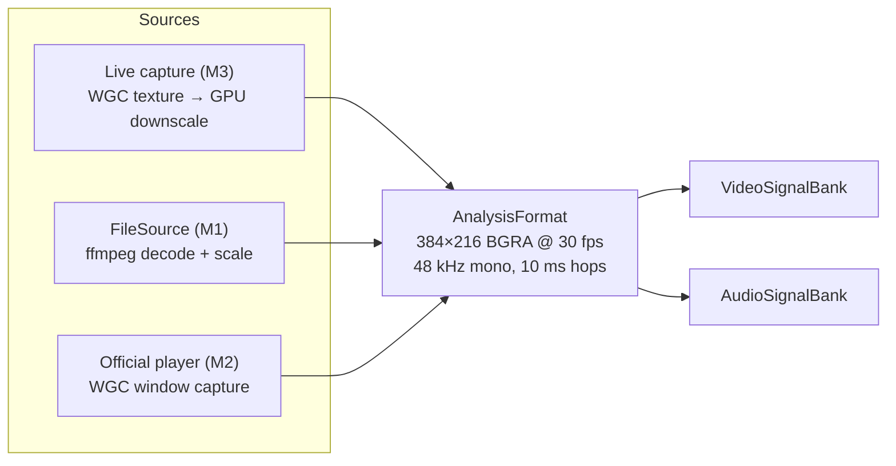
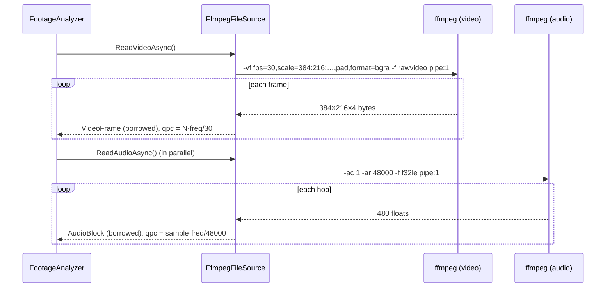

# Media library

`src/Lookback.Media`: the analysis input types and the footage decoder.

## The analysis format

Every source, whether a live 4K game or a 720p stream recording, is converted
to one fixed **analysis format** before any signal sees it
(`Frames/AnalysisFormat.cs`):

| Property | Default | Why |
|---|---|---|
| Width × height | 384 × 216 | Big enough for HUD text and kill-feed changes, small enough that a frame is 330 KB and every signal runs in well under a millisecond |
| Frame rate | 30 fps | Constant, so frame N is always at N/30 s |
| Sample rate | 48 kHz mono | Game audio's native rate; mono is enough for events |
| Hop | 480 samples (10 ms) | Standard frame rate for onset and mel features |

Because signals only ever see this format, their thresholds mean the same
thing on every source.

The frame size can be changed for experiments (`AnalysisFormat.Parse("768x432")`,
`--analysis` in the testbench, `Recorder:AnalysisSize` in the recorder). Every
signal is normalised, so a picture with no finer detail reads the same at any
size; what a larger size adds is fine detail and its noise, at a cost that grows
with the pixel count. [Analysis Resolution](Analysis-Resolution) has the
measurements and why the default stays 384x216.

## `Frames/VideoFrame.cs` and `Frames/AudioBlock.cs`

A `VideoFrame` is tightly packed BGRA8 (the layout D3D11 and
Windows.Graphics.Capture produce) with an `Index` and a QPC timestamp. An
`AudioBlock` is up to one hop of float PCM in [-1, 1] with the index of its
first sample and its QPC time.

Both are **borrowed**: a source fills the same buffer for every frame or
hop, so a consumer must finish with one before asking for the next and must
not keep a reference to it. That is what lets decoding run without
allocating per frame.

## `Ffmpeg/FfmpegFileSource.cs`

Runs ffmpeg as a child process and reads raw output from its stdout.

Details that matter:

- **Aspect ratio:** `force_original_aspect_ratio=decrease` plus `pad` letterboxes
  anything that is not 16:9 instead of stretching it. The HUD detector
  ignores the resulting black bars.
- **Constant frame rate:** the `fps` filter duplicates or drops frames so
  output is exactly 30 fps; timestamps are computed from the frame index,
  which makes replays deterministic.
- **No shell, no injection:** arguments go through `ProcessStartInfo.ArgumentList`,
  so a file name with spaces, quotes or `;` is passed as one literal
  argument.
- **No orphans:** a `ProcessLease` kills ffmpeg if the consumer stops
  early, and cancellation kills it too.
- **Errors surface:** a non-zero exit code throws with ffmpeg's stderr.
- **Locating ffmpeg:** `LOOKBACK_FFMPEG_DIR`, then PATH (`FfmpegLocator`).
  Lookback runs ffmpeg as a separate program and never links it.

On Windows, live capture (M3) replaces the decoder with a GPU path: the
captured texture is downscaled by a compute shader to the same analysis
format before encode. FileSource stays as the platform-neutral way to run
footage.

## `Ffmpeg/MediaProbe.cs`

Runs `ffprobe -print_format json` and returns duration, size, frame rate and
whether video and audio streams exist. The testbench uses it to skip the audio
decoder for silent files and to report media details.
