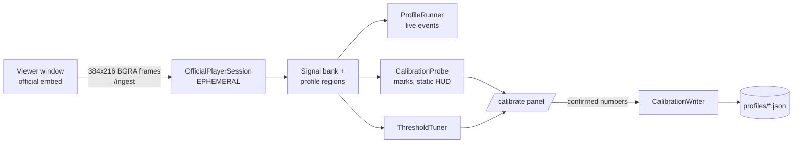

# Official-player calibration

Most profiles ship with HUD regions and thresholds that are estimates
(`reference.calibrated: false`). Calibration checks them against real play:
you watch a video in the viewer's official YouTube or Twitch player, mark the
moments you see, and Lookback proposes better rectangles and thresholds. You
confirm what to keep, and only those numbers are written into the profile.

Source: `src/Lookback.Calibration/`. Tests: `tests/Lookback.Calibration.Tests/`.



## What stays in memory, and what is written

| Data | Where it lives |
|---|---|
| Player frames | One reused 384x216 buffer (and the pooled receive buffer, cleared when the socket closes) |
| Signals, events | The in-process bus, as for any session; no session log is opened |
| Probe state (per-cell activity for 4 s, baselines, static mask, mark maps) | Memory, dropped with the session |
| Threshold statistics (up to 30 min per condition), marks | Memory, dropped with the session |
| Region rectangles and thresholds you confirm | Written into the profile file that defines them |

The `videoRef` the viewer sends is not stored anywhere; the session's title is
just "YouTube embedded player" or "Twitch embedded player".

## Running it

The recorder serves the endpoints by default. `LOOKBACK_READY` carries
`ingest` (`ws://127.0.0.1:PORT/ingest`) and `calibrate`
(`http://127.0.0.1:PORT/calibrate`); open the panel at
`calibrate#token=<token>`. To enable Save, point the recorder at your
checkout's profiles:

```powershell
dotnet run --project src/Lookback.Recorder -- --Recorder:ProfilesDirectory=D:\path\to\Lookback\profiles
```

Then commit the profile change like any other edit.

## The workflow

1. Start a video in the viewer and choose the profile (game or mode) in the panel.
2. Watch. After about 5 s the panel shades static HUD cells and proposes
   rectangles for regions no event rule reads (health, ammo, timer, radar)
   from them.
3. Press an event's button (or its number key) right after each moment: a
   kill, a round win. Each mark takes the grid's response from 2.5 s before
   to 0.3 s after it. After three marks the cells that light up every time
   become the proposed rectangle for the region that event's rules read, and
   the tuner proposes thresholds.
4. Tick the proposals you agree with. **Try selected live** restarts the
   analysis with them in memory, so you can watch the rules fire. Thresholds
   are measured on the current rectangles, so settle regions first, then mark
   a few more moments for thresholds.
5. **Save selected to profile…** shows exactly which numbers will be written
   and writes them only after you confirm. Saved regions also set
   `reference.calibrated` to true in that file.

## How proposals are made

- **Regions from marks.** The frame is split into 8x8-pixel cells. Each cell
  keeps a slow baseline of its luma change; at a mark its response is the
  peak z-score in the mark window. Responses are averaged over an event's
  marks; inside a window around the current estimate, the connected cells
  above half the strongest response (and above z 2) become the proposal.
- **Regions from the static HUD.** Pixels whose luma barely varies (and are
  not letterbox black) count as static. The group of mostly static cells that
  overlaps the current estimate most is proposed. Stream overlays are static
  too, so check these against the player before saving.
- **Thresholds.** For each condition the tuner keeps the exact statistic the
  detector uses (value for `above`, minus value for `below`, value over its
  baseline for `rise`). It tries a threshold just under each marked peak and
  picks the one with the best F1 between marks caught and firings elsewhere
  (counted with the rule's cooldown). The panel shows both the current and
  proposed thresholds' results on this video.

## Wire format of `/ingest`

All binary values are little-endian. Same token and Origin checks as `/events`.

| Message | Content |
|---|---|
| text | `{"type":"start","platform":"youtube"\|"twitch","videoRef":"…","profile":"cs2"}`; `profile` is optional |
| binary kind 1 | `byte 1, int64 µs since start, uint16 width, uint16 height, BGRA8 pixels` (384x216 preferred; other sizes are scaled) |
| binary kind 2 | `byte 2, int64 µs, uint32 sample rate, float32 mono PCM`; accepted and ignored for now |
| text | `{"type":"stop"}` |

## Limits

- Video only for now: the embed's audio cannot be tapped cleanly, so audio
  boosts do not contribute during calibration.
- Marks are human-timed; the 2.5 s lead absorbs reaction time, but marks far
  from the moment add noise. More marks help.
- Proposals are at 8-pixel granularity of the analysis frame (about 2% of the
  width). Fine-tune by hand in the profile if needed.
