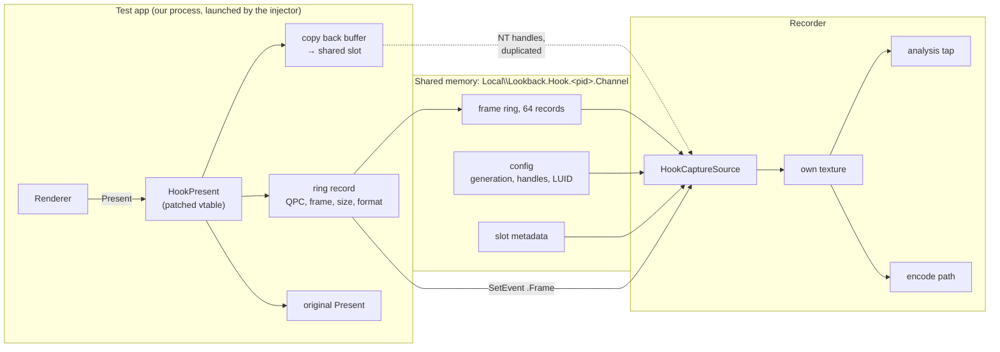
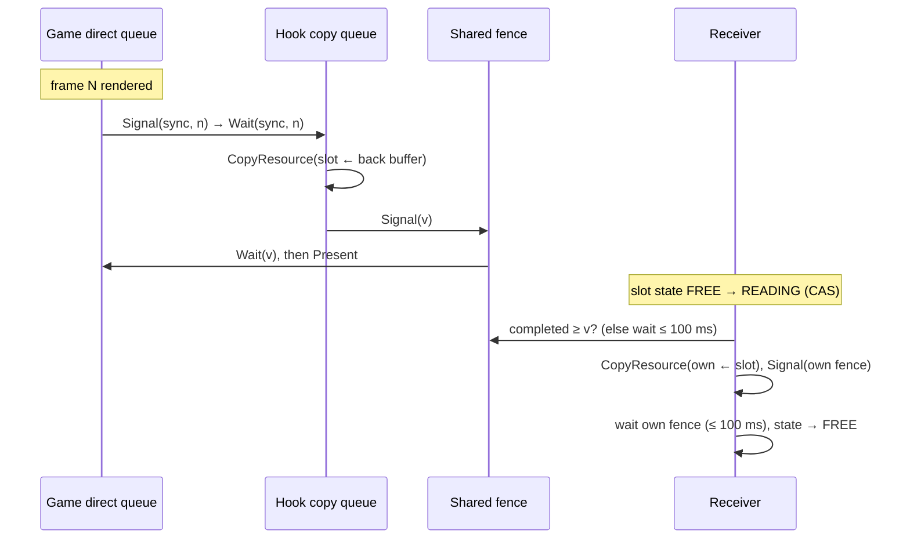

# Present hook (M6)

The present hook is Lookback's third capture backend, next to
Windows.Graphics.Capture and DXGI duplication. A small C++ DLL inside the
rendering process patches `IDXGISwapChain::Present`, copies every presented
back buffer into a shared GPU texture, and tells the recorder when and what it
presented. The recorder opens that texture on its own D3D11 device and feeds
it to the same analysis tap and encode path as any other source.

**It only ever runs in our own two test apps.** It is never injected into a
game, a launcher or anything with anti-cheat, and the code makes that
impossible rather than merely discouraged (see [the allowlist](#the-allowlist)).
Game detection and capture for real games stay external: WGC, plus vision,
audio and OS metadata.

## Why it exists

| | WGC / DXGI duplication | Present hook |
|---|---|---|
| Frame time | Compose time (WGC) or the desktop's last present | QPC at the game's own `Present` call |
| Frames | What the compositor shows; nothing while the window is static | Every present, numbered, with drops counted |
| Occlusion, overlays | Captures what is on screen | The back buffer, before composition |
| Runs inside the target | No | Yes, which is why it is limited to our test apps |

The hook gives exact present timing and per-frame accounting, which is the
ground truth the other backends and the encode clock can be checked against.

## Pieces

| Piece | Where | What it does |
|---|---|---|
| Protocol | `native/include/lookback_hook_protocol.h`, `src/Lookback.Capture/Hook/HookProtocol.cs` | Shared-memory layout, mirrored field for field; layout pinned by C++ `static_assert`s and `HookProtocolTests` |
| Test apps | `native/testapps/d3d11`, `native/testapps/d3d12` | Flip-model swap chains that render a frame-numbered pattern at a set rate. The only hook targets |
| Hook DLL | `native/hook` (`lookback-hook.dll`) | Vtable patch, D3D11 and D3D12 back ends, device-loss watcher |
| Injector | `HookInjector`, `TestAppAllowlist`, `HookedProcess` | Launches a test app suspended, checks it, resumes it, loads the DLL into it |
| Channel | `HookChannel` | The receiver's end: file mapping, frame event, seqlocked reads |
| Source | `HookCaptureSource : ICaptureSource` | Opens the shared textures on the capture `GpuDevice` and delivers frames with the present QPC |

Build the native parts with `native/build.ps1` (Visual Studio 2022+, CMake,
x64, `/W4 /WX`). Output goes to `native/out/bin/Release/`, which is also the
only folder the injector accepts test apps from.

## Data flow



Per present, on the game's thread, the hook:

1. takes `QueryPerformanceCounter` (the frame's timestamp) and counts the
   present (`frame` = present number);
2. picks a free shared slot without waiting, or drops the frame and counts why;
3. queues a GPU copy of the back buffer into the slot;
4. writes the slot's metadata and a ring record, sets the frame event;
5. calls the original `Present`.

The receiver thread wakes on the event (100 ms timeout), reads the newest
record, takes that slot, copies it into a texture it owns, hands the slot
back, and calls the frame handler with the hook's QPC. It always delivers the
newest frame; older records it did not get to are counted as skipped.

## Sync models

### D3D11: keyed mutex

Three shared textures on the game's device, created with
`SHARED_NTHANDLE | SHARED_KEYEDMUTEX`. Key 0 means "the hook may write",
key 1 means "holds a frame for the reader".

```mermaid
sequenceDiagram
    participant G as Game thread (hook)
    participant M as Slot keyed mutex
    participant R as Receiver thread
    G->>M: AcquireSync(0, 0 ms) or AcquireSync(1, 0 ms)
    Note over G,M: both fail → slot busy, try the next one;<br/>all busy → drop (busy)
    G->>G: CopyResource(slot ← back buffer), write slot metadata
    G->>M: ReleaseSync(1)
    G->>R: ring record + SetEvent
    R->>M: AcquireSync(1, 50 ms)
    R->>R: read slot metadata, CopyResource(own ← slot)
    R->>M: ReleaseSync(0)
```

Taking key 1 with a zero timeout lets the hook overwrite a frame the receiver
skipped, so a slow receiver never stalls the game: the hook only drops when
the receiver is holding every slot at that instant. The keyed mutex orders
the GPU work on both devices.

### D3D12: shared fence and a copy queue

Three shared textures (`HEAP_FLAG_SHARED`, simultaneous access) and one
shared fence on the game's device, filled by the hook's own copy queue:



- The game's queue signals a private fence after the frame's rendering, which
  the copy queue waits on, and then waits on the GPU for our copy before it
  executes `Present`. That GPU-side wait is needed: a `FLIP_DISCARD` back
  buffer's contents are undefined once it has been flipped, and without the
  wait, under load, the copy engine sometimes ran after the flip and read the
  frame from three presents earlier (found by the pixel check in
  `HookTests`, about one run in four with the full suite running beside it).
  It cannot deadlock, because the copy depends only on work the game had
  already submitted, and it costs the game's GPU timeline one copy. The CPU
  present thread still never waits.
- Slot ownership is a CAS on `slots[i].state` in shared memory
  (`FREE → WRITING` by the hook, `FREE → READING` by the receiver). The hook
  also skips a slot whose previous copy is still in flight (its allocator
  cannot be reset yet). No slot means the frame is dropped.
- The receiver hands a slot back only after its own GPU copy has finished,
  waiting on a fence of its own rather than polling a query (polling took
  the context lock and starved the encoder, halving capture to 64 fps).
- A D3D12 swap chain does not hand out its queue, so the hook also patches
  `ID3D12CommandQueue::ExecuteCommandLists` and uses the direct queue on the
  swap chain's device that last executed command lists.

## The channel

Created by the receiver before injection, named per target process:

| Object | Name | Use |
|---|---|---|
| File mapping | `Local\Lookback.Hook.<pid>.Channel` | `lbh_header`: status, counters, config, slot metadata, frame ring |
| Auto-reset event | `Local\Lookback.Hook.<pid>.Frame` | Set by the hook after each published frame |
| Shared textures, fence | NT handles in the target process, values in the config | The receiver duplicates them with `DuplicateHandle` (it holds the process handle because it launched the process) |

Reads never wait. The ring records and the config block use seqlocks: the
writer makes the sequence odd, writes, makes it even; the reader retries or
waits for the next frame if it changed. When the hook recreates its textures
it bumps `generation`; the receiver reopens, and re-checks the sequence after
duplicating the handles so a recycled handle value is never trusted.

### Frame accounting

Every hooked present gets a number. Between any two delivered frames `a` and
`b`:

```
b.frame − a.frame − 1  =  (b.dropped − a.dropped)  +  (b.record − a.record − 1)
                          presents the hook            records the receiver
                          did not publish              skipped for a newer one
```

`HookTests` checks this for every pair, and checks that the frame number the
test app drew into the pixels matches the metadata, so a frame can't arrive
under the wrong number or from the wrong slot. Hook drops are split into
`busy`, `not ready` (initialising, resized, waiting for the queue,
unsupported format) and `device`.

## Resize and device loss

| Event | Hook | Receiver |
|---|---|---|
| Resize | Next present sees the new back-buffer size, releases its textures (once in-flight copies are done) and creates new ones: new generation. D3D12: `ResizeBuffers` waits ≤ 100 ms for copies still reading the old buffers | Reopens on the new generation; its own texture is recreated at the new size |
| Swap chain recreated | Adopts a new swap chain once the tracked one has been quiet for 250 ms | New generation |
| Device removed | A watcher thread polls `GetDeviceRemovedReason` every 100 ms and releases every reference at once, the cached queue included. D3D12 devices are per-adapter singletons, so a game can only get a fresh device once ours are gone too | Skips frames whose copy may have been lost (see limits); reopens on the next generation |
| Receiver gone | Keeps going; frames whose slots are free are still copied, nothing blocks | n/a |
| Target exits | `DLL_PROCESS_DETACH` sets state `exiting` | Raises `Stopped` |

The D3D12 test app's `--recreate-at N` calls `ID3D12Device5::RemoveDevice`,
a real device removal, and recovers the way a game does. The D3D11 app
tears its device and swap chain down and recreates them.

## Never blocking the game

| Where | Wait | Bound |
|---|---|---|
| Hook, present thread | Keyed mutex acquire | 0 ms |
| Hook, present thread | Its own lock (the watcher may hold it) | Try-lock; busy → drop |
| Hook, present thread | In-flight copy / allocator check | Non-blocking fence read; busy → next slot or drop |
| Game's GPU queue (D3D12) | Our copy of this frame, before `Present` | One texture copy; it depends only on work already submitted |
| Hook, `ResizeBuffers` (D3D12) | Copies reading the old back buffers | 100 ms |
| Receiver | Frame event | 100 ms |
| Receiver | D3D11 keyed mutex (key 1) | 50 ms |
| Receiver | D3D12 slot CAS | 5 ms of retries |
| Receiver | Hook's fence, own copy fence | 100 ms each |
| Receiver | No new frame | `Stopped` after the stall timeout (2 s; 10 s before the first frame) |
| Injector | Window up, remote `LoadLibraryW`, hook reporting in | 15 s each (`HookLaunchRequest.Timeout`) |

When something does not arrive in time, the frame is dropped or skipped and
counted; when nothing arrives for the stall timeout, the source stops. That
follows the project rule: never deadlock, drop work or stop instead.

## The allowlist

Each check stands on its own, so getting past one still leaves the others.

| # | Check | Where |
|---|---|---|
| 1 | The target's capture policy must say `allowPresentHook: true`. `HookLaunchRequest.AllowPresentHook` defaults to false; profiles for anti-cheat titles keep it false | `HookInjector.Launch` |
| 2 | The file name must be `lookback-testapp-d3d11.exe` or `lookback-testapp-d3d12.exe` | `TestAppAllowlist.Check` |
| 3 | Its final path (symlinks and junctions resolved) must be in the native build output folder, the same folder as `lookback-hook.dll` | `TestAppAllowlist.Check` |
| 4 | The PE export table must hold `LookbackTestAppMarker` = `"lookback-testapp/1"` | `TestAppAllowlist.HasMarker` |
| 5 | The injector starts the process itself, suspended; the image it actually mapped must be that path, a native x64 process | `HookInjector.LaunchVerified` |
| 6 | No running process can be hooked: the only API taking a pid, `HookInjector.Attach`, returns processes this injector launched and refuses every other | `HookInjector.Attach` |
| 7 | Inside the process, the hook does nothing unless the receiver created a channel for that exact pid with the matching protocol version | `InitThread` |
| 8 | Inside the process, the hook checks the host exports the marker (`GetProcAddress`) and unloads itself if not | `InitThread` |

A refusal throws `HookRefusedException` with the reason, before anything is
launched. The hook never reads the target's memory and never writes
anything to disk; frames reach disk only through the encode path, which is
gated by `RetentionRules` like every other source.

## The bench

```powershell
powershell -File native\build.ps1
dotnet build Lookback.slnx -c Release
$cap = "src\Lookback.Capture.Cli\bin\Release\net10.0-windows10.0.22621.0\lookback-capture.exe"
& $cap --hook-testapp d3d11 --seconds 10
& $cap --hook-testapp d3d12 --seconds 10 --app-fps 144 --present1 --encode 5 --out hook.mp4 --codec h264 --size 1280x720 --fps 60
```

Measured on AETHER (Windows 10 19045, RTX 4080 SUPER), 640x360 test apps:

```
hooked lookback-testapp-d3d11.exe (pid 31668): D3D11 640x360, adapter 16D1D
capturing with hook on NVIDIA GeForce RTX 4080 SUPER; persist: True
  3.3s  presents  120.2/s  capture  120.2 fps  hook dropped   0  analysis  29.8 fps
hook HookCounters { Presents = 528, Published = 528, Dropped = 0, ... }

D3D12 at 144 fps with NVENC H.264 60 fps:
  8.3s  presents  144.2/s  capture  144.2 fps  hook dropped   0  analysis  29.8 fps  encode  59.7 fps  repeated   0  skipped 0  busy 0
ticker EncodeStats { Captured = 1451, Ticks = 605, Encoded = 605, Repeated = 0, Skipped = 0, EncoderBusy = 0 }
```

ffprobe on the clip: `h264 640x360`, every tick encoded, and
`ffmpeg -v error -f null` decodes it with no errors. The D3D12 test app
uncapped at 1000 fps is captured at 999 fps with 2 busy drops in 4,219
presents.

## Tests

`tests/Lookback.Capture.Tests/HookTests.cs`. The fixture builds `native/`
with CMake if its output is missing; GPU tests skip without a hardware
adapter (CI), the rest run everywhere on Windows. The GPU tests run in a
non-parallel collection so their 120 fps processes cannot disturb
timing-sensitive tests beside them.

| Test | Proves |
|---|---|
| `HookProtocolTests.Layout_matches_the_native_header` | C# struct sizes and offsets equal the C++ `static_assert`s |
| `HookAllowlistTests.Notepad_is_refused_before_anything_starts` | `notepad.exe` is refused with "not a Lookback test app", and no process is started |
| `…A_process_the_injector_did_not_start_is_refused` | A genuine test app started by someone else, the test host, and System are all refused by `Attach` |
| `…A_capture_policy_without_allowPresentHook_is_refused` | Policy false refuses before launching |
| `…A_test_app_copied_out_of_the_build_output_is_refused` | The same binary (and DLL) in another folder fails the path check |
| `…Only_the_test_apps_carry_the_marker` | The marker reader finds it in both apps and not in the DLL or notepad |
| `HookCaptureTests.Test_app_frames_arrive_numbered_in_order_with_monotonic_qpc` (D3D11, D3D12 × Present, Present1) | ≥ 120 frames; QPC strictly increasing; every frame-number gap explained by drops and skips; pixels match the frame number; ≤ 10 % hook drops; one texture open |
| `…Capture_survives_a_resize_and_a_recreated_device` (D3D11, D3D12) | Resize at frame 60 and device recreation at 180 (a real `RemoveDevice` on D3D12): capture continues, ≥ 300 frames, ≥ 3 opens, accounting holds throughout |
| `…Source_stops_when_the_hook_stops_producing` | With the test app suspended, `Stopped` fires after the 1 s stall timeout |
| `…Source_stops_when_the_test_app_exits` | When the app exits after 240 frames, `Stopped` fires once with the reason |

## Limits

- **Test apps only, by design.** There is no path to hook another process.
- **One swap chain.** The first swap chain that presents is captured; another
  one is adopted only after the first has been silent for 250 ms.
- **D3D12 queue choice.** The copy waits on the direct queue that last ran
  `ExecuteCommandLists` on the swap chain's device. A renderer that presents
  from a different direct queue than it last submitted on could have frames
  copied before they finish (tearing). Our test apps use one queue.
- **Frames in flight at a device removal.** Their GPU copy may never run.
  The receiver discards frames when the fence reports the removed-device value
  or the generation changes during its copy, but the shared fence opened on
  our device does not always show the removal in time, so up to one frame
  per slot (three) just before a removal can show an older image. The test
  allows exactly that and nothing else.
- **No cross-adapter copy.** The capture device must be on the hook's adapter
  (`HookConfig.AdapterLuid`); otherwise the source stops with a clear message.
- **Formats.** BGRA8, RGBA8 (and their sRGB/typeless forms), RGB10A2 and
  RGBA16F. FP16 is delivered as scRGB; 10-bit is treated as SDR, since the
  swap chain's colour space is not read yet.
- **D3D12 adds one GPU copy before each present** on the game's queue (see
  the sync model). It is small (a 640x360 copy is microseconds) but grows
  with resolution.
