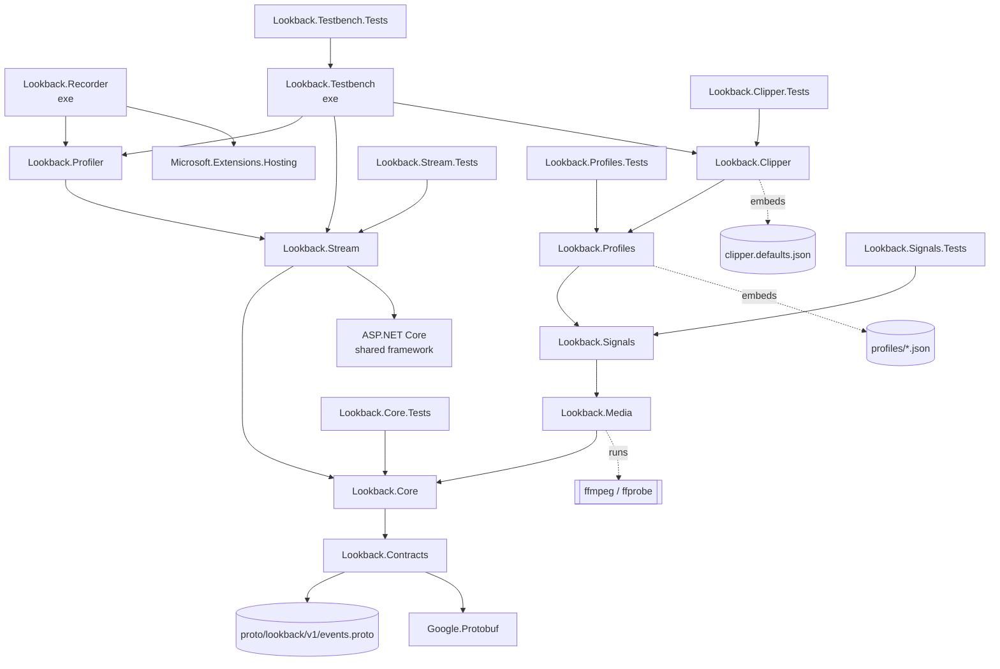
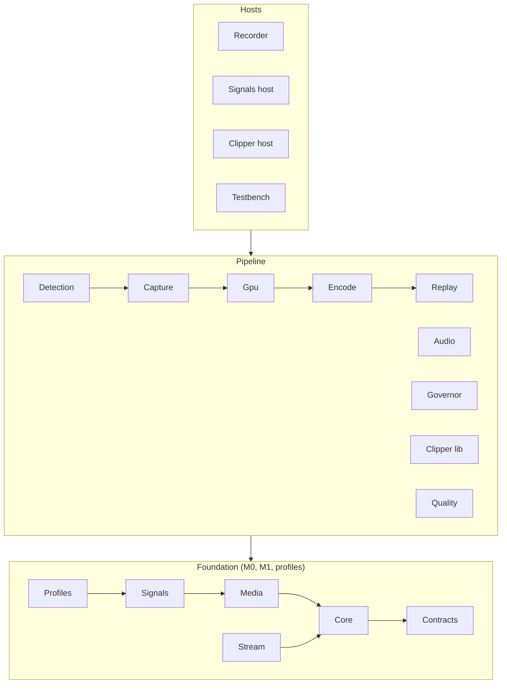

# Project structure

## Repository tree

```
Lookback.slnx                 solution (XML format)
global.json                   SDK pin + Microsoft.Testing.Platform runner
Directory.Build.props         settings every project inherits
Directory.Packages.props      every NuGet version, in one place
.editorconfig                 style and analyzer severities
CLAUDE.md                     rules for contributors and agents
profiles/<game>/              game profiles as JSON, one folder per game tree
                              (generic, overwatch + modes, roblox + experiences)
datasets/<game>/              per-game dataset manifests (media never committed)
proto/
  lookback/v1/events.proto    the event schema
src/
  Lookback.Contracts/         generated schema + Topics + RetentionRules
  Lookback.Core/              clock, lock-free ring, event bus
  Lookback.Stream/            framing, pipes, WebSocket bridge, session log
  Lookback.Media/             analysis format, frames, ffmpeg FileSource
  Lookback.Signals/           video + audio signals, DSP, publisher
  Lookback.Profiles/          game profiles: regions, rules, event detector
  Lookback.Clipper/           excitement curve, peaks, candidate fusion, QA gates
  Lookback.Profiler/          live event profiler page (served by the bridge)
  Lookback.Recorder/          service executable
  Lookback.Testbench/         footage CLI + HTML timeline viewer
tests/
  Lookback.Core.Tests/
  Lookback.Stream.Tests/
  Lookback.Signals.Tests/
  Lookback.Profiles.Tests/
  Lookback.Clipper.Tests/
  Lookback.Testbench.Tests/
docs/
  architecture.md             repository summary
  wiki/                       source of this wiki
.github/workflows/
  ci.yml                      build + test on Windows and Linux
  wiki.yml                    publishes docs/wiki to the GitHub wiki
```

## Project dependencies

Each layer depends only on the ones below it. Contracts knows nothing about
transport; Core knows nothing about files or sockets; only Stream touches I/O.



## What lives where

| Project | Files | Responsibility |
|---|---|---|
| `Lookback.Contracts` | `Topics.cs`, `RetentionRules.cs`, generated `Events.cs` | The vocabulary: message types, topic names, and the persistence rule |
| `Lookback.Core` | `Time/IClock.cs`, `Time/QpcTime.cs`, `Buffers/SpscRing.cs`, `Bus/IEventBus.cs`, `Bus/InProcessEventBus.cs`, `Bus/EnvelopeFactory.cs` | Timekeeping and in-memory movement of data, with no I/O |
| `Lookback.Stream` | `Framing/EnvelopeFraming.cs`, `Pipes/*`, `WebSockets/WebSocketBridge.cs`, `SessionLog/*` | Every way an envelope leaves the process: pipe, socket or file |
| `Lookback.Media` | `Frames/*`, `Ffmpeg/*` | The analysis format and the footage decoder |
| `Lookback.Signals` | `Video/*`, `Audio/*`, `Dsp/*`, `SignalPublisher.cs`, `FootageAnalyzer.cs`, `ReplayPacer.cs` | Game-agnostic features and their publication |
| `Lookback.Profiles` | `Model/*`, `Regions/RegionSignal.cs`, `Detection/*`, `Candidates/*` | Game profiles as data: the profile tree, HUD regions, event rules, sub-game and mode detection, the detector and its bus runner, clip candidates |
| `Lookback.Clipper` | `ClipperEngine.cs`, `ClipperRunner.cs`, `ClipperOptions.cs`, `Curve/*`, `Candidates/*`, `Qa/*`, `clipper.defaults.json` | The [clipper](Clipper): normalisation, excitement curve, peaks, fusion with profile events, QA gates, and its bus runner |
| `Lookback.Profiler` | `ProfilerPage.cs`, `profiler.html` | The [live profiler](Live-Profiler) page, embedded and handed to the bridge |
| `Lookback.Recorder` | `Program.cs`, `StreamHostService.cs`, `RecorderOptions.cs` | Composition root: wires the bus to its transports and announces itself |
| `Lookback.Testbench` | `Program.cs`, `TestbenchRunner.cs`, `Live/*`, `Report/*`, `Datasets/*`, `Browse/*` | Footage CLI, the timeline viewer, the live replay, per-game dataset scoring, and the [dataset browser](Dataset-Browser) |

## Planned projects

These arrive with later milestones and slot into the same layering:
`Lookback.Detection`, `Lookback.Capture`, `Lookback.Gpu`, `Lookback.Encode`,
`Lookback.Replay`, `Lookback.Audio`, `Lookback.Quality`,
`Lookback.Governor`, `Lookback.Memory`, `native/hook`, `app/`, `ml/`.


