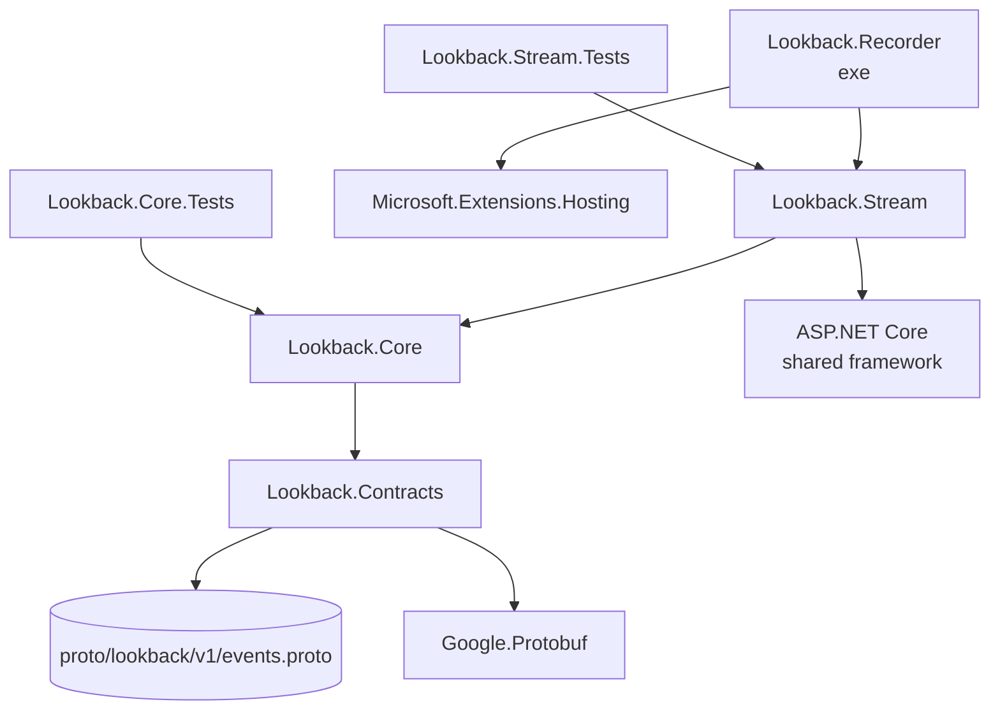
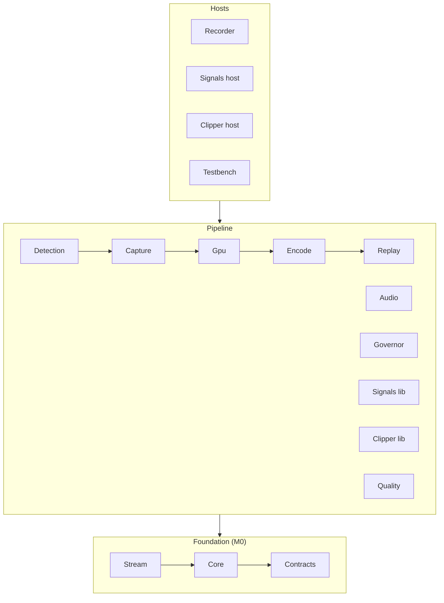

# Project structure

## Repository tree

```
Lookback.slnx                 solution (XML format)
global.json                   SDK pin + Microsoft.Testing.Platform runner
Directory.Build.props         settings every project inherits
Directory.Packages.props      every NuGet version, in one place
.editorconfig                 style and analyzer severities
CLAUDE.md                     rules for contributors and agents
proto/
  lookback/v1/events.proto    the event schema
src/
  Lookback.Contracts/         generated schema + Topics + RetentionRules
  Lookback.Core/              clock, lock-free ring, event bus
  Lookback.Stream/            framing, pipes, WebSocket bridge, session log
  Lookback.Recorder/          service executable
tests/
  Lookback.Core.Tests/
  Lookback.Stream.Tests/
docs/
  architecture.md             repository summary
  wiki/                       source of this wiki
.github/workflows/
  ci.yml                      build + test on Windows and Linux
  wiki.yml                    publishes docs/wiki to the GitHub wiki
```

## Project dependencies

Each layer depends only on the ones below it. Contracts knows nothing about
transport; Core knows nothing about files or sockets; only Stream touches I/O.



## What lives where

| Project | Files | Responsibility |
|---|---|---|
| `Lookback.Contracts` | `Topics.cs`, `RetentionRules.cs`, generated `Events.cs` | The vocabulary: message types, topic names, and the persistence rule |
| `Lookback.Core` | `Time/IClock.cs`, `Time/QpcTime.cs`, `Buffers/SpscRing.cs`, `Bus/IEventBus.cs`, `Bus/InProcessEventBus.cs`, `Bus/EnvelopeFactory.cs` | Timekeeping and in-memory movement of data, with no I/O |
| `Lookback.Stream` | `Framing/EnvelopeFraming.cs`, `Pipes/*`, `WebSockets/WebSocketBridge.cs`, `SessionLog/*` | Every way an envelope leaves the process: pipe, socket or file |
| `Lookback.Recorder` | `Program.cs`, `StreamHostService.cs`, `RecorderOptions.cs` | Composition root: wires the bus to its transports and announces itself |

## Planned projects

These arrive with later milestones and slot into the same layering:
`Lookback.Detection`, `Lookback.Capture`, `Lookback.Gpu`, `Lookback.Encode`,
`Lookback.Replay`, `Lookback.Audio`, `Lookback.Signals`, `Lookback.Clipper`,
`Lookback.Quality`, `Lookback.Governor`, `Lookback.Memory`,
`Lookback.Testbench`, `native/hook`, `app/`, `ml/`.


