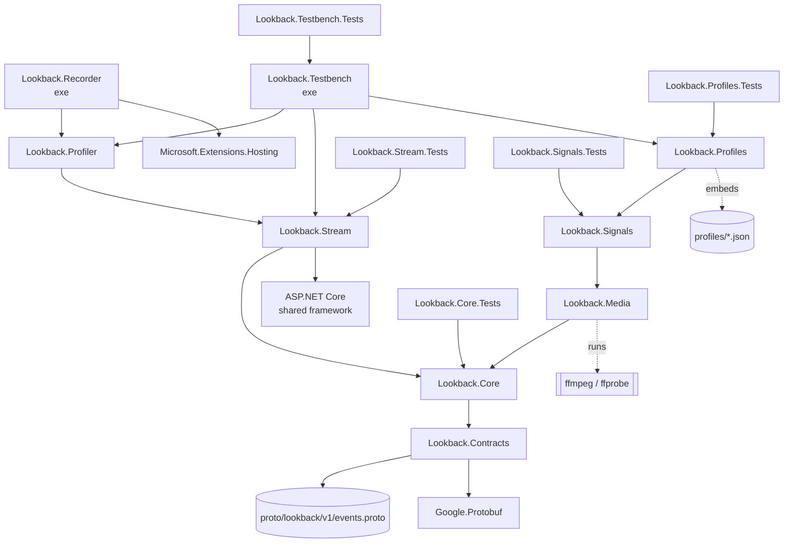
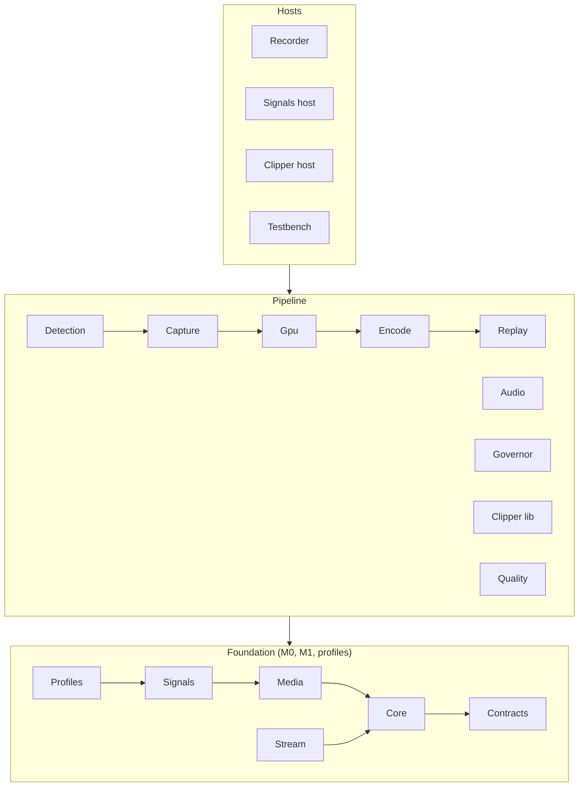

# Project structure

## Repository tree

```
Lookback.slnx                 solution (XML format)
global.json                   SDK pin + Microsoft.Testing.Platform runner
Directory.Build.props         settings every project inherits
Directory.Packages.props      every NuGet version, in one place
.editorconfig                 style and analyzer severities
CLAUDE.md                     rules for contributors and agents
profiles/<game>/              game profiles as JSON, one folder per game tree
                              (generic, overwatch + modes, roblox + experiences)
datasets/<game>/              per-game dataset manifests (media never committed)
proto/
  lookback/v1/events.proto    the event schema
src/
  Lookback.Contracts/         generated schema + Topics + RetentionRules
  Lookback.Core/              clock, lock-free ring, event bus
  Lookback.Stream/            framing, pipes, WebSocket bridge, session log
  Lookback.Media/             analysis format, frames, ffmpeg FileSource
  Lookback.Signals/           video + audio signals, DSP, publisher
  Lookback.Profiles/          game profiles: regions, rules, event detector
  Lookback.Profiler/          live event profiler page (served by the bridge)
  Lookback.Calibration/       official-player calibration: ingest, probe, tuner, writer
  Lookback.Replay/            RAM replay ring, fMP4 muxer, clip writer, disk segment store
  Lookback.Governor/          budget policy and runtime controller
  Lookback.Capture/           WGC + DXGI capture, GPU downscale, NV12 convert (Windows)
  Lookback.Encode/            Media Foundation encoders + the CFR encode clock (Windows)
  Lookback.Capture.Cli/       lookback-capture bench (Windows)
  Lookback.Detection/         game detection: matcher, debounced lifecycle, bus runner
  Lookback.Detection.Windows/ process + window probe, capture target for a game (Windows)
  Lookback.Detection.Cli/     lookback-detect bench (Windows)
  Lookback.Recorder/          service executable
  Lookback.Testbench/         footage CLI + HTML timeline viewer
tests/
  Lookback.Core.Tests/
  Lookback.Stream.Tests/
  Lookback.Signals.Tests/
  Lookback.Profiles.Tests/
  Lookback.Calibration.Tests/
  Lookback.Replay.Tests/
  Lookback.Governor.Tests/
  Lookback.Capture.Tests/     Windows: downscale, encoders, CFR clock (skip elsewhere)
  Lookback.Detection.Tests/   matcher, settings, debounce with a fake machine
  Lookback.Detection.Windows.Tests/  Windows: probe and runner on a real child window
  Lookback.Detection.TestWindow/     stand-in game for those tests (lookback-testwindow)
  Lookback.Testbench.Tests/
docs/
  architecture.md             repository summary
  wiki/                       source of this wiki
.github/workflows/
  ci.yml                      build + test on Windows and Linux
  wiki.yml                    publishes docs/wiki to the GitHub wiki
```

## Project dependencies

Each layer depends only on the ones below it. Contracts knows nothing about
transport; Core knows nothing about files or sockets; only Stream touches I/O.



## What lives where

| Project | Files | Responsibility |
|---|---|---|
| `Lookback.Contracts` | `Topics.cs`, `RetentionRules.cs`, generated `Events.cs` | The vocabulary: message types, topic names, and the persistence rule |
| `Lookback.Core` | `Time/IClock.cs`, `Time/QpcTime.cs`, `Buffers/SpscRing.cs`, `Bus/IEventBus.cs`, `Bus/InProcessEventBus.cs`, `Bus/EnvelopeFactory.cs` | Timekeeping and in-memory movement of data, with no I/O |
| `Lookback.Stream` | `Framing/EnvelopeFraming.cs`, `Pipes/*`, `WebSockets/WebSocketBridge.cs`, `SessionLog/*` | Every way an envelope leaves the process: pipe, socket or file |
| `Lookback.Media` | `Frames/*`, `Ffmpeg/*` | The analysis format and the footage decoder |
| `Lookback.Signals` | `Video/*`, `Audio/*`, `Dsp/*`, `SignalPublisher.cs`, `FootageAnalyzer.cs`, `ReplayPacer.cs` | Game-agnostic features and their publication |
| `Lookback.Profiles` | `Model/*`, `Regions/RegionSignal.cs`, `Detection/*`, `Candidates/*` | Game profiles as data: the profile tree, HUD regions, event rules, sub-game and mode detection, the detector and its bus runner, clip candidates |
| `Lookback.Profiler` | `ProfilerPage.cs`, `profiler.html` | The [live profiler](Live-Profiler) page, embedded and handed to the bridge |
| `Lookback.Recorder` | `Program.cs`, `StreamHostService.cs`, `RecorderOptions.cs` | Composition root: wires the bus to its transports and announces itself |
| `app/` (Electron) | `src/main/*`, `src/preload/*`, `src/renderer/*`, `src/viewer/*`, `src/test/*` | The [desktop shell](Desktop-Shell): recorder process, `/events` library, timeline, ratings, official-player viewer and its `/ingest` sender |
| `Lookback.Testbench` | `Program.cs`, `TestbenchRunner.cs`, `Live/*`, `Report/*`, `Datasets/*`, `Browse/*` | Footage CLI, the timeline viewer, the live replay, per-game dataset scoring, and the [dataset browser](Dataset-Browser) |
| `Lookback.Calibration` | `OfficialPlayerSession.cs`, `CalibrationHost.cs`, `Profiles/*` | [Official-player calibration](Official-Player-Calibration): ephemeral ingest, proposals, confirmed profile writes |
| `Lookback.Replay` | `Packets/*`, `Mp4/*`, `Store/*` | Encoded packets in RAM, fragmented MP4 muxing, clips, and the 2 s segment store on disk |
| `Lookback.Governor` | `GovernorPolicy.cs`, `GovernorController.cs`, `MachineProfile.cs`, `QualityTier.cs` | Machine profile → ring/disk budget and quality tier; steps down under pressure |
| `Lookback.Capture` | `Wgc/*`, `Dxgi/*`, `Gpu/*`, `Targets/*`, `LiveCaptureSession.cs` | [Live capture](Live-Capture): capture backends on the output's adapter, the analysis downscale, NV12 conversion |
| `Lookback.Encode` | `MfVideoEncoder.cs`, `EncodeTicker.cs`, `CodecApi.cs`, `MfGuids.cs` | Hardware/software encoder MFTs chosen by adapter LUID, and the constant-rate encode clock |
| `Lookback.Capture.Cli` | `Program.cs`, `EncodeBench.cs` | `lookback-capture`: capture, analyse, optionally encode a clip of the last seconds |
| `Lookback.Detection` | `Probe/*`, `Matching/*`, `Lifecycle/*`, `DetectionRunner.cs` | [Game detection](Game-Detection): executable and title to profile, the user's allow/deny lists, debounced start/focus/window/stop, `game.lifecycle` on the bus |
| `Lookback.Detection.Windows` | `WindowsSystemProbe.cs`, `WindowsDetection.cs` | Toolhelp, query-limited handles and `EnumWindows` (no memory access); the `CaptureTarget` for a detected game |
| `Lookback.Detection.Cli` | `Program.cs` | `lookback-detect`: prints detected games live, lists windows, edits the allow/deny lists |

## Planned projects

These arrive with later milestones and slot into the same layering:
`Lookback.Audio`, `Lookback.Clipper`, `Lookback.Quality`,
`Lookback.Memory`, `native/hook`, `app/`, `ml/`. (`Lookback.Gpu` folded into
`Lookback.Capture/Gpu`.)


