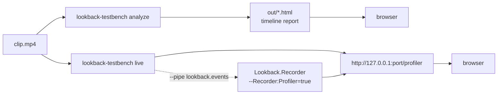

# Quickstart

Run Lookback on Windows in about ten minutes: build it, analyse a clip, open
the timeline report, watch events fire live in the profiler, then run the
desktop app and calibrate a profile from a YouTube or Twitch video. Every step
here was checked on Windows 10 (19045) in a fresh clone.

## What you are running

Lookback is a desktop app (the Electron shell in `app/`), two command-line
programs, and pages they serve:

| Piece | What it is | You use it to |
|---|---|---|
| `lookback-testbench` | Command-line tool | Analyse a clip into a timeline report; play a clip live into the profiler; score a dataset |
| `Lookback.Recorder` | Background service | Host the event stream (named pipe and WebSocket); optionally serve the profiler |
| Timeline report | Self-contained `.html` file | Scrub a clip with every signal, event and rule margin under it |
| Live profiler | Page served from `127.0.0.1` | Watch game events fire in real time |
| Desktop app (`app/`) | Electron shell | Run the recorder; browse clip candidates, rate them, follow the live timeline; calibrate from the official player |



## 1. Install the prerequisites

| Need | Check with | Notes |
|---|---|---|
| .NET 10 SDK | `dotnet --list-sdks` shows `10.0.x` | `global.json` asks for 10.0.100 or a later feature band |
| ffmpeg and ffprobe | `ffmpeg -version` | Must be on `PATH`, or set `LOOKBACK_FFMPEG_DIR` to their folder. A gyan.dev "essentials" build works |
| git | `git --version` | |
| Node.js 24 (for the desktop app) | `node --version` shows `v24.x` | npm comes with it; `npm ci` installs Electron and TypeScript inside `app/` only |

## 2. Clone, build, test

```powershell
git clone https://github.com/Joshmh7128/Lookback.git
cd Lookback
dotnet build Lookback.slnx -c Release
dotnet test --solution Lookback.slnx -c Release
```

Expect `Build succeeded` with 0 warnings (warnings are errors in this repo),
then `Passed!` for every test. On the test machine this took about 3 s to
build and 4 s to test.

## 3. Get a clip

Use any recording of your own. To try things out first, generate a 20-second
test clip:

```powershell
ffmpeg -y -f lavfi -i testsrc2=size=1280x720:rate=60 -f lavfi -i "sine=frequency=440:sample_rate=48000" -t 20 -c:v libx264 -pix_fmt yuv420p -c:a aac sample.mp4
```

## 4. Analyse it and open the report

```powershell
dotnet run -c Release --project src/Lookback.Testbench -- analyze sample.mp4 --out out --profile generic
```

```
session  20261127-152927-sample
media    1280x720 @ 60 fps, 00:00:20, audio: yes
signals  600 video frames, 2002 audio hops in 0.5 s (41.9x real time)
log      out\20261127-152927-sample.lbklog
report   out\20261127-152927-sample.html
events   0 from profile 'generic'
```

Open the `.html` file in your browser. It needs no server and no network.
Each signal gets a lane under the video; hover a lane for values, and click
to seek.

Things worth knowing:

- **600 frames for a 60 fps clip is correct.** Signals always run on a fixed
  384×216, 30 fps analysis format, whatever the source.
- **Try a game profile** with `--profile overwatch`. The report gains an
  events lane, a lane per rule condition and a calibration overlay of the
  profile's HUD regions. On the synthetic test clip it fires about 20
  "eliminations": the moving test pattern looks like HUD activity. That is
  expected on a test pattern. Use real Overwatch footage to judge the
  profile.
- `--profile ./my-profile.json` runs an edited profile without a rebuild.
- Retention applies: your own footage is `owned` (the default). Someone
  else's footage needs `--retention permissioned --permission-ref "<where the
  permission is recorded>"`, and `--retention ephemeral` writes nothing at
  all. See [Data Retention](Data-Retention).

## 5. Watch events fire live

```powershell
dotnet run -c Release --project src/Lookback.Testbench -- live sample.mp4 --profile overwatch
```

```
profiler http://127.0.0.1:55490/profiler#token=890A…
waiting  for the profiler to connect (open the link above)
playing  sample.mp4 at 1x with profile 'overwatch'
finished the clip; the profiler stays up until Ctrl+C
```

Open the printed link. The clip starts when the page connects, so the first
events are not missed. The token is in the `#` fragment, so keep the whole
link. Useful flags: `--loop` for an unattended demo, `--speed 2`,
`--port 5050` for a link you can bookmark, and `--no-wait` to start without
waiting for the page. Stop with Ctrl+C. See [Live Profiler](Live-Profiler)
for what each panel shows.

## 6. Run the recorder

```powershell
dotnet run -c Release --project src/Lookback.Recorder -- --Recorder:Profiler=true
```

```
LOOKBACK_READY {"pipe":"lookback.events","ws":"ws://127.0.0.1:55505/events","token":"2776…"}
LOOKBACK_PROFILER http://127.0.0.1:55505/profiler#token=2776…
```

Stdout carries only these handshake lines; logs go to stderr. Open the
`LOOKBACK_PROFILER` link, then in a second terminal send a clip into the
recorder's pipe:

```powershell
dotnet run -c Release --project src/Lookback.Testbench -- live sample.mp4 --profile overwatch --pipe lookback.events
```

Live capture of a running game arrives in M3. Until then the recorder hosts
the event stream, and the testbench is what feeds it.

## 7. Score a profile against labelled footage

Copy `datasets/overwatch/manifest.example.json` to `manifest.json` next to
your footage, list your files and the moments you marked, then:

```powershell
dotnet run -c Release --project src/Lookback.Testbench -- dataset datasets/overwatch/manifest.json --tolerance 1.0
```

You get precision and recall per event type, and `dataset-out/scores.json`.
Media files are never committed; only manifests are. See
[Game Profiles](Game-Profiles#datasets-and-scoring).

## 8. Run the desktop app

```powershell
cd app
npm ci
npm start
```

The main window starts the recorder (it finds the Release build from step 2)
and shows it as **recorder ready** and **stream open** in the toolbar. To see
the library fill, send the clip into the app's recorder from a second
terminal, as in step 6:

```powershell
dotnet run -c Release --project src/Lookback.Testbench -- live sample.mp4 --profile overwatch --pipe lookback.events
```

**Library** lists the session's clip candidates with score, reasons and QA.
**Timeline** draws the session's events and candidates live. `npm run smoke`
checks the whole start-up path and prints `LOOKBACK_SMOKE ok …`.

To rate your own gameplay, press **Open footage…** in the Library tab, pick
a video and its profile. Candidates appear as it is analysed (at 8x speed);
select one to watch its moment, and give it 1 to 5 stars for whether it is a
highlight worth keeping (keys <kbd>1</kbd>–<kbd>5</kbd>, <kbd>0</kbd> clears,
<kbd>↑</kbd>/<kbd>↓</kbd> to move). Ratings are about the moment, not the
video quality, and are kept in memory until the recorder stores them.

## 9. Calibrate a profile from a YouTube or Twitch video

In the desktop app press **Open viewer**, paste a link to gameplay (for
example a CS2 or Overwatch match) and press Play. The video plays in the
platform's own embedded player; the calibration panel is docked on the
right. Choose the profile in the panel, then follow
[Official-Player Calibration](Official-Player-Calibration#the-workflow). The
viewer's bar shows how many frames went to the recorder; the panel shows how
many it analysed. Nothing about the video is written anywhere; only numbers
you confirm with **Save** go into `profiles/`.

## Running the built programs directly

`dotnet run` builds when needed and then starts the program. After a Release
build the executables are at:

```
src\Lookback.Testbench\bin\Release\net10.0\lookback-testbench.exe
src\Lookback.Recorder\bin\Release\net10.0\Lookback.Recorder.exe
```

`lookback-testbench.exe` with no arguments prints its usage to stderr and
exits with code 64.

## Troubleshooting

| Symptom | Cause and fix |
|---|---|
| `ffprobe` or `ffmpeg` not found | Put both on `PATH`, or set `LOOKBACK_FFMPEG_DIR` |
| Exit code 2 and nothing written | Retention refused the session, for example `permissioned` without `--permission-ref`. The message says why |
| `System.Management.Automation.RemoteException` lines in PowerShell | You redirected stderr with `2>&1`. Drop the redirect; the output is fine |
| Profiler page asks for a token | The link lost its `#token=…` part. Copy the whole printed link |
| Profile events on a test clip | Expected: synthetic patterns trip HUD rules. Use real footage |
| Desktop app says "Lookback.Recorder was not found" | Run `dotnet build Lookback.slnx -c Release` first, or set the recorder's path in Settings |
| Viewer shows "ingest off" | The recorder is not running, or was started with `--Recorder:OfficialPlayer=false` |
| Twitch player says the channel is offline | Pick a live channel or a `twitch.tv/videos/<id>` link |
