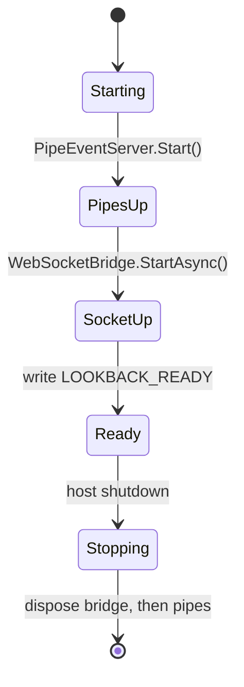
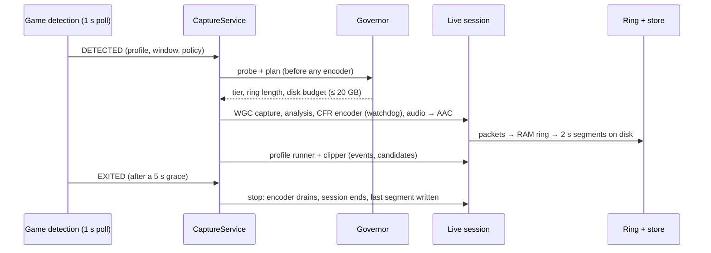

# Recorder host

`src/Lookback.Recorder`: the service executable. It hosts the event stream,
official-player calibration, the shell's control commands (ratings, footage
analysis, saving clips) and, on Windows, live capture: game detection starts a
recording for every allowed game. It targets `net10.0-windows` but still builds
on Linux, where the control commands run and capture stays off; its output
stays in `bin/<config>/net10.0` so the shell finds it.

## `Program.cs`

1. Sets `GCSettings.LatencyMode = SustainedLowLatency`, which avoids blocking
   gen-2 collections while the process runs, so capture and audio threads are
   not paused.
2. Builds a generic host. Console logging goes to **stderr**
   (`LogToStandardErrorThreshold = Trace`), because stdout is reserved for the
   handshake.
3. Binds `RecorderOptions` from the `Recorder` configuration section
   (appsettings, environment variables such as `Recorder__PipeName`, or
   command-line `--Recorder:WebSocketPort=…`).
4. Registers one `InProcessEventBus` as `IEventBus`, `StreamHostService`, and
   `ParentWatcher`.

The project file sets workstation GC (`ServerGarbageCollection=false`) with
concurrent GC on, which suits a desktop background process better than
server GC's per-core heaps.

## `RecorderOptions.cs`

| Option | Default | Meaning |
|---|---|---|
| `PipeName` | `lookback.events` | Named pipe the other processes connect to |
| `WebSocketPort` | `0` | 0 picks a free port, reported in the handshake |
| `Profiler` | `false` | Serve the [live profiler](Live-Profiler) at `/profiler` and print `LOOKBACK_PROFILER <url>` on stdout |
| `OfficialPlayer` | `true` | Accept official-player frames at `/ingest` and serve the [calibration](Official-Player-Calibration) panel |
| `ProfilesDirectory` | unset | The checkout's `profiles` folder, so calibration can save confirmed numbers |
| `Control` | `true` | Handle the shell's `rate`, `analyze` and `save` commands on `/events` |
| `DatasetsDirectory` | `%LOCALAPPDATA%\Lookback\datasets` | Where ratings are stored (`<dir>/<game>/ratings.jsonl`); point it at the checkout's `datasets` so `ml/` trains on them |
| `ParentProcessId` | unset | The shell's pid: the recorder stops when that process exits, however it exits |
| `Capture` | `true` on Windows | Record every allowed game game detection sees start (one at a time) |
| `StoreDirectory` | `%LOCALAPPDATA%\Lookback\store` | Session footage (`sessions/`), saved clips (`clips/`) and temporary previews (`previews/`) |
| `FootageBudgetGB` | `20` | Cap on session footage; the governor may pick less; the oldest unpinned segments go first |
| `ClipsBudgetGB` | `10` | Cap on saved clips, which are never swept: saving is refused at the cap |
| `ClipsWarnFraction` | `0.9` | `recorder.storage` sets `clips_near_limit` from here, for the UI warning |
| `Microphone` | `false` | Record the mic as its own track |
| `DetectionSettings` | `%LOCALAPPDATA%\Lookback\detection.json` | Game detection's allow and deny lists |

## `StreamHostService.cs`

An `IHostedService` that starts the `PipeEventServer` and the
`WebSocketBridge`, then writes one line to stdout:

```
LOOKBACK_READY {"pipe":"lookback.events","ws":"ws://127.0.0.1:45165/events","token":"8BC3…"}
```

Electron spawns the recorder and reads this line. The token travels only over
the child process's stdout pipe: it never appears on a command line (visible
to other processes), in an environment block, or on disk. On shutdown the
service disposes the bridge and the pipe server, which closes every
connection.

Logging uses the `[LoggerMessage]` source generator, which avoids boxing and
string formatting when a level is disabled.



## Live capture

`CaptureService` (Windows) hosts the whole M3 path for one game at a time:



- **Order matters.** The machine probe creates a DXGI factory, which stalls a
  running NVENC encoder, so the plan is made before the encoder exists.
- **The plan:** `GovernorPolicy.Decide` with `DiskCapBytes` = the footage
  budget picks the tier (on AETHER's RTX: 1440p60 HEVC), the ring (120 s) and
  the disk budget.
- **Audio:** `AudioCapturePolicy` decides: process loopback of the game where
  Windows has it (build 19041+, checked, falling back if it fails or stays
  silent), otherwise the whole endpoint; the mic only
  with `Microphone`. If audio fails to start, video keeps recording.
- **No hangs:** the encoder runs under the stall watchdog (fallback chain,
  then fail-fast), and so does the capture thread. A fail-fast exit is the
  shell's cue to restart the recorder.
- **Window changes** (moved, resized, other monitor) restart capture as a new
  session. A second game starting while one records is logged and not recorded.
- **Storage:** `recorder.storage` (`StorageStatus`) is published every 10 s and
  after each save: clip and footage bytes against their budgets, the 90 %
  clips warning, the clips-full flag and the volume's free space.

Verified on AETHER through the built recorder: our own stand-in game window
(`lookback-testwindow.exe`, allowed through a temporary detection list) was
detected, recorded with NVIDIA HEVC 1440p60 and system-loopback AAC, analysed
live, and stopped when the window closed, leaving its segments on disk; a
saved candidate window probes as a 3.5–7 s clip.

## Control commands

The bridge hands each text message a client sends on `/events` to
`ControlService` and returns the reply to that client only, through the same
per-socket send lock as the event stream (so a reply never interleaves with an
event). Messages over 64 KB are dropped unread. The commands and acks are the
contract in [Desktop Shell](Desktop-Shell#control-commands-on-events):

| Command | What the recorder does |
|---|---|
| `rate` | Looks the session and candidate up in `SessionDirectory` (the last 64 sessions' headers and candidates seen on the bus), refuses unknown ones and any session `RetentionRules.CanPersist` rejects (official player: `ephemeral`, nothing written), stores the rating with `RatingStore.Append`, then publishes `ClipRating` on `clip.rating` so every client sees it |
| `analyze` | Validates the path, profile and retention, acks with a new session id, then (`FootageSessions`, at most two at once) runs the file through `FootageAnalyzer`, the profile (`publishCandidates: false`) and `ClipperRunner` on a private bus as fast as the machine allows. Only the session header and end, game events, profile detections, candidates and QA reports reach the recorder's bus, so the shell gets no signal frames. The header's title is the exact path the shell sent |
| `save` | Cuts the candidate's window from the live session's RAM ring (or the stored segments once it has left RAM) into `clips/<session>-NNN.mp4` with no re-encode, pins those segments, publishes `ClipSaved` and a fresh `recorder.storage`, and acks with the `path`. Refused with `clips-full` at the clips budget, `ephemeral` for sessions that may not persist, and `unsupported` for footage files (already on disk) or when the recording no longer covers the moment |
| `preview` | The same cut into `previews/<session>-<candidate>.mp4`, to watch a candidate without saving it: no pin, no clips budget, no `ClipSaved`; reused while it exists. Previews unwatched for 24 h, and the least recently watched past 1 GB, are deleted when one is written. Refused like `save`, except never `clips-full` |

Verified end to end against the built recorder: handshake, `analyze` of a
generated clip, candidates on the socket with 0 signal frames, `rate` acked as
stored and broadcast, one line in `datasets/<game>/ratings.jsonl`, and the
recorder exiting when its parent process is killed.

## Try it

```
dotnet run --project src/Lookback.Recorder 2>/dev/null
```
