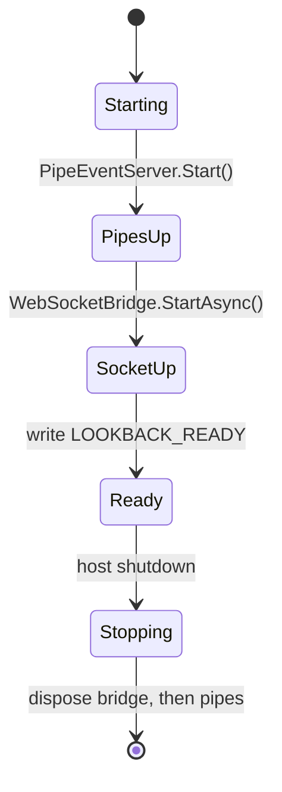

# Recorder host

`src/Lookback.Recorder`: the service executable. It hosts the event stream,
official-player calibration and the shell's control commands (ratings and
footage analysis). Live capture, encode and the governor join it with the
capture wiring (see `docs/capture-handoff.md` step 6).

## `Program.cs`

1. Sets `GCSettings.LatencyMode = SustainedLowLatency`, which avoids blocking
   gen-2 collections while the process runs, so capture and audio threads are
   not paused.
2. Builds a generic host. Console logging goes to **stderr**
   (`LogToStandardErrorThreshold = Trace`), because stdout is reserved for the
   handshake.
3. Binds `RecorderOptions` from the `Recorder` configuration section
   (appsettings, environment variables such as `Recorder__PipeName`, or
   command-line `--Recorder:WebSocketPort=…`).
4. Registers one `InProcessEventBus` as `IEventBus`, `StreamHostService`, and
   `ParentWatcher`.

The project file sets workstation GC (`ServerGarbageCollection=false`) with
concurrent GC on, which suits a desktop background process better than
server GC's per-core heaps.

## `RecorderOptions.cs`

| Option | Default | Meaning |
|---|---|---|
| `PipeName` | `lookback.events` | Named pipe the other processes connect to |
| `WebSocketPort` | `0` | 0 picks a free port, reported in the handshake |
| `Profiler` | `false` | Serve the [live profiler](Live-Profiler) at `/profiler` and print `LOOKBACK_PROFILER <url>` on stdout |
| `OfficialPlayer` | `true` | Accept official-player frames at `/ingest` and serve the [calibration](Official-Player-Calibration) panel |
| `ProfilesDirectory` | unset | The checkout's `profiles` folder, so calibration can save confirmed numbers |
| `Control` | `true` | Handle the shell's `rate`, `analyze` and `save` commands on `/events` |
| `DatasetsDirectory` | `%LOCALAPPDATA%\Lookback\datasets` | Where ratings are stored (`<dir>/<game>/ratings.jsonl`); point it at the checkout's `datasets` so `ml/` trains on them |
| `ParentProcessId` | unset | The shell's pid: the recorder stops when that process exits, however it exits |

## `StreamHostService.cs`

An `IHostedService` that starts the `PipeEventServer` and the
`WebSocketBridge`, then writes one line to stdout:

```
LOOKBACK_READY {"pipe":"lookback.events","ws":"ws://127.0.0.1:45165/events","token":"8BC3…"}
```

Electron spawns the recorder and reads this line. The token travels only over
the child process's stdout pipe: it never appears on a command line (visible
to other processes), in an environment block, or on disk. On shutdown the
service disposes the bridge and the pipe server, which closes every
connection.

Logging uses the `[LoggerMessage]` source generator, which avoids boxing and
string formatting when a level is disabled.



## Control commands

The bridge hands each text message a client sends on `/events` to
`ControlService` and returns the reply to that client only, through the same
per-socket send lock as the event stream (so a reply never interleaves with an
event). Messages over 64 KB are dropped unread. The commands and acks are the
contract in [Desktop Shell](Desktop-Shell#control-commands-on-events):

| Command | What the recorder does |
|---|---|
| `rate` | Looks the session and candidate up in `SessionDirectory` (the last 64 sessions' headers and candidates seen on the bus), refuses unknown ones and any session `RetentionRules.CanPersist` rejects (official player: `ephemeral`, nothing written), stores the rating with `RatingStore.Append`, then publishes `ClipRating` on `clip.rating` so every client sees it |
| `analyze` | Validates the path, profile and retention, acks with a new session id, then (`FootageSessions`, at most two at once) runs the file through `FootageAnalyzer`, the profile (`publishCandidates: false`) and `ClipperRunner` on a private bus as fast as the machine allows. Only the session header and end, game events, profile detections, candidates and QA reports reach the recorder's bus, so the shell gets no signal frames. The header's title is the exact path the shell sent |
| `save` | `unsupported` until the recorder hosts live capture |

Verified end to end against the built recorder: handshake, `analyze` of a
generated clip, candidates on the socket with 0 signal frames, `rate` acked as
stored and broadcast, one line in `datasets/<game>/ratings.jsonl`, and the
recorder exiting when its parent process is killed.

## Try it

```
dotnet run --project src/Lookback.Recorder 2>/dev/null
```
