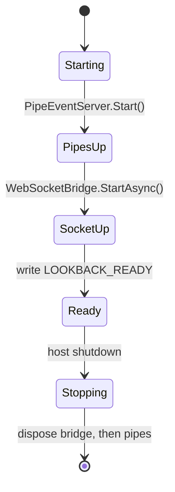

# Recorder host

`src/Lookback.Recorder`: the service executable. In M0 it hosts the event
stream; capture, encode and the governor join it in M3.

## `Program.cs`

1. Sets `GCSettings.LatencyMode = SustainedLowLatency`, which avoids blocking
   gen-2 collections while the process runs, so capture and audio threads are
   not paused.
2. Builds a generic host. Console logging goes to **stderr**
   (`LogToStandardErrorThreshold = Trace`), because stdout is reserved for the
   handshake.
3. Binds `RecorderOptions` from the `Recorder` configuration section
   (appsettings, environment variables such as `Recorder__PipeName`, or
   command-line `--Recorder:WebSocketPort=…`).
4. Registers one `InProcessEventBus` as `IEventBus`, and `StreamHostService`.

The project file sets workstation GC (`ServerGarbageCollection=false`) with
concurrent GC on, which suits a desktop background process better than
server GC's per-core heaps.

## `RecorderOptions.cs`

| Option | Default | Meaning |
|---|---|---|
| `PipeName` | `lookback.events` | Named pipe the other processes connect to |
| `WebSocketPort` | `0` | 0 picks a free port, reported in the handshake |
| `Profiler` | `false` | Serve the [live profiler](Live-Profiler) at `/profiler` and print `LOOKBACK_PROFILER <url>` on stdout |

## `StreamHostService.cs`

An `IHostedService` that starts the `PipeEventServer` and the
`WebSocketBridge`, then writes one line to stdout:

```
LOOKBACK_READY {"pipe":"lookback.events","ws":"ws://127.0.0.1:45165/events","token":"8BC3…"}
```

Electron spawns the recorder and reads this line. The token travels only over
the child process's stdout pipe: it never appears on a command line (visible
to other processes), in an environment block, or on disk. On shutdown the
service disposes the bridge and the pipe server, which closes every
connection.

Logging uses the `[LoggerMessage]` source generator, which avoids boxing and
string formatting when a level is disabled.



## Try it

```
dotnet run --project src/Lookback.Recorder 2>/dev/null
```
