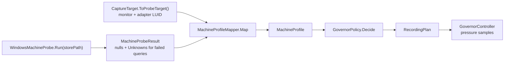

# Resource governor

The governor sizes the recording to the PC it runs on: how much RAM the
replay ring gets, how much disk the session store may use, and which quality
tier (resolution, frame rate, codec, bitrate) to record. It then watches for
memory, disk and encoder pressure and steps quality down, and back up, while
recording.

It is split in three, so the decisions can be tested without the hardware:

| Piece | Project | Platform |
|---|---|---|
| Machine probe: reads RAM, the store volume, GPUs and their outputs, hardware encoders | `Lookback.Governor.Windows` (`WindowsMachineProbe`) | Windows |
| Mapping: probe result + capture target → `MachineProfile`, filling unknowns conservatively | `Lookback.Governor` (`MachineProfileMapper`) | Any |
| Policy and runtime controller: `MachineProfile` → `RecordingPlan`, then step down/up under pressure | `Lookback.Governor` (`GovernorPolicy`, `GovernorController`) | Any |



## The probe

`WindowsMachineProbe.Run(storePath)` reads only what Windows exposes to a
normal user. No admin, no drivers, no WMI, and nothing that opens another
process.

| What | How |
|---|---|
| Physical RAM, total and available | `GlobalMemoryStatusEx` |
| CPU logical cores | `Environment.ProcessorCount` |
| Store volume and free space | `GetVolumePathName` then `GetDiskFreeSpaceEx` (free space available to this user). The store folder need not exist yet; the nearest existing parent is used |
| SSD or HDD, bus type, disk model | `IOCTL_STORAGE_QUERY_PROPERTY` with `StorageDeviceSeekPenaltyProperty` and `StorageDeviceProperty`, on a volume handle opened with **zero access rights**, so no admin is needed. The serial number is in the same descriptor and is not read |
| GPUs | DXGI `EnumAdapters1`: name, PCI vendor, LUID, dedicated VRAM, software flag |
| Which monitors each GPU drives | DXGI `EnumOutputs`, plus `EnumDisplaySettings` for the current mode in physical pixels and the refresh rate. (DXGI desktop coordinates are DPI-virtualised: AETHER's 4K panel at 150% shows as 2560x1440 there) |
| Hardware encoders per GPU | `MfVideoEncoder.List(codec, luid, hardware: true)`, which is `MFTEnum2` filtered by `MFT_ENUM_ADAPTER_LUID`, for H.264, HEVC and AV1 |

Every query is independent. One that fails leaves its field null and adds a
line to `Unknowns`; a single odd adapter (a virtual display driver, say) is
skipped without hiding the others. The probe never throws.

It takes about 80 ms on AETHER the first time (most of it Media Foundation
loading the encoder MFTs) and under 5 ms after that. The Windows tests
assert under 200 ms.

## From probe to profile

`MachineProfileMapper.Map(probe, target)` picks the adapter the pipeline will
run on, because capture, colour conversion and encode all happen on the GPU
that scans out the captured monitor:

1. the adapter that owns the target's monitor (`CaptureTarget.Monitor`);
2. else the target's adapter LUID;
3. else the adapter driving the primary monitor (no target given);
4. else the first hardware adapter with a monitor, then any hardware adapter.

The display size and refresh come from that output. On a hybrid laptop this
picks the iGPU that drives the panel, even when the discrete GPU has better
encoders, since the frames live on the iGPU.

What it assumes when the probe could not tell:

| Unknown | Assumed | Why |
|---|---|---|
| RAM | 8 GB total, 2 GB available | Small ring rather than a large one |
| Store free space | 0, so no disk budget | Never fill a disk we could not measure |
| Seek penalty | SSD only if the bus is NVMe, SCM or UFS; otherwise HDD (20 Mbps cap) | SATA and USB carry both kinds |
| Display mode | 1920x1080 at 60 Hz | The policy never records above the display |
| No H.264 or HEVC hardware encoder on the chosen adapter | Software encoding (`Gpu = null`) | |

Each assumption is listed in `ProfileMapping.Notes`.

**AV1.** The probe records AV1 encoder MFTs (AETHER's NVENC has one) and the
profile lists AV1 among the hardware encoders, but the quality ladder has no
AV1 tier until the muxer writes `av1C`, so the plan tops out at HEVC.

## The policy

`GovernorPolicy.Decide(profile)`:

- **Disk budget**: half the free space above a floor of 5% of the volume (at
  least 10 GB). A user cap can lower it.
- **Ring**: 5% of available RAM, at most 1 GB, holding up to two minutes.
- **Tier**: the best tier the adapter's encoders support that fits the
  display (height and refresh) and leaves the disk budget at least an hour of
  session. On an HDD the bitrate is capped at 20 Mbps. No hardware encoder
  means software H.264 at 720p30.

`GovernorController` then steps down a tier after 2 s of memory, disk or
encoder pressure (halving the ring on memory pressure) and back up after
60 s clear, never above the planned tier.

## Trying it

```
lookback-capture probe [--store <path>] [--monitor <n> | --window <title part>]
```

prints the probe, the chosen adapter and output, the profile, the notes and
the plan with its reasons. The store defaults to `%LOCALAPPDATA%\Lookback`.
It reads only and writes nothing.

AETHER (Windows 10 22H2, RTX 4080 SUPER on a 4K144 primary and a 1440p100,
7800X3D iGPU on another 1440p100), store on D:

```
probe: 77 ms (memory 1, store 2, adapters 8, encoders 65)
memory: 63.1 GB total, 38.2 GB available; 16 logical cores
store: D:\Lookback on D:\: 1078.0 GB free of 1863.0 GB, SSD, Nvme bus, CT2000P3PSSD8
adapter 16D1D: NVIDIA GeForce RTX 4080 SUPER (NVIDIA), 15.7 GB VRAM
  output 0: \\.\DISPLAY1 3840x2160@144 primary
  output 1: \\.\DISPLAY2 2560x1440@100
  H264: NVIDIA H.264 Encoder MFT
  Hevc: NVIDIA HEVC Encoder MFT
  Av1: NVIDIA AV1 Encoder MFT
adapter 17DC8: AMD Radeon(TM) Graphics (AMD), 0.5 GB VRAM
  output 0: \\.\DISPLAY5 2560x1440@100
  H264: AMDh264Encoder, AMDh264Encoder
  Hevc: AMDh265Encoder, AMDh265Encoder
  Av1: none
adapter 47689: NVIDIA GeForce RTX 4080 SUPER (NVIDIA), 15.7 GB VRAM
  H264: NVIDIA H.264 Encoder MFT
  Hevc: NVIDIA HEVC Encoder MFT
  Av1: NVIDIA AV1 Encoder MFT
adapter 17D8A: Microsoft Basic Render Driver (Microsoft, software), 0.0 GB VRAM

target: primary monitor -> NVIDIA GeForce RTX 4080 SUPER \\.\DISPLAY1
profile: 63.1 GB RAM (38.2 available), 16 cores, store D:\ 1078/1863 GB SSD, display 3840x2160@144, encoders H264/Hevc/Av1
  note: NVIDIA GeForce RTX 4080 SUPER has an AV1 encoder; not used until the muxer writes av1C
plan: 2160p60-hevc (hardware, 60 Mbps), ring 1024 MB = 120 s, disk 492 GB = 19.6 h, floor 93 GB
  why: disk budget is 50% of free space above a 93 GB floor
  why: ring gets 1024 MB (5% of available RAM, 1 GB ceiling)
  why: tier 2160p60-hevc: the best that fits the display and holds a useful session
```

The second RTX entry (LUID 47689) drives no monitor; it is the same GPU seen
through a second adapter object, most likely the Parsec virtual display
(an indirect display driver that renders on the RTX). The mapping ignores it because it owns no output. With
`--monitor 2` (the iGPU's monitor) the plan becomes `1440p60-hevc` on AMF.

## Tests

- `tests/Lookback.Governor.Tests/MachineProfileMapperTests.cs` (any OS):
  adapter choice by monitor, by LUID and by primary; hybrid laptops; software
  fallback; AV1-only adapters; every unknown and its assumption; the SSD/HDD
  rule.
- `tests/Lookback.Governor.Windows.Tests` (Windows; skips elsewhere): runs the
  real probe and checks sane values, the 200 ms budget, that every
  `CaptureTarget` maps to the adapter that owns its monitor, that a missing
  drive is recorded instead of thrown, and on AETHER that the RTX has NVIDIA
  H.264, HEVC and AV1 encoders and the plan is HEVC. GitHub's Windows runners
  have no GPU, so the hardware checks skip there.
