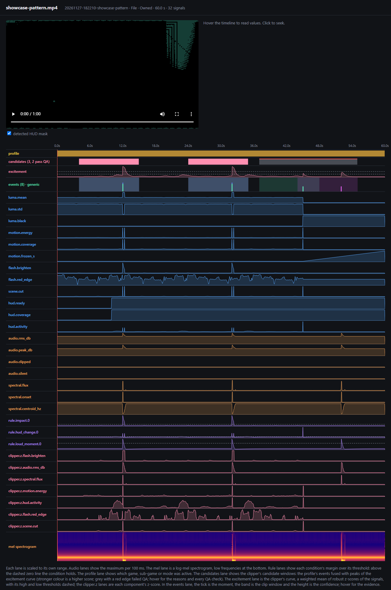
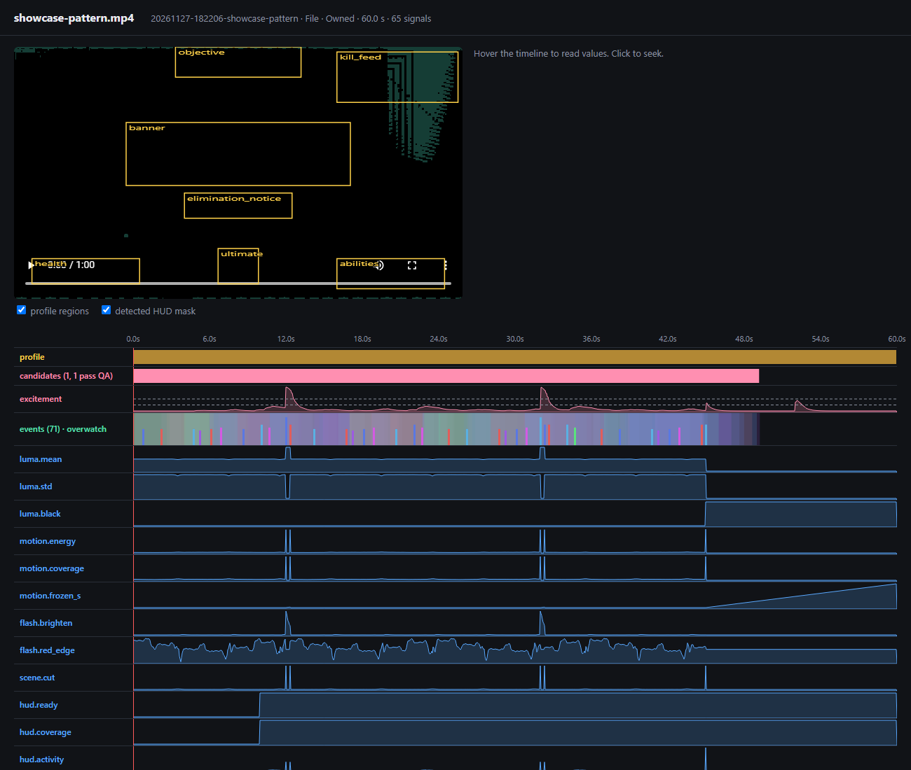
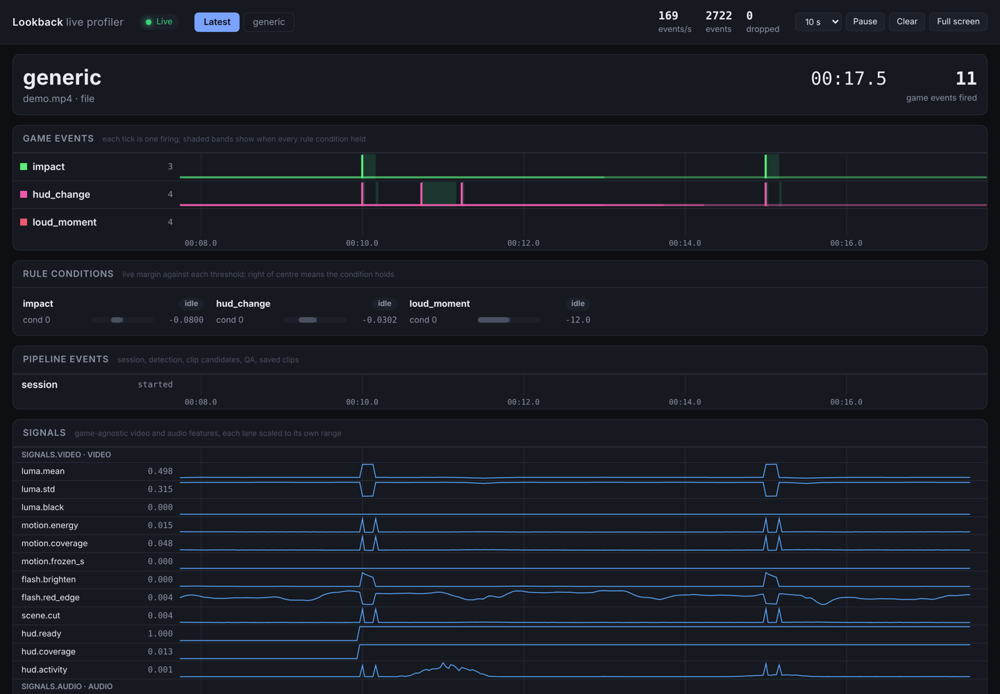
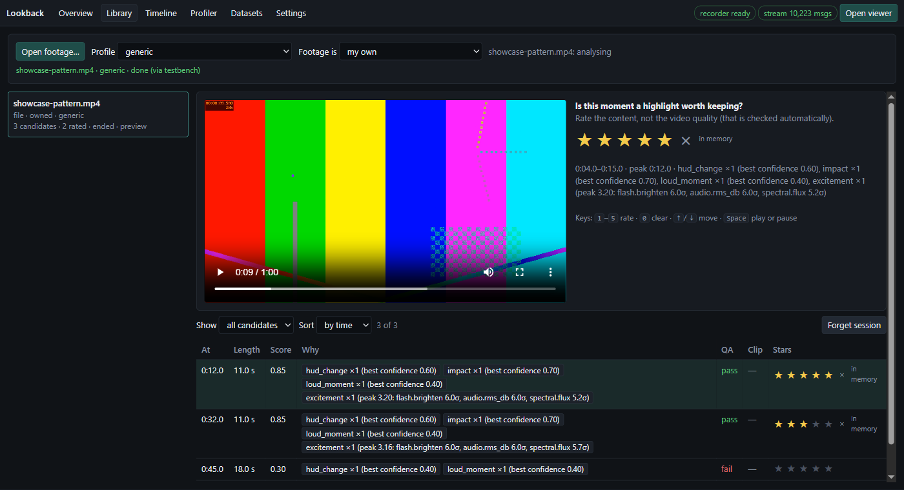
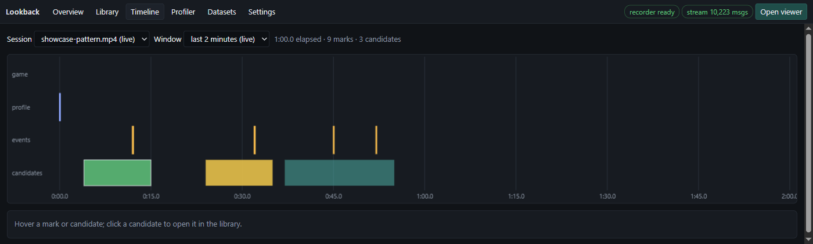
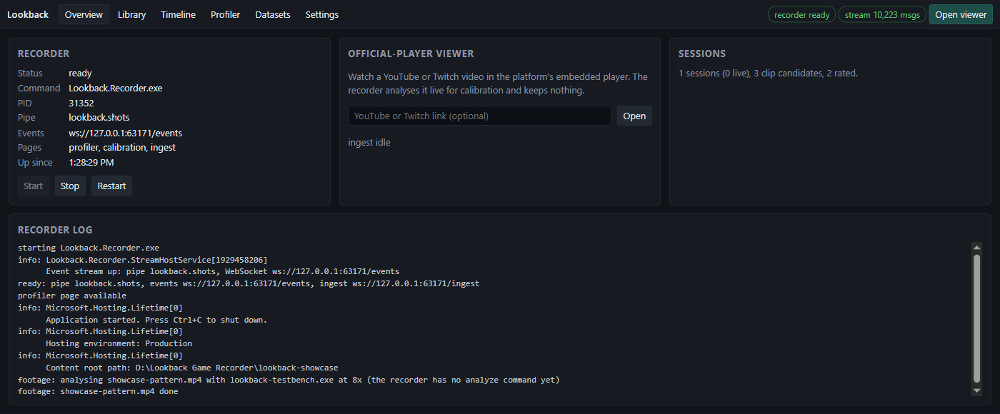

# Showcase

Every part of Lookback you can demo today, in the order data flows through
it: one section per component, with the command, what you should see, how to
read it, and where the code lives. Each section has a target in
`scripts/showcase.ps1`, which builds once and runs the demo for you.

All footage here is generated with ffmpeg test patterns, so nothing on this
page needs a game, your own recordings or anyone else's footage. Every output
excerpt below was captured on the test machine (Windows 10 19045, RTX 4080
SUPER + Radeon iGPU, ffmpeg 7) on 2026-11-27.

## The script

```powershell
./scripts/showcase.ps1 list          # every demo, in pipeline order
./scripts/showcase.ps1 recorder      # run one
./scripts/showcase.ps1 all           # every unattended demo, in order
```

| Option | Default | Does |
|---|---|---|
| `-Seconds n` | per demo | How long a live demo runs |
| `-GameProfile id` | `generic` (or `overwatch` where HUD regions are the point) | Profile for report, profiles, clipper, profiler, recorder |
| `-Monitor n` | the test-pattern window | Capture that monitor instead (capture, encode, watchdog, probe). It captures whatever is on that screen |
| `-Mic` | off | Audio demo: also capture and encode the default microphone |
| `-NoBuild` | build | Skip `dotnet build Lookback.slnx -c Release` |
| `-NoOpen` | open | Print report and page paths instead of opening them |
| `-Out dir` | `%TEMP%\lookback-showcase` | Where everything is written |

What it writes, all under `-Out`, never in the repository:

| Folder | Contents |
|---|---|
| `footage\showcase-pattern.mp4` | The generated test clip (made once) |
| `reports\` | Timeline reports and session logs from `analyze` |
| `browse\`, `recorder\`, `profiler\`, `detect\` | The browser page, process logs, a throwaway detection settings file |
| `clips\` | Clips from the encode, audio and watchdog demos |
| `datasets\`, `rate-out\` | The rating demo's manifest, footage copy and `ratings.jsonl` |
| `ml\` | Synthetic ratings and the trained model |

Nothing is ever recorded from an official player, and the script never
touches your real `%LOCALAPPDATA%\Lookback\detection.json`, the encoder
blocklist, or `datasets/`. Prerequisites are those of the
[Quickstart](Quickstart): .NET 10 SDK, ffmpeg with ffprobe and ffplay on
`PATH`, Node.js 24 for the shell, and Python 3.12 with `ml/requirements.txt`
for training.

### The test clip

`showcase-pattern.mp4` is 60 s of `testsrc2` at 1280x720, 30 fps, with a quiet
440 Hz tone. Two "moments" (a white flash with a low thump) happen at 12 s and
32 s. From 45 s the picture is black and frozen, with a third thump at 52 s.
That gives the clipper two good candidates and one that must fail QA.

```powershell
ffmpeg -y -f lavfi -i "testsrc2=size=1280x720:rate=30,drawbox=x=0:y=0:w=iw:h=ih:color=white@1:t=fill:enable='between(mod(t,20),12,12.3)*lt(t,45)',drawbox=x=0:y=0:w=iw:h=ih:color=black@1:t=fill:enable='gte(t,45)'" -f lavfi -i "aevalsrc='0.05*sin(2*PI*440*t)+if(between(mod(t,20),12,12.6),0.6*sin(2*PI*90*t)*exp(-6*(mod(t,20)-12)),0)':s=48000" -t 60 -c:v libx264 -pix_fmt yuv420p -c:a aac showcase-pattern.mp4
```

The commands below use these names (run from the repository root after
`dotnet build Lookback.slnx -c Release`):

```powershell
$tb  = "src\Lookback.Testbench\bin\Release\net10.0\lookback-testbench.exe"
$rec = "src\Lookback.Recorder\bin\Release\net10.0\Lookback.Recorder.exe"
$cap = "src\Lookback.Capture.Cli\bin\Release\net10.0-windows10.0.22621.0\lookback-capture.exe"
$det = "src\Lookback.Detection.Cli\bin\Release\net10.0-windows10.0.22621.0\lookback-detect.exe"
$clip = "$env:TEMP\lookback-showcase\footage\showcase-pattern.mp4"
```

## What cannot be demoed yet

| Component | Why | Closest demo today |
|---|---|---|
| The recorder hosting live capture (detection → capture → clipper → ring in one process) | That wiring is in progress; the recorder hosts the event stream only | `capture`, `encode`, `audio` run the same pipeline in the `lookback-capture` bench; `recorder` shows the stream |
| The D3D11/D3D12 present hook | In open PR Joshmh7128/Lookback#24, not on `main`. Anti-cheat profiles never allow it | none |
| Ratings stored by the recorder from the shell | The recorder's `rate` handling is not wired; the shell keeps ratings in memory | `rate` stores ratings from the terminal |
| Learned scores on live candidates | No model is trained on real ratings yet, and the testbench rating path attaches only the floor features (2 of 30) | `train` and `scorer` on synthetic data |

`showcase.ps1 list` marks the first two as `not yet`; running them prints the
same explanation.

---

## 1. Recorder handshake and the event stream

**What it shows.** The recorder starts, prints one machine-readable handshake
line, and serves every envelope on a loopback WebSocket. The testbench plays
the test clip into the recorder's named pipe, the way live capture will.

```powershell
./scripts/showcase.ps1 recorder
```

By hand: start the recorder, then feed it from a second terminal.

```powershell
& $rec --Recorder:Profiler=true --Recorder:PipeName=lookback.showcase
& $tb live $clip --profile generic --pipe lookback.showcase --speed 4
```

**What you should see** (tokens shortened here; the script also does that):

```
LOOKBACK_READY {"pipe":"lookback.showcase","ws":"ws://127.0.0.1:62761/events","token":"4696...","ingest":"ws://127.0.0.1:62761/ingest","calibrate":"http://127.0.0.1:62761/calibrate"}
LOOKBACK_PROFILER http://127.0.0.1:62761/profiler#token=4696...

== Event stream on the WebSocket (what the shell sees)
  session         testbench        SessionStarted SOURCE_KIND_FILE RETENTION_OWNED profile=generic
  game.profile    profile.generic  ProfileDetected generic DETECTION_METHOD_MANUAL
  game.event      profile.generic  GameEvent loud_moment confidence 0.4
  game.event      profile.generic  GameEvent impact confidence 0.7
  game.event      profile.generic  GameEvent hud_change confidence 0.6
  (last 5 s: signals.audio 1944, signals.clipper 195, signals.rules 582, signals.video 582)
  clip.candidate  clipper          ClipCandidate 20261127-182039-showcase-pattern-live-c0001 score 0.85
  qa.report       clipper          QaReport 20261127-182039-showcase-pattern-live-c0001 passed=True
  ...
  clip.candidate  clipper          ClipCandidate 20261127-182039-showcase-pattern-live-c0003 score 0.3
  qa.report       clipper          QaReport 20261127-182039-showcase-pattern-live-c0003 passed=False
  session         testbench        SessionEnded end of file
  10223 envelopes received
```

**How to read it.**

- Stdout carries only the `LOOKBACK_READY` and `LOOKBACK_PROFILER` lines;
  logs go to stderr (`recorder\recorder.stderr.txt` under `-Out`). The shell
  parses exactly that line.
- The script connects to `ws` with `?token=` like the shell does, and prints
  one line per non-signal envelope. Signal frames (30 per second per family)
  are only counted.
- The order is the pipeline's: session header, profile, rule events, then a
  candidate and its QA report once nothing unseen could still overlap it.
- A demo pipe name (`lookback.showcase`) keeps it clear of a recorder the
  shell may be running on `lookback.events`.
- The `LOOKBACK_PROFILER` link opens the live profiler for this stream
  (section 4).

**Code.** `src/Lookback.Recorder/` (`StreamHostService.cs`, the handshake),
`src/Lookback.Stream/` (pipes, `WebSockets/WebSocketBridge.cs`, session log),
`proto/lookback/v1/events.proto`. Pages: [Recorder Host](Recorder-Host),
[Stream Library](Stream-Library), [Event Schema](Event-Schema).

## 2. Footage signals and the timeline report

**What it shows.** A video file decoded into the fixed analysis format and
turned into every game-agnostic video and audio signal, drawn as a scrubbable
HTML report.

```powershell
./scripts/showcase.ps1 report
& $tb analyze $clip --out out --profile generic
```

```
session  20261127-182210-showcase-pattern
media    1280x720 @ 30 fps, 00:01:00, audio: yes
signals  1800 video frames, 6002 audio hops in 1.2 s (51.1x real time)
log      ...\reports\20261127-182210-showcase-pattern.lbklog
report   ...\reports\20261127-182210-showcase-pattern.html
```



**How to read it.**

- 1800 frames for 60 s: signals always run at 384x216 and 30 fps, whatever
  the source.
- `flash.brighten`, `motion.energy`, `scene.cut`, `audio.rms_db` and
  `spectral.flux` spike at 12 s and 32 s (the flashes and thumps).
- From 45 s `luma.black` goes high and `motion.frozen_s` climbs: the black,
  frozen stretch. `spectral.*` still fires at 52 s: the thump is audio only.
- Hover a lane for values, click to seek. The top lanes (profile, candidates,
  excitement, events) are sections 3 and 6. The report needs no server; the
  video frame shows once you play or seek.

**Code.** `src/Lookback.Media/` (ffmpeg `FileSource`),
`src/Lookback.Signals/`, `src/Lookback.Testbench/TestbenchRunner.cs`,
`src/Lookback.Testbench/Report/`. Pages: [Signals Library](Signals-Library),
[Testbench](Testbench), [Media Library](Media-Library).

## 3. Game profiles

**What it shows.** Game knowledge as data: the profile tree, one profile's HUD
regions and rules, and those regions drawn over the video in a report. Then
the same profiles in the browser page.

```powershell
./scripts/showcase.ps1 profiles      # tree, one profile, report with overlay
./scripts/showcase.ps1 browse        # the dataset and profile browser
& $tb profiles
& $tb profiles --tag shooter
& $tb analyze $clip --out out --profile overwatch
& $tb browse --out browse\browser.html
```

```
overwatch                    game      6 events  Overwatch.exe
  overwatch.control          mode      6 events  0 hints, no fingerprint yet
  overwatch.escort           mode      6 events  0 hints, no fingerprint yet
  overwatch.push             mode      6 events  0 hints, no fingerprint yet
...
roblox                       game      4 events  RobloxPlayerBeta.exe
  roblox.99-nights-in-the-forest subgame   7 events  0 hints, no fingerprint yet
    roblox.99-nights-in-the-forest.day mode      7 events  0 hints, 1-condition fingerprint
```

The script then prints one profile from `profiles/overwatch/overwatch.json`:

```
executables  Overwatch.exe
policy       presentHook=False memoryReading=False
HUD regions (fractions of the frame):
  kill_feed            x 0.72  y 0.02  w 0.27  h 0.20
  elimination_notice   x 0.38  y 0.58  w 0.24  h 0.10
  ...
Event rules:
  elimination          weight 1.0  whenAny region.elimination_notice.activity rise 0.05
  ultimate_used        weight 1.2  when region.ultimate.activity rise 0.08
  death                weight 0.2  when scene.cut above 0.3; when region.banner.saturation below 0.12
  ...
```



**How to read it.**

- Games list executables; sub-games and modes are detected from hints or
  learned visual fingerprints, and inherit their parent's events.
- Every built-in profile keeps `presentHook` and `memoryReading` false.
- A rule is a condition on an existing signal: `region.<name>.activity`,
  `.luma` and `.saturation` come from the HUD regions; the others are the
  game-agnostic signals.
- In the report, **profile regions** draws the rectangles (yellow) and
  **detected HUD mask** the cells that stay static. The events lane and one
  lane per rule condition show the margin against each threshold.
- On the test pattern the Overwatch rules fire 71 times (27 "eliminations"):
  the pattern moves inside every region. That is expected; judge a profile on
  real footage.
- The browser page lists every profile with what it identifies, its key
  signals, its regions on a frame and dataset coverage. Coverage is empty
  until you add your own `datasets/<game>/manifest.json`; only example
  manifests are committed. See [Dataset Browser](Dataset-Browser) for its
  screenshots.

**Code.** `profiles/<game>/*.json`, `src/Lookback.Profiles/` (model, regions,
rule detector, candidates), `src/Lookback.Testbench/Browse/`. Pages:
[Game Profiles](Game-Profiles), [Profiles and Local Datasets](Local-Datasets),
[Dataset Browser](Dataset-Browser).

## 4. The live profiler

**What it shows.** Events firing in real time, for demos and for debugging a
profile: the clip plays at 1x and every rule, signal, candidate and QA report
appears on a page as it happens.

```powershell
./scripts/showcase.ps1 profiler                  # 90 s, -Seconds to change
& $tb live $clip --profile overwatch --loop
```

```
profiler http://127.0.0.1:62987/profiler#token=C7A7...
```

The script opens the link (keep the whole `#token=…` part if you copy it).
The clip starts when the page connects, so nothing is missed.



**How to read it.** Game-event lanes tick when a rule fires (shaded bands show
when every condition held); the rule panel shows each condition's live margin
(right of centre means it holds); pipeline events list the session,
detection, candidates and QA; signal sparklines scroll below. `live` writes
nothing to disk. The live-capture bench serves the same page with
`--profiler` (section 7).

**Code.** `src/Lookback.Profiler/` (`profiler.html`, `ProfilerPage.cs`),
`src/Lookback.Testbench/Live/LiveRunner.cs`. Page: [Live Profiler](Live-Profiler).

## 5. Game detection

**What it shows.** Which game is running, from the process list and top-level
windows only, with debounced DETECTED / FOCUSED / WINDOW_CHANGED / EXITED. The
demo opts a stand-in "game" (Lookback's own test window) in through a
throwaway settings file and watches it start and stop.

```powershell
./scripts/showcase.ps1 detect
& $det allow lookback-testwindow.exe --profile generic --settings $env:TEMP\detection.json
& $det windows --settings $env:TEMP\detection.json
& $det --seconds 20 --settings $env:TEMP\detection.json
```

```
    pid exe                              mode       size        monitor    fg  verdict / title
  25172 lookback-testwindow.exe          Windowed   640x480     10034          GAME generic (Manual)
        "Lookback showcase game"

Watching for games every 1000 ms (17 game profiles, settings ...\detect\detection.json). Ctrl+C to stop.
    1.02s  (not yet)      pid 25172 lookback-testwindow.exe: generic: holding for start
    3.02s  Detected       generic (Manual) pid 25172 lookback-testwindow.exe  [live-generic-25172-5c3bb40e21f]
           window 0x8C07B2 "Lookback showcase game" 640x480 Windowed, adapter 16D1D
           capture: window "Lookback showcase game" (pid 25172) on \\.\DISPLAY1
           policy: presentHook=False memoryReading=False  engine: ?  why: opted in by the user as generic
   14.03s  Exited         generic (Manual) pid 25172 lookback-testwindow.exe  [live-generic-25172-5c3bb40e21f]
20 polls, 2 lifecycle envelopes on the bus (2 queued for this tool), 0 game(s) running.
```

**How to read it.**

- `holding for start`, then DETECTED 2 s later: the 3 s start hold that
  filters out launchers and splash screens.
- The window closes after 10 s; EXITED comes about 5 s later (the exit grace,
  in case it relaunches).
- No FOCUSED: the test window never takes focus. Click it while it is open
  and FOCUSED / UNFOCUSED appear.
- `Manual` and `opted in by the user`: an executable the user allowed gets
  external capture only, whatever its profile says.
- `lookback-detect windows` (no filter) shows every capture-sized window on
  the machine and why each is or is not a game. The script filters it to the
  stand-in, so nothing else on your desktop is printed. Without `--settings`
  the bench uses your real `%LOCALAPPDATA%\Lookback\detection.json`.

**Code.** `src/Lookback.Detection/` (matching, lifecycle, `DetectionRunner.cs`),
`src/Lookback.Detection.Windows/`, `src/Lookback.Detection.Cli/Program.cs`,
`tests/Lookback.Detection.TestWindow/`. Page: [Game Detection](Game-Detection).

## 6. Clipper v1: candidates and QA

**What it shows.** Signals and profile events become clip candidates: robust
z-scores, an excitement curve, peaks with hysteresis, fusion with the
profile's events, and QA gates on every candidate.

```powershell
./scripts/showcase.ps1 clipper
& $tb analyze $clip --out out --profile generic
```

```
profile      0.0 s  generic (manual, 100 %)
events   8 from profile 'generic'
         hud_change                   3
         impact                       2
         loud_moment                  3
clips    3 candidates, 2 pass QA
             4.0-15.0    s  score 0.85  QA ok    hud_change ×1 (best confidence 0.60); impact ×1 (best confidence 0.70); loud_moment ×1 (best confidence 0.40); excitement ×1 (peak 3.20: flash.brighten 6.0σ, audio.rms_db 6.0σ, spectral.flux 5.2σ)
            24.0-35.0    s  score 0.85  QA ok    hud_change ×1 (best confidence 0.60); impact ×1 (best confidence 0.70); loud_moment ×1 (best confidence 0.40); excitement ×1 (peak 3.16: flash.brighten 6.0σ, audio.rms_db 6.0σ, spectral.flux 5.7σ)
            37.0-55.0    s  score 0.30  QA fail (black, frozen)  hud_change ×1 (best confidence 0.40); loud_moment ×1 (best confidence 0.40)
```

**How to read it.**

- Each candidate's window comes from the events' pre- and post-roll; its
  reasons list the events and the curve peak with the three strongest
  z-scores (each component is clamped to 0..6σ).
- The third candidate sits on black, frozen video: QA fails it (`black`,
  `frozen`) and its score is low. A failed candidate is kept and labelled,
  not dropped.
- In the report (screenshot in section 2): the **candidates** lane shows the
  three windows (grey with a red edge = failed QA; hover for every check), the
  **excitement** lane the curve with its high and low thresholds dashed, and
  the `clipper.z.*` lanes each component's z-score.

**Code.** `src/Lookback.Clipper/` (`ClipperEngine.cs`, `Curve/`, `Candidates/`,
`Qa/`, weights in `clipper.defaults.json`). Page: [Clipper](Clipper).

## 7. Live screen capture and analysis

**What it shows.** WGC capture of a window on the GPU that owns its monitor,
downscaled on the GPU into the same signal pipeline as footage. The script
opens a live test-pattern window (ffplay) and captures that, never your
desktop.

```powershell
./scripts/showcase.ps1 capture                      # -Monitor n to capture a screen instead
ffplay -window_title "Lookback showcase pattern" -x 1280 -y 720 -f lavfi -i testsrc2=size=1280x720:rate=60
& $cap --list
& $cap --window "Lookback showcase pattern" --seconds 15 --profiler
```

```
monitor 0: \\.\DISPLAY1 2560x1440 adapter 16D1D output 0
monitor 1: \\.\DISPLAY2 2560x1440 adapter 16D1D output 1
monitor 2: \\.\DISPLAY5 2560x1440 adapter 17DC8 output 0
WGC supported: True, borderless: False
profiler: http://127.0.0.1:62875/profiler#token=C8BE...
capturing window "Lookback showcase pattern" (pid 34952) on \\.\DISPLAY1 with wgc on NVIDIA GeForce RTX 4080 SUPER; persist: True
  1.3s  capture  143.0 fps  analysis  29.8 fps  dropped 0
  2.3s  capture  144.2 fps  analysis  29.8 fps  dropped 0
  ...
{
  "frames": 242,
  "signals": [ { "signal": "luma.mean", "mean": 0.496, "max": 0.499 }, ... ]
}
```

**How to read it.**

- The capture line names the backend (`wgc`), the adapter that owns the
  window's monitor, and `persist`: whether retention would allow anything to
  be written (false for `--official-player`).
- `capture` follows the compositor (about 144 fps here, the primary's refresh);
  `analysis` is thinned to 30 fps; `dropped` should stay 0.
- Open the `profiler:` link to watch the signals live, as in section 4. The
  JSON at the end summarises each signal over the run.
- Nothing is written to disk without `--encode`.

**Code.** `src/Lookback.Capture/` (`Wgc/`, `Dxgi/`, `Gpu/`,
`LiveCaptureSession.cs`, `Targets/`), `src/Lookback.Signals/LiveAnalyzer.cs`,
`src/Lookback.Capture.Cli/Program.cs`. Page: [Live Capture](Live-Capture).

## 8. Live encode and a saved clip

**What it shows.** The encode path beside the analysis tap: NV12 conversion,
the constant-rate ticker, the hardware encoder picked by adapter LUID, the RAM
replay ring, and a clip cut from the ring without re-encoding.

```powershell
./scripts/showcase.ps1 encode
& $cap --window "Lookback showcase pattern" --seconds 12 --encode 8 --out clip.mp4 --codec hevc --fps 60 --size 1280x720 --mbps 10
ffprobe -v error -count_packets -show_entries stream=codec_name,width,height,avg_frame_rate,nb_read_packets clip.mp4
ffprobe -v error -select_streams v:0 -skip_frame nokey -show_entries frame=pts_time -of csv=p=0 clip.mp4
```

```
encoding Hevc 1280x720@60 10 Mbps with NVIDIA HEVC Encoder MFT (hardware, capture device)
  1.4s  capture  143.3 fps  analysis  29.9 fps  dropped 0  encode  59.7 fps  repeated   0  skipped 0  busy 0  ring    1.1 MB
  ...
 12.5s  capture  143.9 fps  analysis  29.8 fps  dropped 0  encode  59.6 fps  repeated   0  skipped 0  busy 0  ring   13.6 MB
wrote ...\clips\showcase-encode.mp4: 485 frames, 9.2 MB; ticker EncodeStats { Captured = 1741, Ticks = 725, Encoded = 725, Repeated = 0, Skipped = 0, EncoderBusy = 0, PacketsOut = 725, Recoveries = 0 }

== The saved clip
  video hevc 1280x720, 60.000 fps average, 485 frames
  decodes with no errors
keyframes at 0, 2, 4, 6, 8 s
```

**How to read it.**

- The encoder line names the Media Foundation MFT for the capture adapter:
  NVENC here, AMF on the iGPU's monitor (`-Monitor 2` on this machine),
  software H.264 where there is no hardware encoder.
- `encode` holds 60 fps whatever `capture` does: the ticker encodes the
  latest frame on its own clock and counts `repeated`, `skipped` and `busy`
  (all 0 here). `Ticks = Encoded = PacketsOut` means nothing was lost.
- The clip is the last 8 s, starting on the keyframe at or before that point
  (485 frames ≈ 8.08 s). Keyframes every 2 s from 0 is the 2 s GOP.
- `ring` is the replay ring's size in RAM. Only a clip you ask for reaches
  disk, and `--official-player` refuses `--encode` before capture starts.

**Code.** `src/Lookback.Encode/` (`EncodeTicker.cs`, `MfVideoEncoder.cs`),
`src/Lookback.Capture/Gpu/` (NV12 converter), `src/Lookback.Replay/`
(`Packets/ReplayRing.cs`, `Mp4/ClipWriter.cs`). Page:
[Live Capture](Live-Capture#the-bench-lookback-capture).

## 9. Live audio

**What it shows.** WASAPI loopback of the default speakers (and the mic with
`-Mic`), the drift-fitted sample clock, resampling to 48 kHz, analysis hops,
and AAC into the same ring as the video. The script plays a quiet beep so
there is something to hear; loopback records everything the speakers play.

```powershell
./scripts/showcase.ps1 audio            # add -Mic for the microphone track
& $cap audio --list
& $cap audio --seconds 10 --out audio.mp4
```

```
render  * Speakers (Realtek(R) Audio)
capture * Microphone (Yeti Stereo Microphone)
Windows build 19045; process loopback needs 20348+
plan: system loopback, encoded
game: endpoint loopback of Speakers (Realtek(R) Audio) (48000 Hz 2 ch IeeeFloat)
  1.0s  game  -21.5 dBFS  packets 101  hops 101  rate 48000.04 Hz  resets 1  glitches 0  alloc 0 B  aac 45
  ...
 10.1s  game  -21.5 dBFS  packets 1007  hops 1007  rate 47999.87 Hz  resets 1  glitches 0  alloc 0 B  aac 470
wrote ...\clips\showcase-audio.mp4: 145 KiB, tracks 1:game

== The saved audio clip
  audio aac 48000 Hz, 2 channels, 473 packets
  decodes with no errors
```

**How to read it.**

- `plan` is `AudioCapturePolicy`'s decision: endpoint loopback on Windows 10,
  process loopback of the game's pid on build 20348+.
- `rate` is the measured device rate from the clock fit (within a few ppm of
  48000); `resets 1` is the initial fit.
- `alloc 0 B`: nothing is allocated on the capture thread per packet.
- `packets` and `hops` advance 100 per second (10 ms each). With nothing
  playing, loopback is kept alive with silence, so they still advance.
- The clip has one AAC track per source (`tracks 1:game`, plus `2:mic` with
  `-Mic`).

**Code.** `src/Lookback.Audio/` (`WasapiSource.cs`, `AudioCapturePolicy.cs`,
`StereoResampler.cs`), `src/Lookback.Encode/MfAacEncoder.cs`. Page:
[Live Capture](Live-Capture#live-audio).

## 10. The governor probe

**What it shows.** What the resource governor learns about the PC before a
session, and the recording plan it picks for the captured monitor.

```powershell
./scripts/showcase.ps1 probe
& $cap probe --store $env:TEMP\lookback-showcase\store
```

```
probe: 77 ms (memory 0, store 3, adapters 7, encoders 65)
memory: 63.1 GB total, 34.3 GB available; 16 logical cores
store: ...\store on C:\: 260.3 GB free of 930.9 GB, SSD, Nvme bus, Samsung SSD 990 PRO 1TB
adapter 16D1D: NVIDIA GeForce RTX 4080 SUPER (NVIDIA), 15.7 GB VRAM
  output 0: \\.\DISPLAY1 3840x2160@144 primary
  output 1: \\.\DISPLAY2 2560x1440@100
  H264: NVIDIA H.264 Encoder MFT
  Hevc: NVIDIA HEVC Encoder MFT
  Av1: NVIDIA AV1 Encoder MFT
adapter 17DC8: AMD Radeon(TM) Graphics (AMD), 0.5 GB VRAM
  output 0: \\.\DISPLAY5 2560x1440@100
  ...
target: primary monitor -> NVIDIA GeForce RTX 4080 SUPER \\.\DISPLAY1
plan: 2160p60-hevc (hardware, 60 Mbps), ring 1024 MB = 120 s, disk 107 GB = 4.3 h, floor 47 GB
  why: disk budget is 50% of free space above a 46 GB floor
  why: ring gets 1024 MB (5% of available RAM, 1 GB ceiling)
  why: tier 2160p60-hevc: the best that fits the display and holds a useful session
```

**How to read it.** The first line times each probe step (about 80 ms cold).
The plan follows the adapter that owns the target monitor, so it matches the
encoder the capture pipeline will use. Every `why:` line is a rule from the
policy; `note:` lines (AV1 here) and unknowns are logged, never fatal. A
second RTX adapter object with no outputs is ignored.

**Code.** `src/Lookback.Governor/` (`GovernorPolicy.cs`,
`MachineProfileMapper.cs`, `QualityTier.cs`),
`src/Lookback.Governor.Windows/WindowsMachineProbe.cs`. Page:
[Resource Governor](Resource-Governor).

## 11. The encode watchdog

**What it shows.** Lookback never hangs on a stuck encoder: it swaps to the
next encoder on the same tick grid, or ends the process. Real stalls are rare
and driver-dependent, so the demo shows it three ways: the fault-injection
tests, a live encode with a tight watchdog, and the blocklist file.

```powershell
./scripts/showcase.ps1 watchdog
tests\Lookback.Capture.Tests\bin\Release\net10.0-windows10.0.22621.0\Lookback.Capture.Tests.exe -class Lookback.Capture.Tests.EncodeTickerFaultTests -reporter verbose
tests\Lookback.Core.Tests\bin\Release\net10.0\Lookback.Core.Tests.exe -class Lookback.Core.Tests.StallWatchdogTests -reporter verbose
& $cap --window "Lookback showcase pattern" --seconds 10 --encode 6 --out watchdog.mp4 --codec h264 --fps 60 --size 1280x720 --stall-ms 750 --isolate --no-blocklist
```

```
    Lookback.Capture.Tests.EncodeTickerFaultTests.A_hung_encoder_is_abandoned_and_the_next_one_takes_over_on_the_same_grid [FINISHED] Time: 0.836s
    Lookback.Capture.Tests.EncodeTickerFaultTests.An_encoder_that_takes_frames_but_never_outputs_is_replaced [FINISHED] Time: 0.898s
    Lookback.Capture.Tests.EncodeTickerFaultTests.An_encoder_that_refuses_all_input_is_replaced [FINISHED] Time: 0.898s
    Lookback.Capture.Tests.EncodeTickerFaultTests.When_every_encoder_stalls_the_process_is_ended_instead_of_hanging [FINISHED] Time: 2.674s
    Lookback.Capture.Tests.EncodeTickerFaultTests.Too_many_swaps_in_one_session_end_the_process [FINISHED] Time: 2.665s
    Lookback.Capture.Tests.EncodeTickerFaultTests.Dispose_returns_promptly_even_with_a_stuck_encoder [FINISHED] Time: 2.045s
    Lookback.Capture.Tests.EncodeTickerFaultTests.The_blocklist_survives_a_restart [FINISHED] Time: 0.072s
   Lookback.Capture.Tests  Total: 7, Errors: 0, Failed: 0, Skipped: 0, Not Run: 0, Time: 10.187s
   Lookback.Core.Tests  Total: 5, Errors: 0, Failed: 0, Skipped: 0, Not Run: 0, Time: 0.179s

encoding H264 1280x720@60 20 Mbps with NVIDIA H.264 Encoder MFT (hardware, own device)
  ...
wrote ...\clips\showcase-watchdog.mp4: 364 frames, 12.2 MB; ticker EncodeStats { ..., EncoderBusy = 0, PacketsOut = 604, Recoveries = 0 }

== The encoder blocklist on this machine (read only)
none: C:\Users\<you>\AppData\Local\Lookback\encoder-blocklist.json does not exist (no encoder has stalled here)
```

**How to read it.**

- The tests inject encoders that hang inside a call, accept frames but never
  output, or refuse all input. Each test name is what it proves. The two
  ~2.7 s tests end in the fatal path; the test passes its own `Fatal`
  callback, where the real one ends the process.
- In the live run, `--stall-ms 750` is a much tighter threshold than the
  default 2 s, `--isolate` puts the encoder on its own D3D11 device (`own
  device` in the encoder line), and `--no-blocklist` stops a demo from
  blocklisting a healthy encoder. A healthy encoder never trips it:
  `Recoveries = 0` and no `STALLED:` line. If it did, the bench would print
  `STALLED:` with every thread's phase and continue on the next encoder.
- The blocklist (keyed by adapter vendor, device and driver version) is only
  read here. On a machine where an encoder once stalled, you would see its
  entry, and the next run starting further down the chain.

**Code.** `src/Lookback.Core/Diagnostics/StallWatchdog.cs`,
`src/Lookback.Encode/EncodeTicker.cs` and `IVideoEncoder.cs` (fallback chain,
blocklist), `tests/Lookback.Capture.Tests/EncodeTickerFaultTests.cs`. Page:
[Live Capture](Live-Capture#no-deadlocks-one-device-lock-a-watchdog-fail-fast).

## 12. M4: rating, training and the ONNX scorer

**What it shows.** The learning loop: content ratings of candidates stored
behind `RetentionRules`, a model trained and calibrated per game, exported to
ONNX, and scored in C# with the heuristic as a fallback.

### Rating in the terminal

```powershell
./scripts/showcase.ps1 rate
& $tb rate datasets\generic\manifest.json --datasets <scratch datasets folder> --again
```

The script writes a manifest for the test clip into
`-Out\datasets\generic\` (never into the repository's `datasets/`), then asks
for stars:

```
analysing media/showcase-pattern.mp4 ...
          3 candidates
stars 1-5 (5 = a highlight), 0 clears, Enter skips, p plays, q quits
[1/3] showcase-pattern.mp4  00:00:04.0-00:00:15.0  generic  heuristic 0.85
        hud_change ×1 (best confidence 0.60), impact ×1 (best confidence 0.70), ...
stars> 5
...
rated    2 of 3 candidates (0 cleared, 1 skipped, 0 already rated, 0 refused)

== What was stored
  generic-showcase-pattern-c0001  stars 5  label 1  heuristic 0.85  schema clip-features/1, 30 features
  generic-showcase-pattern-c0002  stars 2  label 0.25  heuristic 0.85  schema clip-features/1, 30 features
```

Each rating is one line in `<datasets>/<game>/ratings.jsonl`: ids, stars, the
label used for training, the heuristic score and `clip-features/1`. Today the
testbench path fills only the floor features (heuristic score and window
length); the rest are `null` until the clipper's features are attached there.
`p` plays the candidate with ffplay. Session ids are stable per file, so
without `--again` a second pass asks only about new candidates.

### Training on synthetic ratings

```powershell
./scripts/showcase.ps1 train
cd ml
.venv\Scripts\python -m lookback_ml.synth --out $env:TEMP\lookback-showcase\ml\synth
.venv\Scripts\python -m lookback_ml.train --datasets $env:TEMP\lookback-showcase\ml\synth --out $env:TEMP\lookback-showcase\ml\model
```

It needs `ml\.venv` (see [Clip Scoring](Clip-Scoring#running-it)), or
`LOOKBACK_ML_PYTHON` pointing at a Python that has `ml/requirements.txt`. The
script says so and stops if neither exists; it never installs anything.

```
Trained 2026-11-27T18:25:53+00:00 on 268 ratings from 18 sessions; 5-fold cross-validation by session; C = 0.01.

## Overall

| scorer | auc | log_loss | brier | ece | precision_at_3 | n |
|---|---|---|---|---|---|---|
| heuristic | 0.859 | 0.605 | 0.070 | 0.044 | 0.648 | 268 |
| model | 0.935 | 0.561 | 0.051 | 0.046 | 0.833 | 268 |
| calibrated | 0.935 | 0.520 | 0.035 | 0.033 | 0.833 | 268 |
...
model    ...\ml\model\model.onnx
manifest ...\ml\model\model.json
```

Held-out numbers, overall and per synthetic game (`synth-a`, `synth-b`,
`synth-c`): the logistic-regression model against the heuristic score, then
after per-game Platt calibration (same AUC, lower log loss and ECE). Synthetic
data proves the pipeline, not the model.

### The scorer in C#

```powershell
./scripts/showcase.ps1 scorer
tests\Lookback.Scoring.Tests\bin\Release\net10.0\Lookback.Scoring.Tests.exe -class Lookback.Scoring.Tests.LearnedClipScorerTests -class Lookback.Scoring.Tests.ClipperFeatureMapTests -reporter verbose
```

```
    Lookback.Scoring.Tests.LearnedClipScorerTests.Inference_and_calibration_match_python [FINISHED] Time: 0.097s
    Lookback.Scoring.Tests.LearnedClipScorerTests.Broken_model_is_reported_and_skipped [FINISHED] Time: 0.007s
    Lookback.Scoring.Tests.LearnedClipScorerTests.Heuristic_stands_without_a_model [FINISHED] Time: 0s
    Lookback.Scoring.Tests.ClipperFeatureMapTests.Mapped_features_score_through_the_fixture_model [FINISHED] Time: 0.069s
    ...
   Lookback.Scoring.Tests  Total: 12, Errors: 0, Failed: 0, Skipped: 0, Not Run: 0, Time: 0.195s
```

`Inference_and_calibration_match_python` runs the tiny committed model with
ONNX Runtime and must match Python within 1e-5, raw and calibrated. The
fallback tests show that no model, a corrupt model, a game the model does not
cover or the wrong feature schema all leave the heuristic standing. After
`train`, the script also prints the trained `model.json` header, and `rate`
passes `--model` so a covered game shows the model's probability.

**Code.** `src/Lookback.Scoring/` (`Ratings/`, `Features/`, `Model/`,
`LearnedClipScorer.cs`), `src/Lookback.Testbench/Datasets/RateRunner.cs`,
`ml/lookback_ml/` (`synth.py`, `train.py`, `calibration.py`). Page:
[Clip Scoring](Clip-Scoring).

## 13. The desktop shell

**What it shows.** The Electron app: it starts the recorder, and shows the
clip library with previews and 1–5 star ratings, the live timeline, and the
official-player viewer that feeds calibration.

```powershell
./scripts/showcase.ps1 shell          # npm ci once, then npm start, with a checklist
./scripts/showcase.ps1 shell-smoke    # the same flows, unattended
```

In the app:

1. The toolbar shows **recorder ready** and **stream open**.
2. **Library → Open footage…**, pick
   `%TEMP%\lookback-showcase\footage\showcase-pattern.mp4`, profile
   `generic`. The three candidates appear as it is analysed at 8x.
3. Select a candidate: the preview loops its window. Rate with
   <kbd>1</kbd>–<kbd>5</kbd> (<kbd>0</kbd> clears, <kbd>↑</kbd>/<kbd>↓</kbd>
   moves).
4. **Timeline** draws the session's events and candidates, coloured by
   stars.
5. **Open viewer**: paste a YouTube or Twitch link and press Play; the
   calibration panel docks on the right. Follow
   [Official-Player Calibration](Official-Player-Calibration#the-workflow).
   Nothing about the video is stored; only numbers you confirm with **Save**
   go into `profiles/`.







**How to read it.**

- Library: `pass`/`fail` is QA; the third candidate fails (black, frozen).
  Stars show **in memory**: the recorder does not store ratings yet, so the
  shell keeps them (use `rate` above to store ratings today).
- The footage line says `via testbench`: until the recorder has an `analyze`
  command, the shell runs `lookback-testbench live … --pipe <recorder pipe>
  --speed 8`, and the log on the Overview tab says so.
- Timeline: candidates rated 4–5 are green, 3 yellow, 1–2 red, unrated in
  the lane's own colour. Here the first is rated 5 and the second 3.

The unattended runs print one line each:

```
LOOKBACK_SMOKE ok {"recorder":"ready","stream":"open",...,"candidates":1,"rated":1,"preview":{"src":"lookback-media","readyState":4,...},"footage":[{"name":"showcase-pattern.mp4","profile":"generic","via":"testbench",...}],...}
LOOKBACK_SMOKE ok {"recorder":"ready","stream":"open",...,"ingest":{"status":"streaming","framesSent":157,"framesDropped":0,...},"panel":"158 frames analysed","session":{"title":"YouTube embedded player","retention":"ephemeral","signalFrames":158},...}
```

The first opens the test clip as **Open footage** would, rates a candidate
and checks the preview loaded; the second plays a synthetic player in the
viewer and checks that frames reach `/ingest` and the calibration panel as an
ephemeral session. The smoke runs keep their userData under `-Out`.

**Code.** `app/src/main/` (`recorder.ts`, `stream.ts`, `library.ts`,
`footage.ts`, `media.ts`, `viewer.ts`, `ingest.ts`), `app/src/renderer/`,
`app/src/viewer/`, `src/Lookback.Calibration/`. Pages:
[Desktop Shell](Desktop-Shell),
[Official-Player Calibration](Official-Player-Calibration).

## Troubleshooting

| Symptom | Cause and fix |
|---|---|
| `ffplay was not found` | The capture demos need ffplay for the test-pattern window; a gyan.dev essentials build has it |
| Capture says the window was not found | The pattern window opened on another desktop or was closed. Re-run, or use `-Monitor n` |
| `No Python environment for ml/` | Create `ml\.venv` as the message says, or set `LOOKBACK_ML_PYTHON` |
| PowerShell refuses to run the script | `powershell -ExecutionPolicy Bypass -File scripts\showcase.ps1 list` |
| The profiler page asks for a token | The link lost its `#token=…` part; copy the whole printed line |
| Ctrl+C during a demo | The script stops the processes it started (recorder, testbench, ffplay) |
