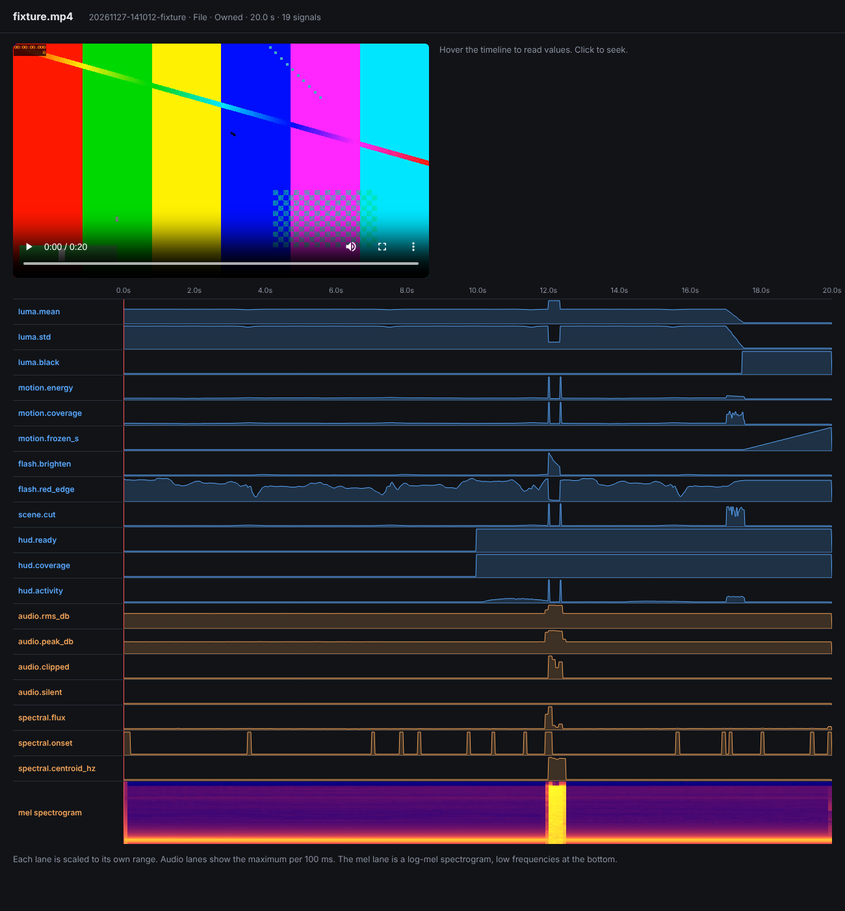
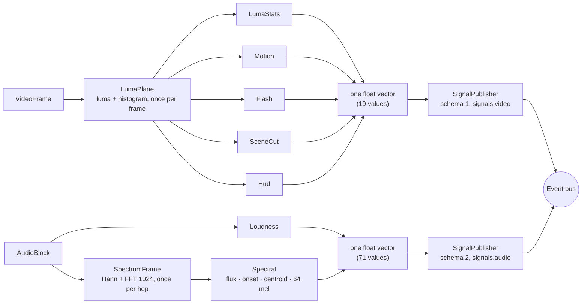
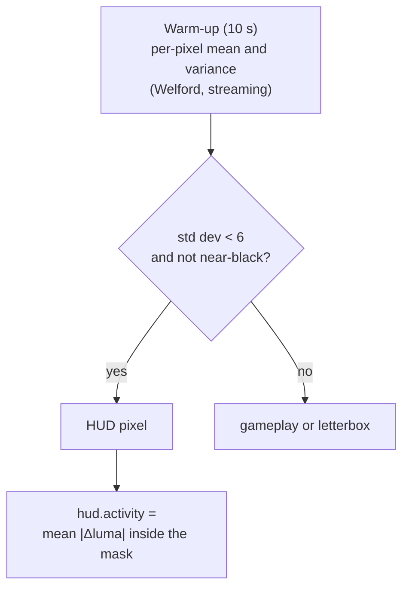

# Signals library

`src/Lookback.Signals`: game-agnostic features computed from every analysis
frame and audio hop, and the code that publishes them onto the event stream.

*A generated test clip: a flash and a noise burst at 12 s, then a fade to
black at 17 s. The flash shows in `luma.mean` and `flash.brighten`; the
burst in the audio lanes, the onset lane and the spectrogram; the fade in
`luma.black` and `motion.frozen_s`.*

## How it fits together

Each **bank** (`VideoSignalBank`, `AudioSignalBank`) runs its signals on one
input and lays their outputs side by side, so one frame or hop becomes one
`SignalFrame`. Shared work (luma conversion, the FFT) is done once by the bank,
not by each signal. Banks and signals allocate nothing per frame; tests
measure this with `GC.GetAllocatedBytesForCurrentThread`.

## Video signals

| Signal | Values | How it works | Why it matters |
|---|---|---|---|
| `LumaStatsSignal` | `luma.mean`, `luma.std`, `luma.black` | Mean and standard deviation of BT.709 luma; black when mean < 0.06 and std < 0.03 | Loading screens, cuts to black, capture failures |
| `MotionSignal` | `motion.energy`, `motion.coverage`, `motion.frozen_s` | Mean absolute luma difference from the previous frame; fraction of pixels that changed by more than ~5%; seconds the picture has been static | Action intensity; coverage separates a camera whip from a muzzle flash; frozen video is a fault |
| `FlashSignal` | `flash.brighten`, `flash.red_edge` | Brightness above a ~10-frame rolling baseline; redness of the outer eighth of the frame minus redness of the centre | Explosions and ability effects; the red damage vignette many games draw |
| `SceneCutSignal` | `scene.cut` | Half the L1 distance between consecutive 32-bin luma histograms | Cuts, deaths, respawns, menus change the histogram wholesale; camera motion does not |
| `HudSignal` | `hud.ready`, `hud.coverage`, `hud.activity` | Learns a HUD mask, then measures change inside it (below) | HUD changes are among the strongest game-agnostic highlight cues |

### HUD auto-discovery

Gameplay pixels change constantly; HUD pixels (health, ammo, minimap frame,
score) stay put. Welford's algorithm tracks each pixel's mean and variance in
one pass with no history buffer. Static near-black pixels are excluded so
letterbox bars are not mistaken for HUD. Afterwards, a health bar dropping or
a kill-feed line appearing shows up as `hud.activity`, without knowing the
game.

## Audio signals

| Signal | Values | How it works | Why it matters |
|---|---|---|---|
| `LoudnessSignal` | `audio.rms_db`, `audio.peak_db`, `audio.clipped`, `audio.silent` | RMS and peak in dBFS; fraction of samples at full scale; silent below −60 dBFS | Loudness spikes are a highlight cue; clipping and silence feed audio QA |
| `SpectralSignal` | `spectral.flux`, `spectral.onset`, `spectral.centroid_hz`, `mel.00`…`mel.63` | See below | Transients (gunshots, impacts), brightness, and the input for later sound-event models |

### Spectral processing

`SpectrumFrame` keeps the last 1024 samples (~21 ms), applies a Hann window
and runs the FFT once per hop. `Dsp/Fft.cs` is an in-place radix-2 FFT with
precomputed twiddles and bit-reversal; a test checks it against a naive DFT.

- **Flux** is the mean positive change in compressed magnitude,
  `log10(1 + 100·|X|)`, across bins. Compression matters: a plain log of
  near-empty bins turns rounding noise into large swings, which the first
  version did, and a test caught it reporting onsets on a steady tone.
- **Onset** is 1 when flux exceeds both the running mean plus 2.5 standard
  deviations and 1.5× the mean, after a 200 ms warm-up. The adaptive threshold
  makes onset rates comparable between loud and quiet games.
- **Centroid** is the power-weighted mean frequency.
- **Mel bands** (`Dsp/MelFilterbank.cs`): 64 triangular filters evenly spaced
  on the mel scale from 20 Hz to Nyquist, output as log10 energy. The mel
  scale gives low frequencies (footsteps, explosions) finer resolution.

## Publishing (`SignalPublisher.cs`)

Each family publishes its `SignalSchema` once (schema 1 = video, schema 2 =
audio), then a `SignalFrame` per frame or hop with the window's start and end
QPC and the value vector. One message object is allocated per window; the
extractors themselves allocate nothing.

## Running footage (`FootageAnalyzer.cs`, `ReplayPacer.cs`)

`FootageAnalyzer` decodes video and audio in parallel and publishes both
for one session. Arrival order across the two does not matter: every event
carries its own timestamp, and the session log's watermark index handles
out-of-order records.

Live capture runs at the game's speed and the bus may drop for a slow
consumer. A replay decodes as fast as it can, so it is **paced** instead:
`ReplayPacer` waits whenever a lossless consumer's queue (the session log)
is above a high-water mark. The testbench also fails loudly if the log
reports any dropped event.
