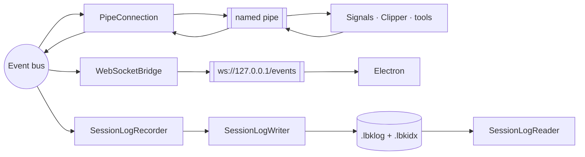
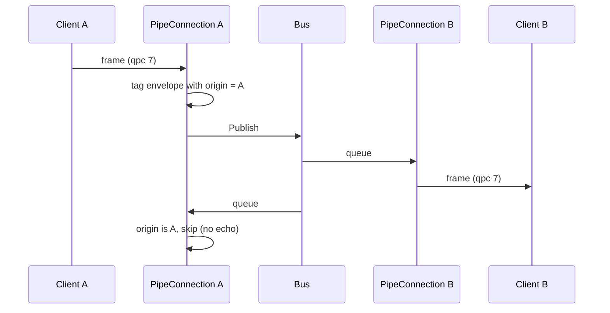
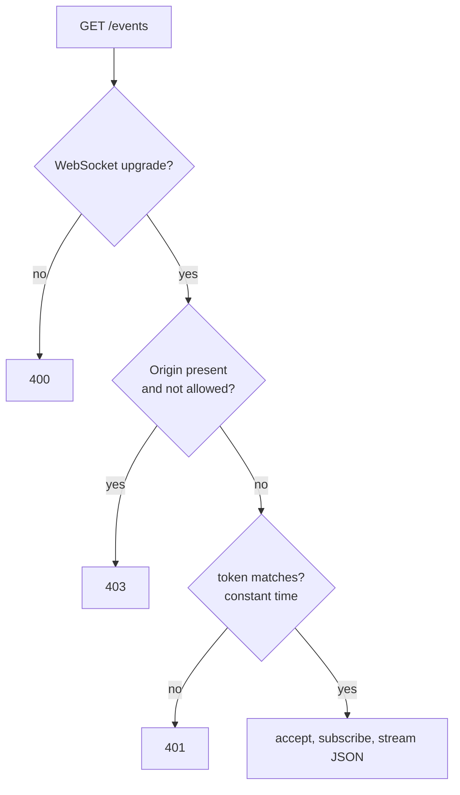
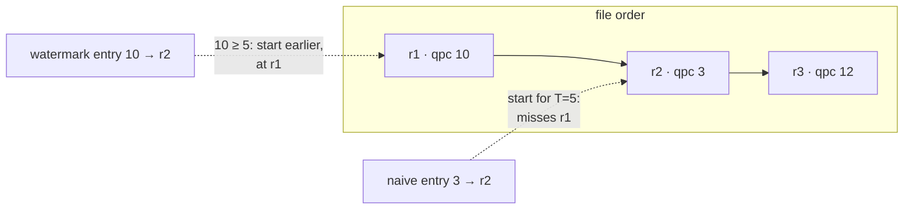
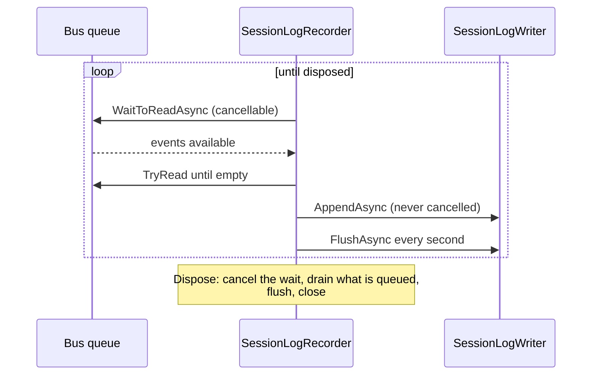

# Stream library

`src/Lookback.Stream`: every way an envelope leaves the process.



## `Framing/EnvelopeFraming.cs`

A byte stream has no message boundaries, so each envelope is prefixed with its
length.

```
+----------------+---------------------------+
| length (4 B LE)| Envelope protobuf (length)|
+----------------+---------------------------+
```

- **Write:** computes the size, rents one buffer from `ArrayPool` for header
  and body, writes both in one call, returns the buffer.
- **Read:** reads the 4-byte header. Zero bytes read means a clean end of
  stream and returns null; a partial header or body throws
  `EndOfStreamException`, so callers can tell "peer closed" from "peer died
  mid-message".
- **Limit:** lengths above 16 MB (or negative) throw `InvalidDataException`
  *before* allocating, so a corrupt or hostile prefix cannot exhaust memory.

The same format is used on pipes and inside the session log.

## `Pipes/PipeConnection.cs`

Bridges one duplex stream onto the bus in both directions.



- Two pumps run together: **outbound** (bus subscription to frames) and
  **inbound** (frames to `bus.Publish`). Whichever ends first (peer closed,
  write failed) cancels the other.
- **No echo:** an envelope that arrived on this connection is tagged in a
  `ConditionalWeakTable<Envelope, PipeConnection>`. The outbound pump skips
  envelopes tagged with its own connection. The weak table holds no
  references, so tags vanish with their envelopes.

## `Pipes/PipeEventServer.cs`

Accepts any number of clients on one pipe name. The accept loop creates a
`NamedPipeServerStream` per connection with `MaxAllowedServerInstances` and
`PipeOptions.CurrentUserOnly`, which sets the pipe's ACL to the current user,
so another account on the machine cannot connect. Each connection runs a
`PipeConnection`; malformed frames or vanished peers end only that
connection. `DisposeAsync` cancels the accept loop and waits for every
connection to finish.

## `Pipes/PipeEventClient.cs`

The client end used by other processes. `PublishAsync` serialises writers
with a semaphore. Cancellation applies only to waiting for that semaphore:
once a frame starts it is always finished, because a half-written frame
would corrupt every frame after it. `ReadAllAsync` yields envelopes until the
server closes the pipe.

## `WebSockets/WebSocketBridge.cs`

Streams bus events to Electron as JSON text frames.

- **Hosting:** a slim ASP.NET Core app with Kestrel bound to
  `IPAddress.Loopback` on a configurable or random port. `Endpoint` is read
  back from the server after start.
- **Format:** `Google.Protobuf.JsonFormatter`, which follows the proto3 JSON
  mapping (64-bit integers as strings, camelCase names). TypeScript can
  generate matching types from the same `.proto`.
- **Checks, in order:** must be a WebSocket upgrade (400); if an `Origin`
  header is present it must be on the allow-list (403); `?token=` must match,
  compared with `CryptographicOperations.FixedTimeEquals` so timing reveals
  nothing (401).
- **Lifetime:** a receive loop watches for the client's close frame and
  cancels the send loop, so a closed client is noticed even when no events
  are flowing. Inbound messages are ignored in M0; ratings and clip requests
  come with M2.



## Session log

### Format (`SessionLog/SessionLogFormat.cs`)

```
session.lbklog
+----------+------------------------+-------------+-------------+-----
| "LBKLOG" | frame: SessionStarted  | frame: env  | frame: env  | ...
| \0 \x01  | (always first)         |             |             |
+----------+------------------------+-------------+-------------+-----

session.lbkidx                (16-byte entries)
+-----------------+-----------------+
| watermark (u64) | offset (u64)    |  ...
+-----------------+-----------------+
```

### Why a watermark index

Producers on different threads publish slightly out of order, so record
timestamps in the file are *not* monotonic. A naive index of "this record's
qpc at this offset" can seek past a late-arriving earlier record. Instead each
index entry stores the **highest qpc of every record before its offset**.

To read from time T, the reader binary-searches for the last entry whose
watermark is **strictly below** T and starts there. Everything before that
offset has qpc ≤ watermark < T, so nothing at or after T can have been
skipped. From that point the reader filters out records below T.

A small example shows the difference. Two records sit in file order:
r1 with qpc 10 (published by a thread that was slightly late), then r2
with qpc 3. Read from T = 5.

| Index type | Entry for r2 | Where reading starts | Result |
|---|---|---|---|
| Naive: record's own qpc | (3 → r2) | 3 < 5, so start at r2 | **r1 (qpc 10) is skipped** |
| Watermark: max qpc before it | (10 → r2) | 10 is not < 5, so start at r1 | r1 is returned, r2 is filtered out |



Watermarks also only ever increase, so the index stays sorted and binary
search is valid; a naive index of out-of-order timestamps is not sorted at
all.

### `SessionLogWriter`

- `CreateAsync` validates retention **before creating any file**, checks the
  session id is a safe file name, then creates both files with
  `FileMode.CreateNew` (never overwrites) and `FileShare.Read` (the app can
  tail a live session). It writes the magic and the `SessionStarted` header.
- `AppendAsync` adds an index entry when session time has advanced by the
  index interval (default 1 s), then writes the frame and updates the
  watermark.
- Not thread-safe by design: one consumer feeds it.

### `SessionLogReader`

- `OpenAsync` checks the magic and that the first record is `SessionStarted`,
  then loads the index, ignoring a torn final entry.
- `ReadAsync(fromQpc)` seeks with the watermark rule and yields records with
  `qpc >= fromQpc`. A record cut off by a crash ends the read cleanly instead
  of throwing.

### `SessionLogRecorder`

Connects the bus to a writer on a background task, keeping only its own
session's events.



Cancellation interrupts only the wait, never a write. An earlier version
passed the token to `AppendAsync`; a test caught it losing the last event,
and it could also have left a half-written frame in the middle of the log.
