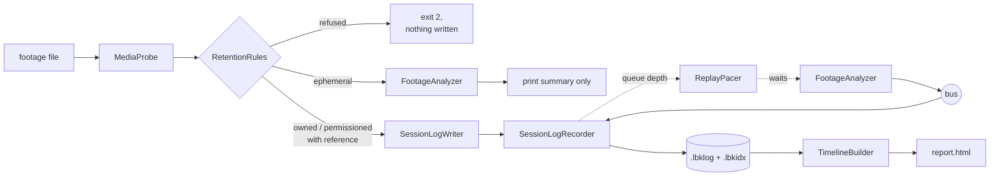

# Testbench

`src/Lookback.Testbench` builds `lookback-testbench`, which runs a footage
file through the same signals live capture uses and renders an interactive
timeline.

## Usage

```
lookback-testbench analyze <file> [--out <dir>] [--retention owned|permissioned|open-license|ephemeral]
                                  [--permission-ref <ref>] [--title <text>] [--game <name>]
lookback-testbench report <session-path-without-extension> [--video <file>]
lookback-testbench live <file> [--profile <id-or-path>] [--game <name>] [--speed <x>] [--loop]
                               [--port <n>] [--no-wait] [--pipe <name>] [--retention ...]
```

`live` plays the footage in real time into the [live profiler](Live-Profiler)
instead of analysing it as fast as possible; see that page.

Requires ffmpeg and ffprobe on PATH (or `LOOKBACK_FFMPEG_DIR`).

```
$ lookback-testbench analyze fixture.mp4 --out out --game fixture
session  20261127-141012-fixture
media    1280x720 @ 60 fps, 00:00:20, audio: yes
signals  600 video frames, 2002 audio hops in 3.3 s (6.1x real time)
log      out/20261127-141012-fixture.lbklog
report   out/20261127-141012-fixture.html
```

## Pipeline



1. **Probe** the file with ffprobe.
2. **Retention** is checked before any work: a refused session exits with
   code 2 and writes nothing. Ephemeral sessions analyse and print a summary
   but store nothing, not even the report.
3. **Analyse** with `FootageAnalyzer`, paced against the session log.
4. **Report** is built **from the session log**, not from memory, so the
   page shows exactly what was recorded and the log format is exercised on
   every run.

## The timeline viewer

`Report/report.html` is a self-contained page: no network, no external
scripts. `ReportWriter` embeds the timeline as JSON inside a
`<script type="application/json">` element; the default JSON encoder escapes
`<`, `>` and `&`, so no title or value can close the element.

- The footage plays above the lanes; the red playhead follows playback.
- Click any lane to seek; hover to read every signal's value at that time.
- Each lane is scaled to its own range. Drawing takes the maximum of the
  samples under each pixel, so one-frame spikes survive downsampling.
- Audio is bucketed to 100 ms (maximum per bucket); video stays per frame.
- The mel lane is a log-mel spectrogram, low frequencies at the bottom.

`TimelineBuilder` reads schemas first, then maps each `SignalFrame` value to
its named lane and bucket, using each schema's own window length to bucket
video frames.

The **official-player viewer** (M2) reuses this timeline live inside the
app, fed from the WebSocket instead of a log, and stores nothing.
