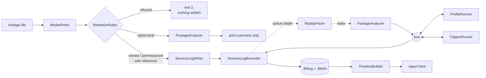

# Testbench

`src/Lookback.Testbench` builds `lookback-testbench`, which runs a footage
file through the same signals live capture uses and renders an interactive
timeline.

## Usage

```
lookback-testbench analyze <file> [--out <dir>] [--retention owned|permissioned|open-license|ephemeral]
                                  [--permission-ref <ref>] [--title <text>] [--game <name>]
                                  [--profile <id-or-path>] [--profiles <file-or-folder>] [--analysis <WxH>|native]
lookback-testbench report <session-path-without-extension> [--video <file>]
lookback-testbench live <file> [--profile <id-or-path>] [--game <name>] [--speed <x>] [--loop]
                               [--port <n>] [--no-wait] [--pipe <name>] [--retention ...] [--analysis <WxH>|native]
lookback-testbench browse [--datasets <dir>] [--results <dir>[,<dir>...]] [--profiles <file-or-folder>] [--out <file>]
lookback-testbench rate <manifest.json> [--out <dir>] [--datasets <dir>] [--profile <id-or-path>]
                                        [--profiles <file-or-folder>] [--model <dir>] [--again] [--play]
lookback-testbench profile-view --profiles <folder> [--id <profile>]
lookback-testbench profile-save --profiles <folder> --id <profile> --edits <file.json|->
```

`live` plays the footage in real time into the [live profiler](Live-Profiler)
instead of analysing it as fast as possible; see that page.

`--analysis` changes the analysis frame size (default 384x216; `native` is the
footage's own size) for experiments, and `analyze` prints the video signal
bank's cost per frame:

```
analysis 1280x720: video signals 6.76 ms/frame (max 28.5 ms)
```

Profile thresholds were set at 384x216. [Analysis Resolution](Analysis-Resolution)
compares the sizes on real footage.

Both `analyze` and `live` run the [clipper](Clipper) alongside the profile
(or on its own without one): the profile runner publishes events, and the
clipper fuses them with peaks of the excitement curve into clip candidates,
each followed by its QA report. `analyze` prints the top ten:

```
clips    1 candidates, 1 pass QA
             4.0-15.2    s  score 0.86  QA ok    hud_change ×1 (best confidence 0.60); impact ×1 (best confidence 0.70); loud_moment ×1 (best confidence 0.40); excitement ×1 (peak 3.42: audio.rms_db 6.0σ, motion.energy 6.0σ, hud.activity 6.0σ)
```

`rate` is the terminal fallback to the shell's rating UI: it analyses each
manifest entry, then asks for 1 to 5 stars per candidate on its content
(5 = a highlight). `p` plays the candidate with ffplay, Enter skips, `0`
clears, `q` stops. Ratings go to `datasets/<game>/ratings.jsonl` through
`RatingStore`, so the entry's retention is checked first; a second pass skips
what is rated unless `--again`. See [Clip Scoring](Clip-Scoring).

`profile-view` and `profile-save` are the desktop app's profile editor:
the first prints the profile list and a profile resolved with the source of
every weight and threshold, as JSON; the second changes weights, thresholds
and clipper overrides in the folder's files in place, after checking that the
whole folder still loads the way the recorder loads it, and prints the files
it changed (or `{"ok":false,"message":…}` and writes nothing). See
[Game Profiles](Game-Profiles#editing-weights-and-thresholds). Neither needs ffmpeg.

`browse` writes the [Dataset Browser](Dataset-Browser): one page for sifting profiles, datasets and their scores. It needs no ffmpeg.

Requires ffmpeg and ffprobe on PATH (or `LOOKBACK_FFMPEG_DIR`).

```
$ lookback-testbench analyze fixture.mp4 --out out --game fixture
session  20261127-141012-fixture
media    1280x720 @ 60 fps, 00:00:20, audio: yes
signals  600 video frames, 2002 audio hops in 3.3 s (6.1x real time)
log      out/20261127-141012-fixture.lbklog
report   out/20261127-141012-fixture.html
```

## Pipeline



1. **Probe** the file with ffprobe.
2. **Retention** is checked before any work: a refused session exits with
   code 2 and writes nothing. Ephemeral sessions analyse and print a summary
   but store nothing, not even the report.
3. **Analyse** with `FootageAnalyzer`, paced against the session log, the
   profile runner and the clipper. At the end the profile runner is flushed
   first, then the clipper, which waits on its events.
4. **Report** is built **from the session log**, not from memory, so the
   page shows exactly what was recorded and the log format is exercised on
   every run.

## The timeline viewer

`Report/report.html` is a self-contained page: no network, no external
scripts. `ReportWriter` embeds the timeline as JSON inside a
`<script type="application/json">` element; the default JSON encoder escapes
`<`, `>` and `&`, so no title or value can close the element.

- The footage plays above the lanes; the red playhead follows playback.
- Click any lane to seek; hover to read every signal's value at that time.
- Each lane is scaled to its own range. Drawing takes the maximum of the
  samples under each pixel, so one-frame spikes survive downsampling.
- Audio is bucketed to 100 ms (maximum per bucket); video stays per frame.
- The mel lane is a log-mel spectrogram, low frequencies at the bottom.
- The **candidates** lane shows each clip candidate's window. Stronger colour
  is a higher score; grey with a red edge failed QA. Hover for the reasons
  (which events and which curve components) and every QA check with its value.
- The **excitement** lane under it is the clipper's curve, with its `high`
  and `low` thresholds dashed (they follow the active profile); the
  `clipper.z.*` lanes are each component's robust z-score.

`TimelineBuilder` reads schemas first, then maps each `SignalFrame` value to
its named lane and bucket, using each schema's own window length to bucket
video frames (the clipper's curve frames each cover 100 ms). `qa.report`
envelopes are attached to their candidates by id.

The **official-player viewer** (M2) reuses this timeline live inside the
app, fed from the WebSocket instead of a log, and stores nothing.
